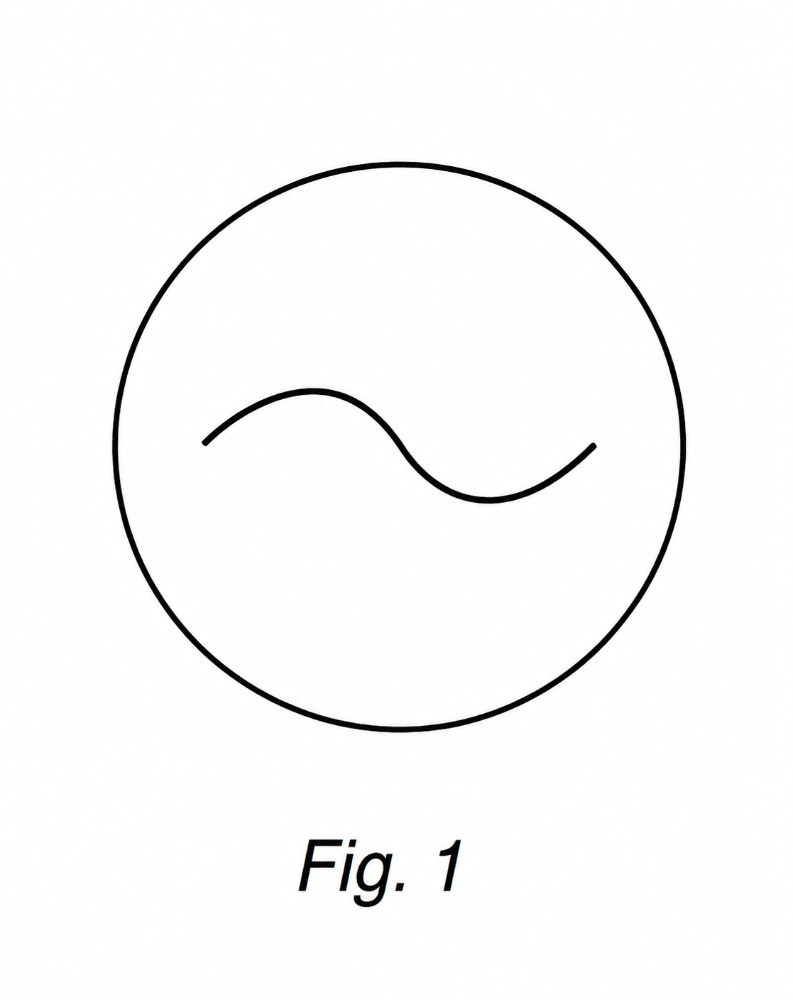
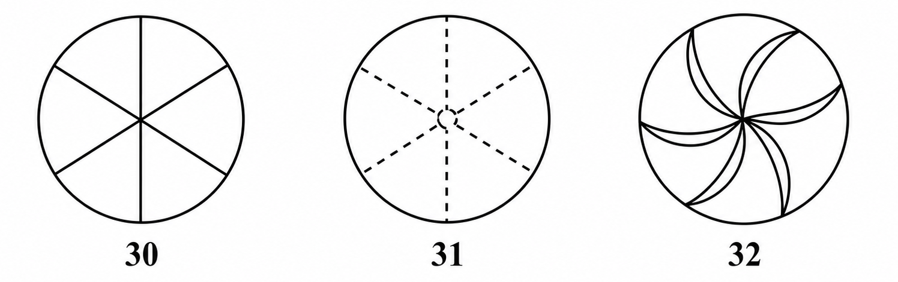

# 视觉符号与盲人：Cambridge IELTS 4 Test 1 Passage 3 双语精读

这篇文章真正要回答的，不是“盲人会不会画画”，而是：没有视觉经验的人，能否理解运动线、心形、圆形与方形这类视觉符号。Part 1 用五种轮辐线条做实验，发现盲人与视力正常者对运动含义的判断高度一致；Part 2 再用二十组反义词测试抽象形状，结果同样接近。作者由此把一个个有趣的画图案例推进成更普遍的结论：视觉隐喻并不完全依赖亲眼看见。

**You should spend about 20 minutes on Questions 27–40 which are based on Reading Passage 3 below.**

你应当用大约 20 分钟完成第 27–40 题；这些题目以下面的阅读文章 3 为依据。

- `spend time on` **(B1)**：花时间做……；`be based on` **(B1)**：以……为依据。

标题 **Visual Symbols and the Blind** 可译为“视觉符号与盲人”。`visual` **(B2)** 指“视觉的”；`symbol` **(B1，专业/符号词)** 指“符号、象征”；`the blind` **(B2)** 是“the + 形容词”表示一类人的正式用法，指“盲人群体”。

## 01 Part 1：运动线条

### 1

**From a number of recent studies, it has become clear that blind people can appreciate the use of outlines and perspectives to describe the arrangement of objects and other surfaces in space.**

多项近期研究已经清楚表明，盲人能够理解如何运用轮廓线和透视法来表现物体以及其他表面在空间中的布局。

- `recent studies` **(B1)**：近期研究；`it has become clear that ...` **(B2)**：已经清楚表明……；`blind` **(B1)**：失明的。
- `appreciate` **(B2)**：此处不是“欣赏”，而是“理解、领会”。
- `outline` **(B2，专业/视觉艺术词)**：轮廓线；`perspective` **(B2，专业/视觉艺术词)**：透视法。
- `describe` **(B1)**：描绘、说明；`arrangement` **(B2)**：排列、布局；`surface` **(B1)**：表面；`in space` **(B1)**：在三维空间中。

### 2

**But pictures are more than literal representations.**

但图画并不只是对现实的直接再现。

- `more than` **(B1)**：不只是，暗示图画还有象征功能。
- `literal` **(B2)**：字面的、照实的；`representation` **(B2，专业/视觉艺术词)**：再现、表现形式。

### 3

**This fact was drawn to my attention dramatically when a blind woman in one of my investigations decided on her own initiative to draw a wheel as it was spinning.**

在我的一项研究中，一名盲人女性主动决定画一个正在旋转的轮子；这件事以十分强烈的方式让我注意到了上述事实。

- `draw something to someone's attention` **(B2)**：使某人注意到某事；这里用被动式 `was drawn to my attention`。
- `dramatically` **(B2)**：强烈地、显著地，并非仅指“戏剧性地”。
- `blind` **(B1)**：失明的；`investigation` **(B2，专业/研究词)**：调查、研究。
- `on one's own initiative` **(C1)**：主动地、自发地；`spinning` **(B2，专业/运动词)**：旋转中的。

### 4

**To show this motion, she traced a curve inside the circle (Fig. 1).**

为了表现这种运动，她在圆圈内画出了一条曲线（图 1）。

- `motion` **(B2，专业/物理与视觉艺术词)**：运动；`trace` **(B2)**：沿着轨迹画出、描出；`curve` **(B2，专业/几何词)**：曲线。
- 句首不定式 `To show ...` 表目的：她画曲线不是装饰，而是编码“旋转”。

### 5

**I was taken aback.**

我大吃一惊。

- [`be taken aback`](https://dictionary.cambridge.org/dictionary/english/take-aback) **(C1)**：因意外之事一时吃惊、愣住，强于普通的 `be surprised`。

**A层深挖 1｜be taken aback**

这个短语的核心不只是“惊讶”，而是信息来得突然，让人像被向后推了一下，短时间不知道如何反应。它常用被动式，搭配 `by/at` 引出原因：`be taken aback by the result`。作者只用五个词独立成句，让节奏突然停住，也把这条曲线的理论意义突出出来：一个从未靠视觉学习图画的人，竟自行采用了现代插画中的运动符号。

`be surprised` 语气最宽；`be startled` 常指突发声音或动作造成的惊跳；`be astonished` 强调极度惊讶，却不一定有短暂失措感。迁移例句：`The research team was taken aback by how consistent the two groups' answers were.` 研究团队对两组答案如此一致感到意外。`I was taken aback by the interviewer's direct question, but I answered it calmly.` 面试官直截了当的问题让我一愣，但我还是冷静作答。

### 6

**Lines of motion, such as the one she used, are a very recent invention in the history of illustration.**

像她所用的这种运动线，在插画史上其实是非常晚近的发明。

- `line of motion` **(C1，专业/插画词)**：表现移动方向或速度的运动线。
- `recent` **(B1)**：晚近的；`invention` **(B2)**：发明、创造物；`illustration` **(B2，专业/出版与艺术词)**：插画、图示。

### 7

**Indeed, as art scholar David Kunzle notes, Wilhelm Busch, a trend-setting nineteenth-century cartoonist, used virtually no motion lines in his popular figures until about 1877.**

事实上，正如艺术史学者戴维·昆茨勒所指出的那样，引领潮流的 19 世纪漫画家威廉·布施直到约 1877 年，在其广受欢迎的人物画中仍几乎不使用运动线。

- `indeed` **(B2)**：的确、事实上，用来加强上一句；`note` **(B1)**：指出、提到；`scholar` **(B2，专业/学术身份词)**：学者。
- `trend-setting` **(C1)**：引领潮流的；`nineteenth-century` **(B1)**：19 世纪的。
- `cartoonist` **(B2，专业/职业词)**：漫画家；`virtually no` **(C1)**：几乎没有。
- `figure` **(B2，专业/视觉艺术词)**：此处指画中的人物形象，不是“数字”。

### 8

**When I asked several other blind study subjects to draw a spinning wheel, one particularly clever rendition appeared repeatedly: several subjects showed the wheel's spokes as curved lines.**

当我请另外几名盲人受试者画一个旋转的轮子时，一种格外巧妙的画法反复出现：有几个人都把轮辐画成了曲线。

- `blind` **(B1)**：失明的；`study subject` **(B2，专业/研究词)**：研究受试者；`spinning` **(B2，专业/运动词)**：旋转的。
- `particularly` **(B1)**：尤其、格外；`clever` **(B1)**：巧妙的；`rendition` **(C2，专业/艺术词)**：对某物的表现版本、画法。
- `repeatedly` **(B2)**：反复地；`spoke` **(B2，专业/机械词)**：轮辐；`curved` **(B2，专业/几何词)**：弯曲的。
- 冒号后的内容解释前面的 `rendition` 到底是什么。

### 9

**When asked about these curves, they all described them as metaphorical ways of suggesting motion.**

当被问到这些曲线时，他们都说，这些线是暗示运动的隐喻性表达方式。

- `curve` **(B2，专业/几何词)**：曲线；`describe A as B` **(B2)**：把 A 描述为 B。
- `metaphorical` **(C1，专业/修辞与视觉艺术词)**：隐喻性的；`suggest` **(B2)**：此处是“暗示、表示”，不是“建议”；`motion` **(B2，专业/物理与视觉艺术词)**：运动。

### 10

**Majority rule would argue that this device somehow indicated motion very well.**

按照少数服从多数的原则，可以认为这种手法确实能以某种方式很好地表示运动。

- `majority rule` **(C1，专业/决策词)**：多数决定原则。
- `argue that` **(B2)**：提出理由认为……，不是“争吵”；`device` **(B2，专业/艺术手法词)**：此处指表现手法，不是电子设备。
- `somehow` **(B2)**：以某种方式，带有机制尚不明确的意味；`indicate` **(B1)**：表示、表明；`motion` **(B2，专业/物理与视觉艺术词)**：运动。

### 11

**But was it a better indicator than, say, broken or wavy lines – or any other kind of line, for that matter?**

但是，它真的比断线或波浪线之类的线条更能表示运动吗？甚至进一步说，它会比任何其他线条都更好吗？

- `indicator` **(B2)**：指示物、表征；`say` **(B1)**：插入语，“比如说”。
- `broken line` **(B2，专业/图形词)**：断线；`wavy line` **(B2，专业/图形词)**：波浪线。
- `for that matter` **(C1)**：就此而言、说到这一点，用来把比较范围扩大到所有其他线条。

### 12

**The answer was not clear.**

答案并不明确。

- `clear` 在此为 **(B1)**：明确的、确定的，而不是“清澈的”。短句把个案观察转成了下一步需要实验验证的问题。

### 13

**So I decided to test whether various lines of motion were apt ways of showing movement or if they were merely idiosyncratic marks.**

因此，我决定检验各种运动线究竟是表现移动的恰当方式，还是仅仅属于个人独有的特殊标记。

- `various` **(B1)**：各种不同的；`line of motion` **(C1，专业/插画词)**：运动线。
- `apt` **(C1)**：恰当的、贴切的；`merely` **(B2)**：仅仅。
- [`idiosyncratic`](https://dictionary.cambridge.org/dictionary/english/idiosyncratic) **(C2)**：个人特有且往往不同寻常的；`mark` **(B1)**：标记、痕迹。

**A层深挖 2｜idiosyncratic marks**

`idiosyncratic` 在本句并非单纯夸“独特”，而是质疑这些线条会不会只是某些人自己的画法，别人未必能读懂。它常修饰 `style, approach, feature, habit`；在研究语境里，若结果是 idiosyncratic，就难以推广为共享规律。作者把 `apt ways` 与 `merely idiosyncratic marks` 对置：前者有公共可读性，后者只是私人记号，`merely` 又进一步压低后者的解释价值。

`unique` 只表示独一无二，未必古怪；`distinctive` 强调容易辨认的特征，通常较正面；`eccentric` 更直接地形容人或行为古怪。迁移例句：`A useful interface cannot depend on the designer's idiosyncratic symbols.` 实用的界面不能依赖设计师个人化、别人难懂的符号。`The first sample looked idiosyncratic, so the team repeated the experiment with more participants.` 第一份样本看起来可能只是个体现象，因此团队增加参与者重复了实验。

### 14

**Moreover, I wanted to discover whether there were differences in how the blind and the sighted interpreted lines of motion.**

此外，我还想弄清楚盲人与视力正常者在解读运动线时是否存在差异。

- `moreover` **(B2)**：此外、而且，表示递进；`discover whether` **(B1)**：查明是否……。
- `the blind` **(B2)**：盲人群体；`the sighted` **(C1，专业/视觉状态词)**：视力正常者；`interpret` **(B2)**：解读、理解；`line of motion` **(C1，专业/插画词)**：运动线。

### 15

**To search out these answers, I created raised-line drawings of five different wheels, depicting spokes with lines that curved, bent, waved, dashed and extended beyond the perimeter of the wheel.**

为了查明答案，我制作了五个不同轮子的凸线图；图中的轮辐分别由曲线、折线、波浪线、虚线，以及伸出轮子外缘的线构成。

- `search out` **(B2)**：努力查明、探寻；`raised-line drawing` **(C1，专业/无障碍触觉图词)**：可供触摸的凸线图。
- `depict` **(C1)**：描绘；`spoke` **(B2，专业/机械词)**：轮辐；`bent` **(B2)**：弯折的；`dashed` **(C1，专业/制图词)**：虚线的。
- `extend beyond` **(B2)**：延伸到……之外；`perimeter` **(C2，专业/几何词)**：周界、外缘。

### 16

**I then asked eighteen blind volunteers to feel the wheels and assign one of the following motions to each wheel: wobbling, spinning fast, spinning steadily, jerking or braking.**

随后，我请 18 名盲人志愿者触摸这些轮子，并从以下运动状态中为每个轮子指定一种：摇晃、快速旋转、匀速旋转、急促颠动或制动。

- `blind` **(B1)**：失明的；`volunteer` **(B1，专业/研究参与者词)**：志愿者；`feel` 此处为 **(B1)**：用手触摸感知。
- `assign A to B` **(B2)**：把 A 分配给 B；`motion` **(B2，专业/物理词)**：运动状态。
- `wobbling` **(C1，专业/运动词)**：摇摆、晃动；`steadily` **(B2)**：稳定地；`jerking` **(C1，专业/运动词)**：突然急动；`braking` **(B2，专业/机械词)**：制动、刹车。

### 17

**My control group consisted of eighteen sighted undergraduates from the University of Toronto.**

我的对照组由 18 名来自多伦多大学、视力正常的本科生组成。

- `control group` **(B2，专业/实验设计词)**：对照组；`consist of` **(B1)**：由……组成。
- `sighted` **(C1，专业/视觉状态词)**：视力正常的；`undergraduate` **(B2，专业/教育身份词)**：本科生。

### 18

**All but one of the blind subjects assigned distinctive motions to each wheel.**

除一人外，所有盲人受试者都为每个轮子指定了彼此不同的运动状态。

- `all but one` **(B2)**：除一人外全部；`blind` **(B1)**：失明的；`subject` **(B2，专业/研究词)**：受试者。
- `assign` **(B2)**：指定、分配；`distinctive` **(C1)**：有明显区别的；`motion` **(B2，专业/物理词)**：运动状态。

### 19

**Most guessed that the curved spokes indicated that the wheel was spinning steadily; the wavy spokes, they thought, suggested that the wheel was wobbling; and the bent spokes were taken as a sign that the wheel was jerking.**

大多数人认为，弯曲轮辐表示轮子在稳定旋转；波浪形轮辐表示轮子在摇晃；折弯的轮辐则被理解为轮子在急促颠动。

- `curved spokes` **(B2，专业/机械与图形词)**：弯曲轮辐；`wavy spokes` **(B2，专业/机械与图形词)**：波浪形轮辐；`bent spokes` **(B2，专业/机械与图形词)**：折弯的轮辐。
- `indicate` **(B1)** 与 `suggest` **(B2)**：此处都表示“表明、暗示”；`steadily` **(B2)**：稳定地。
- `wobble` **(C1，专业/运动词)**：摇晃；`be taken as a sign that` **(B2)**：被视为……的标志；`jerk` **(C1，专业/运动词)**：突然急动。
- 三个并列分句逐一建立“线条形状 → 运动含义”的映射，是 30–32 题的核心证据之一。

### 20

**Subjects assumed that spokes extending beyond the wheel's perimeter signified that the wheel had its brakes on and that dashed spokes indicated the wheel was spinning quickly.**

受试者认为，伸出轮子外缘的轮辐表示轮子正在刹车，而虚线轮辐表示轮子正在快速旋转。

- `assume` **(B2)**：认为、推定；`extend beyond` **(B2)**：延伸到……之外。
- `perimeter` **(C2，专业/几何词)**：外缘；`signify` **(C1)**：表示、象征；`have the brakes on` **(B2，专业/机械词)**：处于制动状态。
- `dashed` **(C1，专业/制图词)**：虚线的；`indicate` **(B1)**：表示；`spinning` **(B2，专业/运动词)**：旋转。

### 21

**In addition, the favored description for the sighted was the favored description for the blind in every instance.**

此外，在每一种图形中，视力正常者最常选的描述也都是盲人最常选的描述。

- `in addition` **(B1)**：此外；`favored` **(B2)**：最受偏好的、最常被选择的；`description` **(B1)**：描述、说法。
- `the sighted` **(C1，专业/视觉状态词)**：视力正常者；`the blind` **(B2)**：盲人群体；`in every instance` **(C1)**：在每个实例中、无一例外。

### 22

**What is more, the consensus among the sighted was barely higher than that among the blind.**

而且，视力正常者内部的一致程度只比盲人内部略高一点。

- `what is more` **(B2)**：而且、更重要的是；[`consensus`](https://dictionary.cambridge.org/dictionary/english/consensus) **(C2，专业/研究统计词)**：群体共识、一致意见。
- `the sighted` **(C1，专业/视觉状态词)**：视力正常者；`the blind` **(B2)**：盲人群体；`among` **(B1)**：在某群体内部；`barely` **(B2)**：仅仅、勉强；`that` 替代前面的 `the consensus`，避免重复。

**A层深挖 3｜the consensus was barely higher**

`consensus` 不是每个人百分之百同意，而是群体中占主导的共同判断，常见搭配有 `reach a consensus`、`broad consensus`、`consensus among/on`。本句还用 `barely higher` 精确限制差距：视力正常者的一致性确实较高，但高得非常有限。作者没有说两组结果 identical，而是用受约束的比较支撑“高度相似”，这正是学术写作中避免过度推断的做法。

`agreement` 可泛指两人或多人意见一致；`consistency` 强调结果前后一贯；`unanimity` 则是全体一致，强度远高于本文数据。迁移例句：`There is a broad consensus among teachers that feedback should be specific.` 教师群体普遍认同反馈应当具体。`The second method was barely faster, so speed alone could not justify the extra cost.` 第二种方法只快了一点，因此仅凭速度不足以证明额外成本合理。

### 23

**Because motion devices are unfamiliar to the blind, the task I gave them involved some problem solving.**

由于盲人并不熟悉这些表现运动的手法，我交给他们的任务包含了一定的问题解决过程。

- `motion device` **(C1，专业/视觉艺术词)**：表现运动的手法；`be unfamiliar to` **(B2)**：对……而言陌生；`the blind` **(B2)**：盲人群体。
- `involve` **(B1)**：包含、涉及；`problem solving` **(B2，专业/认知研究词)**：问题解决。

### 24

**Evidently, however, the blind not only figured out meanings for each line of motion, but as a group they generally came up with the same meaning at least as frequently as did sighted subjects.**

然而，证据显然表明，盲人不仅理解了每一种运动线的含义，而且从群体结果看，他们得出相同含义的频率至少与视力正常者一样高。

- `evidently` **(C1)**：显然、从证据看；`however` **(B1)**：然而；`the blind` **(B2)**：盲人群体；`figure out` **(B1)**：弄懂、想明白。
- `line of motion` **(C1，专业/插画词)**：运动线；`come up with` **(B1)**：想出、得出。
- `generally` **(B1)**：总体上；`at least as frequently as` **(B2)**：至少与……一样频繁；`sighted subject` **(C1，专业/研究词)**：视力正常的受试者。
- `not only ... but ...` 把“能解释”推进到“群体解释高度一致”；末尾倒装式 `as did sighted subjects` 中 `did` 代替 `came up with the same meaning`。

## 02 Part 2：抽象形状

### 25

**We have found that the blind understand other kinds of visual metaphors as well.**

我们还发现，盲人同样能够理解其他类型的视觉隐喻。

- `the blind` **(B2)**：盲人群体；`visual metaphor` **(C1，专业/修辞与视觉艺术词)**：视觉隐喻，即用可见形状表达非字面意义；`as well` **(B1)**：也、同样。

### 26

**One blind woman drew a picture of a child inside a heart – choosing that symbol, she said, to show that love surrounded the child.**

一名盲人女性画了一个位于心形中的孩子；她说，选择这个符号是为了表示孩子被爱包围着。

- `blind` **(B1)**：失明的；`symbol` **(B1，专业/符号词)**：符号、象征；`surround` **(B1)**：环绕、包围。
- 破折号后的 `choosing ...` 补充她选择心形的目的；这里的 heart 不是器官，而是“爱”的视觉符号。

### 27

**With Chang Hong Liu, a doctoral student from China, I have begun exploring how well blind people understand the symbolism behind shapes such as hearts that do not directly represent their meaning.**

我与来自中国的博士生刘昌洪一起，开始研究盲人对心形这类形状背后象征意义的理解程度；这些形状并不直接描摹它们所表达的含义。

- `doctoral student` **(B2，专业/教育身份词)**：博士生；`explore` **(B2，专业/研究词)**：探索、研究；`blind` **(B1)**：失明的。
- `symbolism` **(C1，专业/符号与艺术词)**：象征意义；`shape` **(B1，专业/几何词)**：形状。
- `directly represent` **(B2)**：直接表现；`how well` 引出理解“达到什么程度”，不只是是否理解。

### 28

**We gave a list of twenty pairs of words to sighted subjects and asked them to pick from each pair the term that best related to a circle and the term that best related to a square.**

我们给视力正常的受试者一张包含 20 组词对的清单，请他们从每组中选出与圆形最相关的词，以及与方形最相关的词。

- `pair` **(B1)**：一对、一组；`sighted subject` **(C1，专业/研究词)**：视力正常的受试者。
- `pick from` **(B1)**：从……中选取；`term` **(B2)**：词语、术语；`relate to` **(B1)**：与……相关。

### 29

**For example, we asked: What goes with soft? A circle or a square? Which shape goes with hard?**

例如，我们问：“什么形状与 soft（柔和的）相配？圆形还是方形？哪一种形状与 hard（坚硬的）相配？”

- `for example` **(B1)**：例如；`go with` **(B1)**：与……相配；`shape` **(B1，专业/几何词)**：形状。
- 三个问句完整展示任务方式：每一对反义词都必须分别分配给圆形和方形。

### 30

**All our subjects deemed the circle soft and the square hard.**

所有受试者都认为圆形对应 soft，而方形对应 hard。

- `subject` **(B2，专业/研究词)**：受试者；`deem A B` **(C1)**：认为 A 是 B、把 A 视为 B，语体较正式。

### 31

**A full 94% ascribed happy to the circle, instead of sad.**

足足 94% 的人把 happy 而不是 sad 归给了圆形。

- `a full 94%` **(B2)**：足足 94%，强调比例之高；`ascribe A to B` **(C2)**：把 A 归给 B。
- `instead of` **(B1)**：而不是；本句是在做词形匹配，并非解释“快乐的原因”。

### 32

**But other pairs revealed less agreement: 79% matched fast to slow and weak to strong, respectively.**

但其他词对的一致程度较低：79% 的人把 fast 配给圆形、slow 配给方形；同样有 79% 的人分别把 weak 配给圆形、strong 配给方形。

- `reveal` **(B2)**：显示、揭示；`agreement` **(B1)**：一致性。
- `match A to B` **(B2)**：把 A 与 B 配对；`weak` **(B1)**：弱的；`respectively` **(B2)**：分别地，表示前后项目按顺序对应。
- 原文承接前文圆形在先、方形在后的次序，省略了 circle/square：`fast` 和 `weak` 对应圆形，`slow` 和 `strong` 对应方形；`respectively` 同时要求保留两组内部的先后对应。

### 33

**And only 51% linked deep to circle and shallow to square. (See Fig. 2)**

而且只有 51% 的人把 deep 与圆形相联系，把 shallow 与方形相联系。（见图 2。）

- `link A to B` **(B1)**：把 A 与 B 联系起来；`deep` **(B1)**：深的；`shallow` **(B2)**：浅的。

### 34

**When we tested four totally blind volunteers using the same list, we found that their choices closely resembled those made by the sighted subjects.**

当我们用同一张清单测试四名完全失明的志愿者时，发现他们的选择与视力正常受试者的选择非常相似。

- `totally blind` **(B1)**：完全失明的；`volunteer` **(B1，专业/研究参与者词)**：志愿者。
- `closely resemble` **(B2)**：高度相似；`those` 替代 `choices`；`sighted subject` **(C1，专业/研究词)**：视力正常的受试者。

### 35

**One man, who had been blind since birth, scored extremely well.**

其中一名自出生起就失明的男子得分极高。

- `blind` **(B1)**：失明的；`since birth` **(B1)**：自出生起；`score` **(B1)** 作动词表示“得分”；`extremely` **(B1)**：极其、非常。
- 非限定性定语从句强调他没有可依赖的早期视觉记忆。

### 36

**He made only one match differing from the consensus, assigning ‘far’ to square and ‘near’ to circle.**

他只有一项匹配与群体共识不同：他把 far 分给方形，把 near 分给圆形。

- `match` **(B1)**：匹配结果；`differ from` **(B1)**：与……不同。
- `consensus` **(C2，专业/研究统计词)**：群体共识；`assign A to B` **(B2)**：把 A 分配给 B。
- 现在分词 `assigning ...` 具体说明那一项不同是什么。

### 37

**In fact, only a small majority of sighted subjects – 53% – had paired far and near to the opposite partners.**

事实上，视力正常受试者中也只有微弱多数，也就是 53%，把 far 和 near 配给了与那名盲人相反的形状。

- `in fact` **(B1)**：事实上，用来修正读者对上一句“错误”的印象；`majority` **(B2)**：多数；`a small majority` 指“微弱多数”。
- `sighted subject` **(C1，专业/研究词)**：视力正常的受试者；`pair A to B` **(B2)**：把 A 与 B 配对；`opposite` **(B1)**：相反的；`partner` **(B1)**：此处指配对的另一方。

### 38

**Thus, we concluded that the blind interpret abstract shapes as sighted people do.**

因此，我们得出结论：盲人解读抽象形状的方式与视力正常者相同。

- `thus` **(B2)**：因此，正式结论标记；`conclude` **(B1)**：得出结论。
- `the blind` **(B2)**：盲人群体；`sighted` **(C1，专业/视觉状态词)**：视力正常的；`interpret` **(B2)**：解读、理解；`abstract shape` **(B2，专业/视觉与几何词)**：抽象形状。
- `as sighted people do` 中 `do` 代替 `interpret abstract shapes`；结论说解释方式相似，不等于所有个人答案完全一致。

### Fig. 2 数据与图注

| 与圆形/方形匹配的词对 | 视力正常受试者的一致率 |
| --- | ---: |
| SOFT-HARD 柔和-坚硬 | 100% |
| MOTHER-FATHER 母亲-父亲 | 94% |
| HAPPY-SAD 快乐-悲伤 | 94% |
| GOOD-EVIL 善良-邪恶 | 89% |
| LOVE-HATE 爱-恨 | 89% |
| ALIVE-DEAD 活着-死亡 | 87% |
| BRIGHT-DARK 明亮-黑暗 | 87% |
| LIGHT-HEAVY 轻-重 | 85% |
| WARM-COLD 温暖-寒冷 | 81% |
| SUMMER-WINTER 夏季-冬季 | 81% |
| WEAK-STRONG 弱-强 | 79% |
| FAST-SLOW 快-慢 | 79% |
| CAT-DOG 猫-狗 | 74% |
| SPRING-FALL 春季-秋季 | 74% |
| QUIET-LOUD 安静-响亮 | 62% |
| WALKING-STANDING 行走-站立 | 62% |
| ODD-EVEN 奇数-偶数 | 57% |
| FAR-NEAR 远-近 | 53% |
| PLANT-ANIMAL 植物-动物 | 53% |
| DEEP-SHALLOW 深-浅 | 51% |

**Fig. 2 Subjects were asked which word in each pair fits best with a circle and which with a square.**

图 2：受试者需要判断每组词中哪一个最适合圆形，哪一个最适合方形。

**These percentages show the level of consensus among sighted subjects.**

这些百分比表示视力正常受试者之间的一致程度。

- `subject` **(B2，专业/研究词)**：受试者；`fit best with` **(B1)**：与……最匹配；`percentage` **(B1，专业/统计词)**：百分比；`level of consensus` **(C2，专业/研究统计词)**：共识程度。

## 03 Questions 27–29：四选一

**题型说明：Choose the correct letter, A, B, C or D. Write your answers in boxes 27–29 on your answer sheet.**

选择正确字母 A、B、C 或 D，并将答案写在答题纸第 27–29 题的方框内。

### 27

**In the first paragraph the writer makes the point that blind people**

第一段中，作者提出的观点是：盲人……

**答案：C**

**原文证据：** `blind people can appreciate the use of outlines and perspectives ...`。`appreciate` 在这里是“理解”，`perspectives` 是视觉表现惯例，因此对应 `recognize conventions such as perspective`。

- **A may be interested in studying art.** 可能有兴趣学习艺术。**干扰原因：** 原文谈的是理解视觉表现手法，不是学习艺术的兴趣；把研究主题偷换成个人兴趣。
- **B can draw outlines of different objects and surfaces.** 能画出不同物体和表面的轮廓。**干扰原因：** 原文是能 `appreciate the use of outlines and perspectives to describe ...`，即理解这些惯例的用途，并没有断言他们能画出各种对象。
- **C can recognize conventions such as perspective.** 能识别透视法等视觉惯例。**正确原因：** `recognize conventions` 准确概括 `appreciate the use of outlines and perspectives`。
- **D can draw accurately.** 能准确地绘画。**干扰原因：** 全文实验考查符号理解，不考查绘画准确度。

### 28

**The writer was surprised because the blind woman**

作者感到惊讶，是因为那名盲人女性……

**答案：C**

**原文证据：** `To show this motion, she traced a curve inside the circle. I was taken aback.` 她用圆内曲线表示旋转，惊讶点是无视觉经验者主动使用了运动符号。

- **A drew a circle on her own initiative.** 主动画了一个圆。**干扰原因：** `on her own initiative` 修饰她主动“画正在旋转的轮子”，但作者紧接着因内部曲线这一运动符号而吃惊；选项只抓到局部动作。
- **B did not understand what a wheel looked like.** 不理解轮子的外观。**干扰原因：** 与原文相反；她画出了轮子并表达其旋转。
- **C included a symbol representing movement.** 加入了一个表示运动的符号。**正确原因：** 对应 `traced a curve ... to show this motion`。
- **D was the first person to use lines of motion.** 是第一个使用运动线的人。**干扰原因：** 原文只说运动线是插画史上较晚近的发明，没有说她是首创者。

### 29

**From the experiment described in Part 1, the writer found that the blind subjects**

根据 Part 1 所述实验，作者发现盲人受试者……

**答案：A**

**原文证据：** `the blind not only figured out meanings for each line of motion ... generally came up with the same meaning at least as frequently as did sighted subjects.`

- **A had good understanding of symbols representing movement.** 很好地理解了表示运动的符号。**正确原因：** `figured out meanings for each line of motion` 是直接同义改写。
- **B could control the movement of wheels very accurately.** 能非常准确地控制轮子的运动。**干扰原因：** 实验只让人触摸图形并匹配含义，没有真实轮子，也没有控制任务。
- **C worked together well as a group in solving problems.** 作为团队合作解决问题时表现很好。**干扰原因：** `as a group` 是汇总群体数据，不表示受试者互相合作；`problem solving` 是个人理解陌生符号的认知过程。
- **D got better results than the sighted undergraduates.** 成绩优于视力正常的本科生。**干扰原因：** 原文说盲人的一致率“至少一样频繁”，且视力正常组的共识还 `barely higher`，不能推出盲人更好。

## 04 Questions 30–32：图形匹配

**题型说明：Look at the following diagrams (Questions 30–32), and the list of types of movement below. Match each diagram to the type of movement A–E generally assigned to it in the experiment. Choose the correct letter A–E and write them in boxes 30–32 on your answer sheet.**

观察下列图形（第 30–32 题）及下方的运动类型。把每幅图与实验中人们通常赋予它的运动类型 A–E 配对，并将正确字母写入答题纸第 30–32 题。

### 全部选项

- **A steady spinning**：稳定旋转。
- **B jerky movement**：急促、不连贯的运动。
- **C rapid spinning**：快速旋转。
- **D wobbling movement**：摇晃运动。
- **E use of brakes**：使用制动、正在刹车。

### 30

**答案：E — use of brakes（正在刹车）**

**原文证据：** `spokes extending beyond the wheel's perimeter signified that the wheel had its brakes on`。图 30 的直轮辐伸出圆周，所以对应 E。

- **A 干扰：** 稳定旋转对应 `curved spokes`，不是伸出外缘的直线。
- **B 干扰：** 急促运动对应 `bent spokes`。
- **C 干扰：** 快速旋转对应 `dashed spokes`。
- **D 干扰：** 摇晃对应 `wavy spokes`。

### 31

**答案：C — rapid spinning（快速旋转）**

**原文证据：** `dashed spokes indicated the wheel was spinning quickly`。图 31 的轮辐是虚线，`quickly` 对应 `rapid`。

- **A 干扰：** 稳定旋转对应弯曲轮辐。
- **B 干扰：** 急促运动对应折弯轮辐。
- **D 干扰：** 摇晃对应波浪形轮辐，不是虚线。
- **E 干扰：** 制动对应伸出圆周的轮辐。

### 32

**答案：A — steady spinning（稳定旋转）**

**原文证据：** `the curved spokes indicated that the wheel was spinning steadily`。图 32 的轮辐明显弯曲，所以对应 A。

- **B 干扰：** 急促运动对应 `bent`，即有折角的轮辐，不是平滑曲线。
- **C 干扰：** 快速旋转对应虚线轮辐。
- **D 干扰：** 摇晃对应波浪形轮辐；不能仅凭旋涡视觉印象判断。
- **E 干扰：** 制动对应伸出轮子外缘的轮辐。

## 05 Questions 33–39：摘要选词填空

**题型说明：Complete the summary below using words from the box. Write your answers in boxes 33–39 on your answer sheet. NB You may use any word more than once.**

用方框中的词补全下列摘要，将答案写在答题纸第 33–39 题。注意：每个词可以使用多次。

### 完整题干与译文

**In the experiment described in Part 2, a set of word 33 ______ was used to investigate whether blind and sighted people perceived the symbolism in abstract 34 ______ in the same way.**

在 Part 2 所述实验中，研究者使用了一组词 33 ______，来考察盲人与视力正常者是否以相同方式感知抽象 34 ______ 中的象征意义。

**Subjects were asked which word fitted best with a circle and which with a square.**

受试者需要判断哪个词最适合圆形，哪个词最适合方形。

**From the 35 ______ volunteers, everyone thought a circle fitted 'soft' while a square fitted 'hard'.**

在 35 ______ 志愿者中，所有人都认为圆形适合 soft，而方形适合 hard。

**However, only 51% of the 36 ______ volunteers assigned a circle to 37 ______.**

然而，只有 51% 的 36 ______ 志愿者把圆形与 37 ______ 配对。

**When the test was later repeated with 38 ______ volunteers, it was found that they made 39 ______ choices.**

后来用 38 ______ 志愿者重复测试时，研究者发现他们作出了 39 ______ 的选择。

### 词框全部选项

| 选项 | 中文 | 在本题中的判断 |
| --- | --- | --- |
| associations | 联系、联想 | 可接在 `word` 后但原文是 `pairs of words`；不对应任何空。 |
| blind | 盲的、盲人 | 第 38 空正确；其他涉及最初统计的空均指 sighted。 |
| deep | 深的 | 第 37 空正确，对应 `linked deep to circle`。 |
| hard | 坚硬的 | 已在题干中与 square 配对，不能填第 37 空。 |
| hundred | 一百 | 题干已有 51%，且此处需要词类或研究对象，不需要数词。 |
| identical | 完全相同的 | 原文只说 `closely resembled`，并非完全相同。 |
| pairs | 词对、成对事物 | 第 33 空正确，构成 `word pairs`。 |
| shapes | 形状 | 第 34 空正确，构成 `abstract shapes`。 |
| sighted | 视力正常的 | 第 35、36 空正确，二者都指最初的视力正常组。 |
| similar | 相似的 | 第 39 空正确，对应 `closely resembled`。 |
| shallow | 浅的 | 原文把它与 square 配对，不是第 37 空的 circle。 |
| soft | 柔和的、软的 | 题干已经说明 circle 与 soft 的 100% 配对，不是 51% 那一项。 |
| words | 词语 | `word words` 结构错误；原文单位是词对。 |

### 33

**答案：pairs（词对）**

**原文证据：** `We gave a list of twenty pairs of words to sighted subjects ...`

**判断：** 空前已有 `word`，需要复数名词组成固定复合名词 `word pairs`。`associations` 虽可表示“词语联想”，但原文实验材料明确是二十组词对；`words` 会形成错误的 `word words`，其余词在词义或词性上均不成立。

**逐项排除：** `associations` 会把原文的“词对”偷换成“词语联想”；`blind`、`sighted` 是视觉状态；`deep`、`hard`、`shallow`、`soft` 是词对成员；`hundred` 是无数据支持的数词；`identical`、`similar` 描述相似程度；`shapes` 是被研究的图形；`words` 会形成错误的 `word words`。这 12 项均不能替代 `pairs`。

### 34

**答案：shapes（形状）**

**原文证据：** `the symbolism behind shapes such as hearts`；结论又出现 `abstract shapes`。

**判断：** `abstract shapes` 是原文原词复现。`associations` 可谈抽象联想，却不符合原文研究对象；`words/pairs` 是实验材料，不是承载 symbolism 的图形；其余选项均不能构成题意中的抽象对象。

**逐项排除：** `associations` 不是原文承载象征意义的对象；`blind`、`sighted` 指人；`deep`、`hard`、`shallow`、`soft` 是用于匹配的词；`hundred` 是数词；`identical`、`similar` 是关系形容词；`pairs`、`words` 指实验材料。除 `shapes` 外的 12 项都不能与 `abstract` 构成符合原文的研究对象。

### 35

**答案：sighted（视力正常的）**

**原文证据：** `We gave ... to sighted subjects`，随后 `All our subjects deemed the circle soft and the square hard.`

**判断：** `All our subjects` 回指最初的 sighted subjects。`blind` 组在后文才接受测试；其他词不是描述志愿者视觉状态的形容词。

**逐项排除：** `blind` 指后测的四名志愿者，不是本句 100% 的首测组；`hundred` 会误称有一百名志愿者；`associations`、`pairs`、`shapes`、`words` 不能在此描述志愿者；`deep`、`hard`、`shallow`、`soft` 是配对词；`identical`、`similar` 描述选择关系。只有 `sighted` 与原文首测对象一致。

### 36

**答案：sighted（视力正常的）**

**原文证据：** `only 51% linked deep to circle and shallow to square`；图注说明这些百分比是 `among sighted subjects`。

**判断：** 51% 属于视力正常组的统计，因此仍填 `sighted`。`blind` 组只有四人，原文没有给出其 51% 数据；其他词无法修饰 volunteers 或不合事实。

**逐项排除：** `blind` 错把 Fig. 2 的视力正常组百分比归给后测组；`hundred` 与 51% 及样本描述无关；`associations`、`pairs`、`shapes`、`words` 不能正确修饰此处的志愿者；`deep`、`hard`、`shallow`、`soft` 是刺激词；`identical`、`similar` 描述两组选择的关系。只有 `sighted` 能承接图注中的 `among sighted subjects`。

### 37

**答案：deep（深的）**

**原文证据：** `only 51% linked deep to circle and shallow to square.`

**判断：** 题干把 `linked deep to circle` 改写成 `assigned a circle to deep`。`shallow` 对应 square；`soft` 对应 circle 但比例是 100%；`hard` 对应 square；其余词不是这项 51% 的词对成员。

**逐项排除：** `shallow` 在该 51% 配对中对应方形；`soft` 虽对应圆形，但一致率为 100%；`hard` 对应方形；`blind`、`sighted` 指受试者；`associations`、`pairs`、`shapes`、`words` 是名词，不能作 `assigned a circle to ...` 所需的该项词义；`hundred` 是数词；`identical`、`similar` 描述选择关系。只有 `deep` 同时满足圆形和 51% 两个条件。

### 38

**答案：blind（盲人）**

**原文证据：** `When we tested four totally blind volunteers using the same list ...`

**判断：** `later repeated` 对应第二阶段对四名盲人志愿者的测试。`sighted` 是第一阶段；其他词不能正确修饰 volunteers。

**逐项排除：** `sighted` 是先接受测试的组，不符合 `later repeated`；`hundred` 与原文的 four 冲突；`associations`、`pairs`、`shapes`、`words` 不能描述志愿者；`deep`、`hard`、`shallow`、`soft` 是测试词；`identical`、`similar` 应描述 choices 而非志愿者。只有 `blind` 对应 `four totally blind volunteers`。

### 39

**答案：similar（相似的）**

**原文证据：** `their choices closely resembled those made by the sighted subjects.`

**判断：** `closely resembled` 同义改写为 `made similar choices`。`identical` 过强，因为后文明确有人有一项匹配不同；其他选项不能准确描述两组选择之间的关系。

**逐项排除：** `identical` 把“高度相似”夸大成“完全相同”；`blind`、`sighted` 描述人；`deep`、`hard`、`shallow`、`soft` 是配对内容；`hundred` 是数词；`associations`、`pairs`、`shapes`、`words` 都不能自然、准确地修饰此处的 `choices`。只有 `similar` 是 `closely resembled` 的等义改写。

## 06 Question 40：全文主旨

**题型说明：Choose the correct letter, A, B, C or D. Write your answer in box 40 on your answer sheet.**

选择正确字母 A、B、C 或 D，并将答案写入答题纸第 40 题。

**Which of the following statements best summarizes the writer's general conclusion?**

以下哪项陈述最准确地概括了作者的总体结论？

**答案：B**

**原文证据：** Part 1 发现盲人与视力正常者对运动线的主流解释一致；Part 2 的结论句是 `the blind interpret abstract shapes as sighted people do.` 两部分共同支持“以相似方式理解视觉隐喻”。

- **A The blind represent some aspects of reality differently from sighted people.** 盲人在表现现实的某些方面时与视力正常者不同。**干扰原因：** 方向与全文结论相反；文章强调两组解释相似，而非差异。
- **B The blind comprehend visual metaphors in similar ways to sighted people.** 盲人理解视觉隐喻的方式与视力正常者相似。**正确原因：** `comprehend` 改写 `understand/interpret`，`visual metaphors` 同时覆盖运动线与抽象形状，范围完整。
- **C The blind may create unusual and effective symbols to represent reality.** 盲人可能会创造不寻常且有效的符号来表现现实。**干扰原因：** 只概括开头盲人女性画曲线的个案，无法覆盖两个群体实验；`unusual and effective` 也不是总体结论。
- **D The blind may be successful artists if given the right training.** 如果得到适当训练，盲人可能成为成功的艺术家。**干扰原因：** 原文没有讨论艺术训练、职业成就或成功条件。

## 07 答案汇总与阅读抓手

| 题号 | 答案 | 核心定位 |
| --- | --- | --- |
| 27 | C | appreciate outlines and perspectives |
| 28 | C | curve used to show motion |
| 29 | A | figured out meanings for lines of motion |
| 30 | E | spokes beyond perimeter = brakes on |
| 31 | C | dashed spokes = spinning quickly |
| 32 | A | curved spokes = spinning steadily |
| 33 | pairs | twenty pairs of words |
| 34 | shapes | abstract shapes |
| 35 | sighted | first volunteer group |
| 36 | sighted | 51% shown for sighted subjects |
| 37 | deep | deep to circle |
| 38 | blind | four totally blind volunteers |
| 39 | similar | choices closely resembled |
| 40 | B | same broad conclusion across both parts |

这组题最值得练的不是生词替换，而是证据边界。`as a group` 不等于“合作完成任务”，`at least as frequently as` 不等于“表现更好”，`closely resembled` 也不等于 `identical`。主旨题还要检查选项能否同时覆盖 Part 1 的运动线和 Part 2 的抽象形状；只复述一个精彩个案，仍然不是全文结论。
