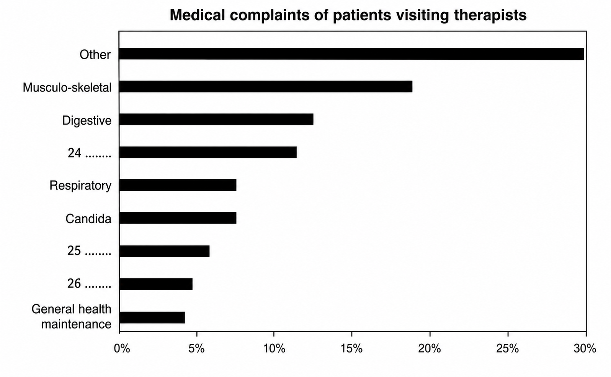

# 从“替代”到“补充”：澳大利亚医学边界的松动｜Cambridge IELTS 04 Test 2 Passage 2 双语精读

`Alternative Medicine in Australia` 表面上写替代疗法在澳大利亚逐渐流行，真正的主线却是医学权威、患者需求与商业现实之间的重新谈判。文章先用大学正式开课说明替代疗法获得认可，再把澳大利亚医生与欧美同行对照，接着用两组调查解释公众为什么离开传统诊所，最后把 `alternative medicine` 改称 `complementary medicine`：它往往不是取代常规医学，而是在常规医学“给不出答案”时补上缺口。

正文共 32 句，题号为 14–26。每句的 B1+ 词或词组均按本句实际出现顺序独立列出；同一项在后文再次出现时会再次标注，同一句内重复出现也不合并。医学、公共卫生、商业等专业词采用“CEFR·领域”双标。

## 01 逐句精读

### 题名：Alternative Medicine in Australia

**澳大利亚的替代医学**

`alternative medicine` 指处于主流或常规医学体系之外的治疗方法。读到结尾会发现，作者有意让标题里的 `alternative` 接受检验：这些疗法究竟是在“替代”，还是在“补充”？

### 1

**The first students to study alternative medicine at university level in Australia began their four-year, full-time course at the University of Technology Sydney, in early 1994.**

澳大利亚第一批在大学层面学习替代医学的学生，于 1994 年初在悉尼科技大学开始了为期四年的全日制课程。

句子主干是 `The first students ... began their ... course`。两个 `to` 短语分别说明“学习什么”和“在哪里达到大学层级”，开篇用正式学位课程把边缘疗法放进制度化教育场景。

**本句 B1+**：`alternative medicine` **[B2·医学]**；`at university level` **[B1·教育]**；`four-year` **[B1]**；`full-time course` **[B1·教育]**；`University of Technology` **[B1·教育]**。

### 2

**Their course covered, among other therapies, acupuncture.**

他们的课程除其他疗法外，还包括针灸。

`among other therapies` 是插入成分，提醒读者针灸只是课程内容之一，不等于整门课程只教针灸。这一点也会成为第 22 题识别“范围缩窄”干扰的基础。

**本句 B1+**：`covered`（包括）**[B1]**；`among other therapies` **[B2·医学]**；`acupuncture` **[C1·医学]**。

### 3

**The theory they learnt is based on the traditional Chinese explanation of this ancient healing art that it can regulate the flow of ‘Qi’ or energy through pathways in the body.**

他们所学的理论以中国传统对这种古老治疗技艺的解释为基础：针灸能够调节“气”或能量，使其沿身体内的通路流动。

主干是 `The theory ... is based on the ... explanation`。`they learnt` 修饰 `theory`；`that it can regulate...` 说明这套解释的内容。翻译时把后半句处理成冒号后的解释，比照搬英语长定语自然。

**本句 B1+**：`theory` **[B1·学术]**；`be based on` **[B1]**；`traditional` **[B1]**；`explanation` **[B1]**；`ancient` **[B1]**；`healing art` **[B2·医学]**；`regulate` **[B2·医学]**；`flow` **[B1]**；`Qi` **[C1·中医学]**；`energy` **[B1]**；`pathway` **[B2·医学]**。

### 4

**This course reflects how far some alternative therapies have come in their struggle for acceptance by the medical establishment.**

这门课程反映出，一些替代疗法在争取主流医学界认可的道路上已经走了多远。

`how far ... have come` 不只写物理距离，而是衡量进展。`medical establishment` 不是某一家医疗机构，而是掌握资格、规范与专业权威的主流医学体系。课程进入大学，正是“获得认可”的可见证据。

**本句 B1+**：`reflect` **[B1]**；`how far ... have come` **[B2]**；`alternative therapies` **[B2·医学]**；`struggle for acceptance` **[B2]**；`medical establishment` **[C1·医学/制度]**。

### 5

**Australia has been unusual in the Western world in having a very conservative attitude to natural or alternative therapies, according to Dr Paul Laver, a lecturer in Public Health at the University of Sydney.**

悉尼大学公共卫生讲师 Paul Laver 博士称，澳大利亚在西方世界中显得不同寻常，因为它对自然疗法或替代疗法一直持非常保守的态度。

`be unusual in doing` 说明“不同寻常之处在于……”。作者先定下澳大利亚的特殊性，随后用其他工业化国家、欧洲、德国和美国作对照。

**本句 B1+**：`unusual` **[B1]**；`Western world` **[B1]**；`conservative attitude to` **[B2]**；`natural therapies` **[B2·医学]**；`alternative therapies` **[B2·医学]**；`according to` **[B1]**；`lecturer` **[B1·教育]**；`Public Health` **[B2·公共卫生]**。

### 6

**‘We’ve had a tradition of doctors being fairly powerful and I guess they are pretty loath to allow any pretenders to their position to come into it.’**

“我们一直有这样一种传统：医生相当有权势；我想，他们非常不愿意让任何觊觎其地位的人进入这个领域。”

`loath to do` 比 `do not want to do` 更强，表示明显不情愿；`pretenders to their position` 带有医生把新来者视为“觊觎者、挑战者”的防御语气。`it` 回指医生占据的专业领域或地位范围。

**本句 B1+**：`tradition` **[B1]**；`fairly` **[B1]**；`powerful` **[B1]**；`loath to do` **[C1]**；`allow` **[B1]**；`pretender to a position` **[C1]**；`position`（地位）**[B1]**。

### 7

**In many other industrialized countries, orthodox and alternative medicine have worked ‘hand in glove’ for years.**

在许多其他工业化国家，正统医学与替代医学多年来一直“密切合作”。

**本句 B1+**：`industrialized countries` **[B2·社会经济]**；`orthodox medicine` **[C1·医学]**；`alternative medicine` **[B2·医学]**；`hand in glove` **[C1]**。

#### A层深挖 1/3：hand in glove

[`hand in glove`](https://dictionary.cambridge.org/dictionary/english/hand-in-glove) 的字面画面是“手严丝合缝地伸进手套”，所以核心不是普通的“在一起”，而是双方配合得非常紧密。它常用于 `work hand in glove with sb`；Cambridge Dictionary 还提示，这个表达有时暗含勾结或共同做不正当事情的色彩。本句给短语加引号，却没有指控不当行为，重点是突出欧美两种医学体系的合作之紧密，从而反衬澳大利亚医生的排斥态度。

使用边界上，`work closely with` 最中性；`go hand in hand` 强调两件事相伴发生；`be in league with` 往往明显带负面“串通”意味。这里若换成 `work closely`，事实不变，但手与手套的贴合画面和轻微的惊讶感都会减弱。

- Universities can work hand in glove with local hospitals to improve clinical training. 大学可以与当地医院密切合作，改进临床培训。
- Strong privacy rules must go hand in hand with the use of health data. 严格的隐私规则必须与健康数据的使用同步推进。
- The two departments worked closely together, but they retained separate responsibilities. 两个部门密切合作，但仍各自承担不同职责。

### 8

**In Europe, only orthodox doctors can prescribe herbal medicine.**

在欧洲，只有正统医学体系的医生可以开具草药处方。

`prescribe` 的主语通常是有处方权的医疗人员，宾语可以是药物或治疗。这里不是说欧洲排斥草药，反而说明草药已经被纳入正统医生的执业范围。

**本句 B1+**：`orthodox doctors` **[C1·医学]**；`prescribe` **[B2·医学]**；`herbal medicine` **[B2·医学]**。

### 9

**In Germany, plant remedies account for 10% of the national turnover of pharmaceuticals.**

在德国，植物药占全国药品营业额的 10%。

`account for` 在数据题中表示“占……比例”；`turnover` 此处是销售营业额，不是“人员流动率”。这项德国数据继续证明替代或植物疗法已进入主流市场。

**本句 B1+**：`plant remedies` **[B2·药学]**；`account for` **[B1]**；`national turnover` **[B2·商业]**；`pharmaceuticals` **[C1·药学]**。

### 10

**Americans made more visits to alternative therapists than to orthodox doctors in 1990, and each year they spend about $US12 billion on therapies that have not been scientifically tested.**

1990 年，美国人去看替代疗法治疗师的次数多于去看正统医生的次数；而且他们每年在尚未经过科学检验的疗法上花费约 120 亿美元。

`more ... than ...` 比较的是就诊次数，不是两类药物的支出。后半句只给出替代疗法的绝对花费，没有与正统药物花费比较，这正是第 15 题 C 项的陷阱。

**本句 B1+**：`made more visits to` **[B1]**；`alternative therapists` **[B2·医学]**；`orthodox doctors` **[C1·医学]**；`each year` **[B1]**；`spend about $US12 billion on` **[B1·商业]**；`therapies` **[B2·医学]**；`scientifically tested` **[B2·科研/医学]**。

### 11

**Disenchantment with orthodox medicine has seen the popularity of alternative therapies in Australia climb steadily during the past 20 years.**

对正统医学的失望，使替代疗法在澳大利亚的受欢迎程度在过去 20 年里稳步上升。

`has seen + 宾语 + 动词原形` 在这里不是“看见”，而是“促成/伴随某变化发生”。真正的因果链是：公众对正统医学失望，于是更多人转向替代疗法。

**本句 B1+**：`disenchantment with` **[C1]**；`orthodox medicine` **[C1·医学]**；`has seen ... climb` **[B2]**；`popularity` **[B1]**；`alternative therapies` **[B2·医学]**；`climb steadily` **[B1]**；`during the past 20 years` **[B1]**。

### 12

**In a 1983 national health survey, 1.9% of people said they had contacted a chiropractor, naturopath, osteopath, acupuncturist or herbalist in the two weeks prior to the survey.**

在 1983 年的一项全国健康调查中，1.9% 的人表示，他们在调查前两周内曾就诊于脊椎指压治疗师、自然疗法师、整骨师、针灸师或草药师。

`had contacted` 用过去完成时，是因为“就诊”发生在“回答调查”之前。五个职业名构成并列清单，不能把其中的 `acupuncturist` 当成全部调查对象。

**本句 B1+**：`national health survey` **[B2·公共卫生]**；`contacted`（就诊/联系）**[B1]**；`chiropractor` **[C1·医学]**；`naturopath` **[C1·医学]**；`osteopath` **[C1·医学]**；`acupuncturist` **[C1·医学]**；`herbalist` **[B2·医学]**；`two weeks prior to` **[B2]**；`survey` **[B1·研究]**；`survey` **[B1·研究]**。

### 13

**By 1990, this figure had risen to 2.6% of the population.**

到 1990 年，这一比例已升至总人口的 2.6%。

`By 1990` 与过去完成时 `had risen` 标出截至该年的累计变化。从 1.9% 到 2.6% 是增加 0.7 个百分点，并不是增加 8% 的人口。

**本句 B1+**：`figure`（数字/比例）**[B1]**；`rise to` **[B1]**；`population` **[B1·人口统计]**。

### 14

**The 550,000 consultations with alternative therapists reported in the 1990 survey represented about an eighth of the total number of consultations with medically qualified personnel covered by the survey, according to Dr Laver and colleagues writing in the Australian Journal of Public Health in 1993.**

据 Laver 博士及其同事 1993 年在《澳大利亚公共卫生杂志》发表的文章，1990 年调查所报告的 55 万次替代疗法就诊，约占该调查覆盖的、由具备医学资质人员提供的全部诊疗次数的八分之一。

主干是 `The 550,000 consultations ... represented about an eighth...`。两个过去分词 `reported`、`covered` 分别修饰前后两组 `consultations`；句末 `according to...` 才交代数据来源。数字很大，但作者用“八分之一”校准它在整体医疗服务中的比例。

**本句 B1+**：`consultations` **[B2·医学]**；`alternative therapists` **[B2·医学]**；`reported` **[B1·研究]**；`survey` **[B1·研究]**；`represented`（占）**[B1]**；`about an eighth of` **[B1]**；`total number of` **[B1]**；`consultations` **[B2·医学]**；`medically qualified personnel` **[C1·医学/资质]**；`covered by` **[B1·研究]**；`survey` **[B1·研究]**；`according to` **[B1]**；`colleagues` **[B1]**；`writing in` **[B1·学术出版]**；`Australian Journal of Public Health` **[B2·公共卫生/学术出版]**；`in 1993` **[B1·时间表达]**。

### 15

**‘A better educated and less accepting public has become disillusioned with the experts in general, and increasingly skeptical about science and empirically based knowledge,’ they said.**

他们说：“一个教育程度更高、也不再轻易接受权威说法的公众，已经对各领域专家普遍感到失望，并且越来越怀疑科学和以实证为基础的知识。”

`less accepting` 不是“接受能力更差”，而是“不再照单全收”。`disillusioned with` 指原有信任或理想破灭后的失望；`empirically based` 强调来自观察、实验或数据。这句话解释了转向替代疗法背后的广泛权威危机。

**本句 B1+**：`better educated` **[B1]**；`less accepting` **[B2]**；`the public` **[B1]**；`become disillusioned with` **[C1]**；`experts in general` **[B1]**；`increasingly` **[B2]**；`skeptical about` **[B2]**；`science` **[B1·科研]**；`empirically based knowledge` **[C1·科研]**。

### 16

**‘The high standing of professionals, including doctors, has been eroded as a consequence.’**

“因此，包括医生在内的专业人士原本享有的崇高声望已经受到削弱。”

`erode` 原指水土被慢慢侵蚀，这里写公众信任逐渐流失，而不是突然崩塌。`has been eroded` 支持第 19 题：今天的评价下降，意味着过去评价更高。

**本句 B1+**：`high standing` **[C1]**；`professionals` **[B2]**；`including` **[B1]**；`erode` **[C1]**；`as a consequence` **[B2]**。

### 17

**Rather than resisting or criticizing this trend, increasing numbers of Australian doctors, particularly younger ones, are forming group practices with alternative therapists or taking courses themselves, particularly in acupuncture and herbalism.**

越来越多的澳大利亚医生，尤其是年轻医生，并没有抵制或批评这一趋势，而是与替代疗法治疗师组建联合诊所，或亲自参加课程，特别是针灸和草药学课程。

句首 `Rather than doing A, ... are doing B` 把旧反应与新行动对照。主干有两个并列动作：`are forming...` 和 `(are) taking...`。这不是一句空泛的“态度改善”，而是合作执业与重新学习两种具体变化。

**本句 B1+**：`rather than` **[B1]**；`resist` **[B2]**；`criticize` **[B1]**；`trend` **[B1]**；`increasing numbers of` **[B1]**；`particularly` **[B1]**；`form group practices` **[C1·医学/执业]**；`alternative therapists` **[B2·医学]**；`take courses` **[B1·教育]**；`particularly` **[B1]**；`acupuncture` **[C1·医学]**；`herbalism` **[C1·医学]**。

### 18

**Part of the incentive was financial, Dr Laver said.**

Laver 博士说，部分动机来自经济利益。

`incentive` 是促使人行动的因素；`financial` 点明医生接受新疗法不完全是医学理念改变，也有患者与收入流失的现实压力。

**本句 B1+**：`incentive` **[B2]**；`financial` **[B1·商业]**。

### 19

**‘The bottom line is that most general practitioners are business people.**

“归根结底，大多数全科医生也是生意人。

**本句 B1+**：`the bottom line` **[C2·商业]**；`general practitioners` **[B2·医学]**；`business people` **[B1·商业]**。

#### A层深挖 2/3：the bottom line

[`bottom line`](https://dictionary.cambridge.org/dictionary/english/bottom-line) 原指公司账目最下面显示最终利润或亏损的那一行，后来引申为“最重要的事实、最终结论”。本句恰好同时激活两层含义：Laver 一面说“说到底”，一面提醒读者诊所也要面对营收，所以这个表达比普通的 `the main point` 更贴合商业动机。

常用结构是 `The bottom line is that + 完整句子`。它适合在讨论末尾收束判断，语气直接；在需要委婉协商时会显得过硬。`in short` 只是简要概括，`ultimately` 强调最终结果，`the key point` 强调论证重点，都没有天然的财务联想。

- The bottom line is that a health service cannot expand without trained staff. 归根结底，医疗服务没有受训人员就无法扩张。
- The proposal sounds attractive, but the bottom line is whether patients receive better care. 这项提案听起来很有吸引力，但最关键的是患者能否得到更好的照护。
- Ultimately, the team chose reliability over speed. 团队最终选择了可靠性，而不是速度。

### 20

**If they see potential clientele going elsewhere, they might want to be able to offer a similar service.’**

如果他们看到潜在客户去了别处，就可能也想提供类似的服务。”

`clientele` 把患者写成“客户群”，延续上一句的商业视角。`might` 保留推测语气：Laver 在解释一种可能的动机，并没有断言所有医生都只为赚钱。

**本句 B1+**：`potential clientele` **[C1·商业]**；`going elsewhere` **[B1]**；`might want to be able to` **[B2]**；`offer a similar service` **[B1·商业]**。

### 21

**In 1993, Dr Laver and his colleagues published a survey of 289 Sydney people who attended eight alternative therapists’ practices in Sydney.**

1993 年，Laver 博士及其同事发表了一项调查，调查对象是 289 名曾在悉尼八家替代疗法诊所就诊的人。

`who attended...` 修饰 `289 Sydney people`；医学语境中的 `practice` 可以指医生或治疗师执业的诊所。人数、地点和诊所数量都明确，但此句没有说这些人接受的是针灸。

**本句 B1+**：`colleagues` **[B1]**；`publish a survey` **[B1·研究]**；`attend a practice` **[B2·医学]**；`alternative therapists’ practices` **[B2·医学/执业]**。

### 22

**These practices offered a wide range of alternative therapies from 25 therapists.**

这些诊所由 25 名治疗师提供种类广泛的替代疗法。

`a wide range of` 明确是多种疗法，直接否定第 22 题把全部 289 人缩窄为针灸患者的说法。

**本句 B1+**：`practices` **[B2·医学/执业]**；`offer a wide range of` **[B1]**；`alternative therapies` **[B2·医学]**；`therapists` **[B2·医学]**。

### 23

**Those surveyed had experienced chronic illnesses, for which orthodox medicine had been able to provide little relief.**

这些受访者都曾患有慢性疾病，而正统医学几乎未能缓解这些疾病带来的痛苦。

`Those surveyed` 指前文全部 289 名受访者；`for which` 回指 `chronic illnesses`。`little relief` 是“几乎没有缓解”，不能误读为“有一点且效果尚可”。这也是第 23 题中 `all` 和 `long-term medical complaints` 的证据。

**本句 B1+**：`those surveyed` **[B1·研究]**；`experience chronic illnesses` **[B2·医学]**；`orthodox medicine` **[C1·医学]**；`provide little relief` **[B2·医学]**。

### 24

**They commented that they liked the holistic approach of their alternative therapists and the friendly, concerned and detailed attention they had received.**

他们表示，自己喜欢替代疗法治疗师所采用的整体性方法，也喜欢治疗师给予的友善、关切和细致照顾。

`holistic` 强调把人的身体、心理与整体处境一并考虑；后面的三个形容词则把抽象的“整体性”落到患者实际感受到的沟通与关注上。

**本句 B1+**：`commented that`（表示/评论）**[B1]**；`holistic approach` **[C1·医学]**；`alternative therapists` **[B2·医学]**；`friendly` **[B1]**；`concerned`（关切的）**[B2]**；`detailed attention` **[B2·医疗沟通]**；`received` **[B1]**。

### 25

**The cold, impersonal manner of orthodox doctors featured in the survey.**

正统医生冷淡、缺乏人情味的态度，也成为调查中显著呈现的一项特征。

`feature in` 表示“在……中占有显著位置/成为其中的特点”，不是说调查“展示了一张医生照片”。这句话与上一句形成鲜明的服务体验对照。

**本句 B1+**：`impersonal manner` **[C1·医疗沟通]**；`orthodox doctors` **[C1·医学]**；`feature in` **[B2]**；`survey` **[B1·研究]**。

### 26

**An increasing exodus from their clinics, coupled with this and a number of other relevant surveys carried out in Australia, all pointing to orthodox doctors’ inadequacies, have led mainstream doctors themselves to begin to admit they could learn from the personal style of alternative therapists.**

越来越多患者离开正统医生的诊所；再加上调查中呈现出的这种冷漠态度，以及澳大利亚开展的其他多项相关调查都指向正统医生的不足，所有这些因素促使主流医生自己开始承认，他们可以借鉴替代疗法治疗师与患者相处的个人风格。

主干是 `An increasing exodus ..., coupled with ..., have led mainstream doctors ... to admit...`。`all pointing to...` 补充说明多项调查共同指向什么。原句用复数谓语 `have led`，把患者流失和多项调查共同看作推动变化的一组力量。

**本句 B1+**：`increasing exodus from` **[C1]**；`clinics` **[B1·医学]**；`coupled with this` **[B2]**；`a number of other relevant surveys` **[B1·研究]**；`carried out in Australia` **[B1·研究]**；`all pointing to` **[B1]**；`orthodox doctors’ inadequacies` **[C1·医学]**；`have led` **[B1]**；`mainstream doctors` **[B2·医学]**；`themselves` **[B1]**；`begin to admit` **[B1]**；`learn from` **[B1]**；`personal style` **[B2·医疗沟通]**；`alternative therapists` **[B2·医学]**。

#### A层深挖 3/3：an exodus from

[`exodus`](https://dictionary.cambridge.org/dictionary/english/exodus) 是正式词，指大量的人离开某个地方或处境；常见搭配有 `an exodus from`、`an exodus of` 和 `a mass exodus`。它比普通的 `many patients left` 更有“成群外流”的规模感。文章前面给出比例和动机，这里用 `an increasing exodus from their clinics` 把分散的就诊选择汇成主流诊所正在失去患者的趋势，也解释了医生为何开始改变。

使用时要有足够规模，几个人离开不宜称为 `exodus`。`outflow` 更适合资金、人口或资源的统计流出；`departure` 中性，只表示离开；`brain drain` 专指受教育或高技能人才外流。

- Poor working conditions triggered an exodus of nurses from rural hospitals. 较差的工作条件引发护士大量离开乡村医院。
- The platform redesign caused an exodus of experienced sellers to rival services. 平台改版导致大批资深卖家转向竞争对手的服务。
- The region is trying to slow the brain drain by creating skilled jobs. 该地区正通过创造高技能岗位来减缓人才外流。

### 27

**Dr Patrick Store, President of the Royal College of General Practitioners, concurs that orthodox doctors could learn a lot about bedside manner and advising patients on preventative health from alternative therapists.**

皇家全科医生学院院长 Patrick Store 博士也赞同，正统医生可以从替代疗法治疗师那里学到很多，包括如何改善临床沟通态度，以及如何向患者提供预防保健建议。

`concurs that` 是正式的“同意”；`bedside manner` 不只是站在病床边的姿态，而是医生面对患者时的沟通方式、同理心和态度。文章在这里把“医生能学什么”落到具体的人际技能上。

**本句 B1+**：`President` **[B1·机构职务]**；`Royal College of General Practitioners` **[B2·医学/机构]**；`concur` **[C1]**；`orthodox doctors` **[C1·医学]**；`bedside manner` **[C1·医疗沟通]**；`advise patients on` **[B2·医学]**；`preventative health` **[B2·公共卫生]**；`alternative therapists` **[B2·医学]**。

### 28

**According to the Australian Journal of Public Health, 18% of patients visiting alternative therapists do so because they suffer from musculo-skeletal complaints, 12% suffer from digestive problems, which is only 1% more than those suffering from emotional problems.**

据《澳大利亚公共卫生杂志》报道，去看替代疗法治疗师的患者中，18% 是因为肌肉骨骼方面的不适，12% 是因为消化问题；后者只比因情绪问题就诊的患者比例高 1 个百分点。

`which` 回指 12% 这一比例。由“12% 只高 1%”可推出 `emotional problems` 为 11%，对应图表第 24 空。这里的 `complaints` 是医学上的“症状/主诉”，不是日常意义的“投诉”。

**本句 B1+**：`according to` **[B1]**；`Journal of Public Health` **[B2·公共卫生/学术出版]**；`patients` **[B1·医学]**；`alternative therapists` **[B2·医学]**；`suffer from` **[B1·医学]**；`musculo-skeletal complaints` **[C1·医学]**；`suffer from` **[B1·医学]**；`digestive problems` **[B2·医学]**；`suffer from` **[B1·医学]**；`emotional problems` **[B2·心理健康]**。

### 29

**Those suffering from respiratory complaints represent 7% of their patients, and candida sufferers represent an equal percentage.**

因呼吸系统问题就诊的人占患者的 7%，念珠菌相关疾病患者所占比例与之相同。

`an equal percentage` 回指 7%，所以图中的 `Respiratory` 与 `Candida` 两条柱一样长。它们都是图表已给出的固定标签，不是第 24–26 题答案。

**本句 B1+**：`suffer from` **[B1·医学]**；`respiratory complaints` **[C1·医学]**；`represent`（占）**[B1]**；`patients` **[B1·医学]**；`candida sufferers` **[C1·医学]**；`represent`（占）**[B1]**；`equal percentage` **[B1·统计]**。

### 30

**Headache sufferers and those complaining of general ill health represent 6% and 5% of patients respectively and a further 4% see therapists for general health maintenance.**

头痛患者和自述整体健康不佳的人分别占患者的 6% 和 5%，另有 4% 的人为了日常整体健康维护而去看治疗师。

`respectively` 要求前后严格按顺序配对：`Headache sufferers` 对应 6%，`general ill health` 对应 5%。因此第 25 空接受 `headache` 或 `headaches`，第 26 空是 `general ill health`；4% 的 `general health maintenance` 是图上已给标签。

**本句 B1+**：`headache sufferers` **[B1·医学]**；`complain of`（主诉）**[B2·医学]**；`general ill health` **[B2·医学]**；`represent`（占）**[B1]**；`patients` **[B1·医学]**；`respectively` **[B2·统计]**；`a further 4%` **[B1·统计]**；`therapists` **[B2·医学]**；`general health maintenance` **[B2·健康管理]**。

### 31

**The survey suggested that complementary medicine is probably a better term than alternative medicine.**

这项调查表明，“补充医学”或许是比“替代医学”更恰当的称呼。

`suggested` 和 `probably` 双重降低断言强度。`complementary` 强调与常规治疗配合，`alternative` 则容易让人理解为二选一或完全取代。

**本句 B1+**：`survey` **[B1·研究]**；`suggested` **[B1]**；`probably` **[B1]**；`complementary medicine` **[C1·医学]**；`better term than` **[B1·语言/学术]**；`alternative medicine` **[B2·医学]**。

### 32

**Alternative medicine appears to be an adjunct sought in times of disenchantment when conventional medicine seems not to offer the answer.**

当人们对常规医学感到失望、觉得它似乎无法给出答案时，替代医学看来是一种被寻求的辅助治疗手段。

主干是 `Alternative medicine appears to be an adjunct`；`sought...` 是过去分词，修饰 `adjunct`；`when...` 交代人们求助于它的情境。结尾没有宣称替代疗法更有效，而是谨慎界定它的角色：常规医学不足时的补充。

**本句 B1+**：`alternative medicine` **[B2·医学]**；`appears to be` **[B1]**；`adjunct` **[C1·医学]**；`sought`（seek 的过去分词）**[B1]**；`in times of` **[B2]**；`disenchantment` **[C1]**；`conventional medicine` **[B2·医学]**；`seems not to offer the answer` **[B1]**。

## 02 Questions 14–15：单项选择

**题目说明：Choose the correct letter, A, B, C or D. Write your answers in boxes 14 and 15 on your answer sheet.**

选择正确字母 A、B、C 或 D，并把答案写在答题纸第 14、15 题的方框中。

### 14

**Traditionally, how have Australian doctors differed from doctors in many Western countries?**

传统上，澳大利亚医生与许多西方国家的医生有何不同？

- **A They have worked closely with pharmaceutical companies.** 他们一直与制药公司密切合作。
- **B They have often worked alongside other therapists.** 他们经常与其他治疗师一起工作。
- **C They have been reluctant to accept alternative therapists.** 他们一直不愿接受替代疗法治疗师。
- **D They have regularly prescribed alternative remedies.** 他们经常开具替代疗法药物或疗方。

**答案：C**

**原文证据**：`Australia has been unusual ... in having a very conservative attitude to natural or alternative therapies`，以及医生 `are pretty loath to allow any pretenders to their position to come into it`。`loath to allow` 对应题目的 `reluctant to accept`。

**干扰项逐一排除**：A 把德国 `pharmaceuticals` 的营业额信息偷换成澳大利亚医生与药企合作，原文无此关系；B 是 `many other industrialized countries` 的情况，恰好不是澳大利亚传统；D 把欧洲正统医生可开草药处方的规定移植到澳大利亚，且 `can prescribe` 也不等于 `regularly prescribed`。

### 15

**In 1990, Americans ...**

1990 年，美国人……

- **A were prescribed more herbal medicines than in previous years.** 获得的草药处方比往年更多。
- **B consulted alternative therapists more often than doctors.** 看替代疗法治疗师的次数比看医生更多。
- **C spent more on natural therapies than orthodox medicines.** 在自然疗法上的花费高于在正统药物上的花费。
- **D made more complaints about doctors than in previous years.** 对医生的投诉比往年更多。

**答案：B**

**原文证据**：`Americans made more visits to alternative therapists than to orthodox doctors in 1990`。`made more visits to` 被同义改写为 `consulted ... more often than`。

**干扰项逐一排除**：A 既没有“草药处方”数据，也没有与往年比较；C 利用后文 `$US12 billion` 制造印象，但原文只给替代疗法的绝对支出，没有和正统药物比较；D 原文没有美国人投诉医生或年度投诉变化的信息。

## 03 Questions 16–23：YES / NO / NOT GIVEN

**题目说明：Do the following statements agree with the views of the writer in Reading Passage 2? In boxes 16–23 on your answer sheet write YES if the statement agrees with the views of the writer, NO if the statement contradicts the views of the writer, NOT GIVEN if it is impossible to say what the writer thinks about this.**

下列陈述是否与阅读文章 2 中作者的观点一致？若陈述与作者观点一致写 **YES（是）**；与作者观点矛盾写 **NO（否）**；无法判断作者对此有何看法写 **NOT GIVEN（未提及）**。

### 16

**Australians have been turning to alternative therapies in increasing numbers over the past 20 years.**

过去 20 年中，越来越多澳大利亚人开始转向替代疗法。

**答案：YES**

**原文证据**：`the popularity of alternative therapies in Australia [has] climb[ed] steadily during the past 20 years`，并有 1983 年 1.9% 到 1990 年 2.6% 的数据支持。

**另两项为何不选**：NO 不成立，因为原文明确说受欢迎程度稳步上升；NOT GIVEN 不成立，因为时间范围、对象和趋势均直接出现。

### 17

**Between 1983 and 1990 the numbers of patients visiting alternative therapists rose to include a further 8% of the population.**

1983 至 1990 年间，去看替代疗法治疗师的患者人数上升，新增人数达到总人口的 8%。

**答案：NO**

**原文证据**：比例从 `1.9%` 升到 `2.6%`，只增加 **0.7 个百分点**；`about an eighth` 说的是 1990 年替代疗法就诊次数约占全部合资格医疗人员诊疗次数的八分之一，不是新增人口 8%。

**另两项为何不选**：YES 不成立，因为题干把两组不同口径的数字拼接并改成“新增 8% 人口”；NOT GIVEN 不成立，因为原文提供了足以直接反驳题干的具体数字。

### 18

**The 1990 survey related to 550,000 consultations with alternative therapists.**

1990 年的调查涉及 55 万次替代疗法就诊。

**答案：YES**

**原文证据**：`The 550,000 consultations with alternative therapists reported in the 1990 survey...`，题干只是改换语序。

**另两项为何不选**：NO 不成立，因为人数、年份和就诊对象完全一致；NOT GIVEN 不成立，因为 55 万次被直接写明。

### 19

**In the past, Australians had a higher opinion of doctors than they do today.**

过去，澳大利亚人对医生的评价比今天更高。

**答案：YES**

**原文证据**：`The high standing of professionals, including doctors, has been eroded as a consequence.` `high standing ... has been eroded` 表示原有较高声望如今已下降。

**另两项为何不选**：NO 不成立，因为原文方向是声望由高到低，而不是今天更高；NOT GIVEN 不成立，因为过去与现在的变化虽未用比较级复述，却由 `has been eroded` 明确表达。

### 20

**Some Australian doctors are retraining in alternative therapies.**

一些澳大利亚医生正在重新学习替代疗法。

**答案：YES**

**原文证据**：越来越多医生 `are ... taking courses themselves, particularly in acupuncture and herbalism`。参加针灸与草药学课程就是题干 `retraining in alternative therapies` 的概括。

**另两项为何不选**：NO 不成立，因为医生亲自参加课程被明确写出；NOT GIVEN 不成立，因为这里不是推测其学习意愿，而是直接描述其行动。

### 21

**Alternative therapists earn higher salaries than doctors.**

替代疗法治疗师的薪资高于医生。

**答案：NOT GIVEN**

**原文证据**：文章只说医生有 `financial` incentive，也说潜在客户可能 `going elsewhere`；没有任何一处比较两类从业者的薪资。

**另两项为何不选**：YES 不成立，因为患者流失或商业动机不能推出替代疗法治疗师收入更高；NO 也不成立，因为原文同样没有说医生收入更高。缺少比较信息时只能选 NOT GIVEN。

### 22

**The 1993 Sydney survey involved 289 patients who visited alternative therapists for acupuncture treatment.**

1993 年的悉尼调查涉及 289 名为了接受针灸治疗而去看替代疗法治疗师的患者。

**答案：NO**

**原文证据**：289 人去过八家替代疗法诊所，而这些诊所 `offered a wide range of alternative therapies from 25 therapists`。原文明确是多种替代疗法，不是全部为了针灸。

**另两项为何不选**：YES 不成立，因为题干把 `a wide range` 偷换为单一 `acupuncture treatment`；NOT GIVEN 不成立，因为原文提供了与“全是针灸”相冲突的范围信息。

### 23

**All the patients in the 1993 Sydney survey had long-term medical complaints.**

1993 年悉尼调查中的所有患者都有长期健康问题。

**答案：YES**

**原文证据**：`Those surveyed had experienced chronic illnesses`。`Those surveyed` 覆盖全部受访者，`chronic illnesses` 对应 `long-term medical complaints`。

**另两项为何不选**：NO 不成立，因为原文没有限定为“部分”患者；NOT GIVEN 不成立，因为患者范围和慢性疾病都被直接说明。

## 04 Questions 24–26：图表纵轴填空

**题目说明：Complete the vertical axis on the table below. Choose NO MORE THAN THREE WORDS from Reading Passage 2 for each answer. Write your answers in boxes 24–26 on your answer sheet.**

补全下图的纵轴标签。每个答案从阅读文章 2 中选取，**不得超过三个词**，并写入答题纸第 24–26 题。

图题 `Medical complaints of patients visiting therapists` 意为“就诊患者的健康问题”。图中已给标签全部翻译如下：`Other` 其他；`Musculo-skeletal` 肌肉骨骼问题；`Digestive` 消化问题；`Respiratory` 呼吸系统问题；`Candida` 念珠菌相关疾病；`General health maintenance` 整体健康维护。

### 24

**图中位置**：约 11% 的缺失标签。

**答案：emotional problems**，意为“情绪问题”。这里保留原文中的完整词组，不写成图表中的泛化标签。

**原文证据**：`12% suffer from digestive problems, which is only 1% more than those suffering from emotional problems.` 消化问题占 12%，比情绪问题高 1 个百分点，所以空格对应 11%。

**干扰项为何不选**：`Digestive` 是已给的 12% 标签；`Musculo-skeletal` 是 18%；`Respiratory` 与 `Candida` 都是 7%；它们的比例或图中位置均不符。

### 25

**图中位置**：约 6% 的缺失标签。

**答案：headaches**，意为“头痛”。

**原文证据**：`Headache sufferers and those complaining of general ill health represent 6% and 5% of patients respectively.` `respectively` 表示前者对应 6%，后者对应 5%。

**干扰项为何不选**：`general ill health` 是后一个 5% 类别；`Respiratory` 和 `Candida` 都是 7%；`General health maintenance` 是已给的 4% 标签。图中该空是类别标签，因此按答案键使用复数 `headaches`。

### 26

**图中位置**：约 5% 的缺失标签。

**答案：general ill health**，意为“整体健康不佳”。

**原文证据**：同一句中，`Headache sufferers` 与 `general ill health` 按 `respectively` 分别对应 6% 和 5%。答案恰为三个词，符合字数限制。

**干扰项为何不选**：`headaches` 对应前一个 6% 空；`general health maintenance` 对应 4% 且图中已给；不能因为两者都有 `general health` 就混为同一类。

## 05 答案汇总

| 题号 | 答案 |
| --- | --- |
| 14 | C |
| 15 | B |
| 16 | YES |
| 17 | NO |
| 18 | YES |
| 19 | YES |
| 20 | YES |
| 21 | NOT GIVEN |
| 22 | NO |
| 23 | YES |
| 24 | emotional problems |
| 25 | headaches |
| 26 | general ill health |
