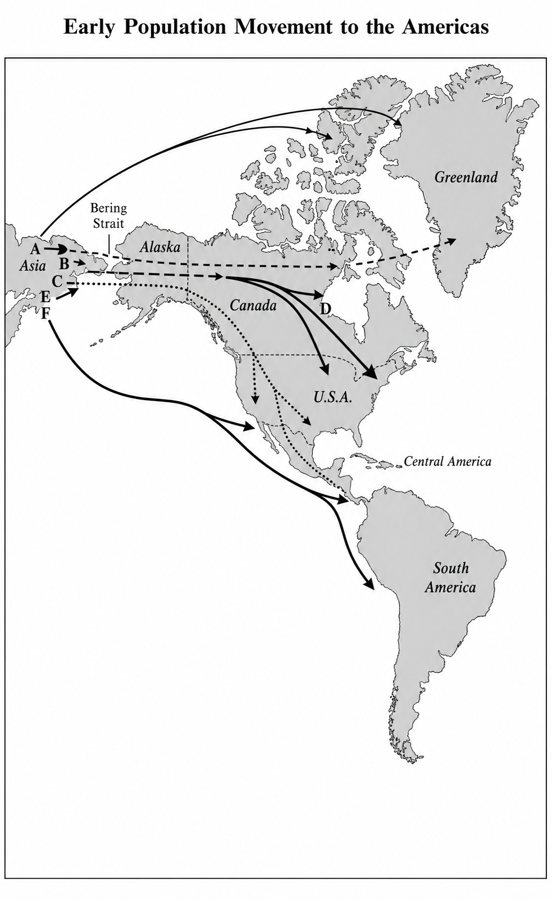

# Population movements and genetics｜人口迁徙与遗传学

**READING PASSAGE 2**

You should spend about 20 minutes on Questions 14–26, which are based on Reading Passage 2 on the following pages.

你应当用大约 20 分钟完成第 14–26 题；这些题目以随后几页的阅读文章 2 为依据。

题目前导词语逐次讲解：`be based on`【B1】以……为依据；`Reading Passage`【IELTS 题型·B1】阅读文章；`the following pages`【B1】随后几页。其余为基础词/基础表达。

这篇文章追问的不只是“美洲最早的居民从哪里来”。它真正展示的是研究方法怎样改变历史认识：考古遗物和化石提供传统证据，血液蛋白、线粒体 DNA 与牙齿特征则让活着的人体成为另一座“考古现场”。文章先提出迁徙次数与年代之谜，再用遗传、牙齿和语言三条证据链检验“三次迁徙说”，最后提醒读者：推定年代若没有硬考古证据支撑，仍须谨慎对待。

标题 `Population movements and genetics` 直译为“人口迁徙与遗传学”。复数 `movements` 强调多批次的群体移动；`genetics` 点明本文借遗传证据回推人群关系与迁徙时间。标题词语逐次讲解：`population movement`【人口史·B2】人口迁徙；`genetics`【遗传学·B2】遗传学。其余为基础词/基础表达。

## A

**1**

> Study of the origins and distribution of human populations used to be based on archaeological and fossil evidence.

对人类群体起源与分布的研究，过去主要以考古证据和化石证据为基础。

主干是 `Study ... used to be based on ...`；中间的 `of` 短语说明研究对象。被动结构突出“研究依据”，`used to` 把旧方法放到过去，为新技术蓄势。

词语逐次讲解：`origin`【B2】起源；`distribution`【B2】分布；`human population`【人口学·B2】人类群体；`used to be based on`【B1】过去以……为依据；`archaeological`【考古学·C1】考古学的；`fossil evidence`【古生物学/考古学·B2】化石证据。其余低阶词为基础词/基础表达。

**2**

> A number of techniques developed since the 1950s, however, have placed the study of these subjects on a sounder and more objective footing.

不过，自 20 世纪 50 年代以来发展起来的多种技术，使这些课题的研究建立在更可靠、也更客观的基础之上。

主干是 `techniques have placed the study ... on ... footing`。`developed since the 1950s` 后置修饰 `techniques`；`however` 对照新旧方法；两个比较级说明研究基础比过去更稳。

词语逐次讲解：`a number of`【B1】若干；`technique`【B1】方法；`developed since ...`【B1】自……以来发展起来的；`however`【B1】不过；`place ... on a ... footing`【C1】使……处于某种基础；`sound`【B2】可靠的；`objective`【B2】客观的；`subject`【B1】课题。其余为基础词/基础表达。

**A层深挖 1｜`on a sounder and more objective footing`**

这里的 `footing` 不是“脚”，而是某事赖以成立的条件或基础；[Cambridge Dictionary 对 footing 的释义](https://dictionary.cambridge.org/dictionary/english/footing)也保留了“某事存在的地位或条件”这一义项。字面画面是双脚站得更稳，因此 `put/place something on a sound footing` 比普通的 `improve something` 更具体：研究得到了更可靠的证据基础和更客观的方法标准。

这个正式表达常用于制度、财务、研究和合作。它在本段承担转轴作用，把“过去依据什么”推向“现在凭什么更可信”。`The new sampling rules put the survey on a sounder footing.` 新抽样规则使调查有了更可靠的基础。`Mutual access to the data placed the partnership on an equal footing.` 双方都能访问数据，使合作建立在平等基础上。`a solid basis` 强调坚实依据；`a firm foundation` 更强调长期发展；`on equal terms` 只强调双方条件平等。

**3**

> The best information on early population movements is now being obtained from the ‘archaeology of the living body’, the clues to be found in genetic material.

如今，关于早期人口迁徙的最佳信息，正从“活体考古学”中获得，也就是从遗传物质里寻找线索。

主干是 `information ... is now being obtained from ...`；现在进行时被动语态强调正在展开的新趋势。逗号后的名词短语与引号部分同位，解释“活体考古”的内容。

词语逐次讲解：`early population movements`【人口史·B2】早期人口迁徙；`be obtained from`【B2】从……获得；`archaeology of the living body`【遗传考古学·C1】借现存人体材料回溯历史；`clue`【B1】线索；`genetic material`【遗传学·B2】遗传物质。`information on` 是基础表达。其余为基础词/基础表达。

## B

**4**

> Recent work on the problem of when people first entered the Americas is an example of the value of these new techniques.

近期针对“人类最早何时进入美洲”这一问题的研究，正体现了这些新技术的价值。

主干是 `Recent work ... is an example ...`。`when` 从句具体说明问题内容；作者由方法概述转入美洲案例。

词语逐次讲解：`recent work on`【B1】近期关于……的研究；`the problem of when ...`【B1】……发生于何时的问题；`the Americas`【地理·B1】南、北美洲；`value`【B2】价值；`technique`【B1】方法。`an example of` 是基础表达。其余为基础词/基础表达。

**5**

> North-east Asia and Siberia have long been accepted as the launching ground for the first human colonisers of the New World¹.

长期以来，东北亚和西伯利亚一直被视为首批前往新大陆的人类殖民者的出发地。

现在完成时配合 `long` 表示认识延续已久；被动语态隐去研究共同体。`launching ground` 把该地区写成迁徙启程的平台。

词语逐次讲解：`North-east Asia`【地理·B1】东北亚；`Siberia`【地理·B1】西伯利亚；`have long been accepted as`【B2】长期被公认为；`launching ground`【C1】出发地；`human coloniser`【人口史·C1】迁入并定居新地区的人；`New World`【历史地理·B2】新大陆。其余为基础词/基础表达。

**6**

> But was there one major wave of migration across the Bering Strait into the Americas, or several?

但当时究竟只有一次跨越白令海峡进入美洲的大规模迁徙，还是有好几次？

这是 `Was there ...?` 存在句问句，`one ... or several` 构成选择。作者不否定出发区域，而是追问迁徙批次，直接引出“三次迁徙说”。

词语逐次讲解：`major wave of migration`【人口史·B2】大规模的一波迁徙；`migration`【B2】迁徙；`Bering Strait`【地理·B2】白令海峡；`the Americas`【地理·B1】南、北美洲。`or several` 是基础表达。其余为基础词/基础表达。

**7**

> And when did this event, or events, take place?

而这一次事件，或者说这些事件，又发生在什么时候？

主干是 `when did ... take place`。插入的 `or events` 修正单数 `event`，保留“单次还是多次”的不确定性。两个问句把任务压缩为“次数”和“年代”。

词语逐次讲解：`take place`【B1】发生。`event, or events` 是基础表达。其余为基础词/基础表达。

**8**

> In recent years, new clues have come from research into genetics, including the distribution of genetic markers in modern Native Americans².

近年来，新的线索来自遗传学研究，其中包括现代美洲原住民群体中遗传标记的分布。

主干是 `new clues have come from research`；`including ...` 补充研究内容。现在完成时连接近年来与当前认识，段末引向血液蛋白变体。

词语逐次讲解：`in recent years`【B1】近年来；`clue`【B1】线索；`research into`【B2】对……的研究；`genetics`【遗传学·B2】遗传学；`distribution`【B2】分布；`genetic marker`【遗传学·C1】遗传标记；`Native American`【民族史·B2】美洲原住民。`including` 和 `modern` 是基础词。其余为基础词/基础表达。

## C

**9**

> An important project, led by the biological anthropologist Robert Williams, focused on the variants (called Gm allotypes) of one particular protein – immunoglobin G – found in the fluid portion of human blood.

一项由生物人类学家罗伯特·威廉斯主持的重要研究，聚焦于一种特定蛋白质——免疫球蛋白 G——的变体（称为 Gm 同种异型）；这种蛋白存在于人体血液的液体部分。

主干是 `An important project focused on the variants`。`led by ...` 说明负责人，`found in ...` 修饰 `protein`；括号和破折号依次给变体、蛋白命名。

词语逐次讲解：`project`【B1】研究项目；`led by`【B1】由……主持；`biological anthropologist`【生物人类学·C1】生物人类学家；`focus on`【B2】聚焦；`variant`【遗传学·C1】变体；`Gm allotype`【免疫遗传学·C2】Gm 同种异型；`particular`【B1】特定的；`protein`【生物学·B2】蛋白质；`immunoglobin G`【免疫学·C2】原文所写“免疫球蛋白 G”；`fluid portion`【生理学·B2】液体部分。其余为基础词/基础表达。

**10**

> All proteins ‘drift’, or produce variants, over the generations, and members of an interbreeding human population will share a set of such variants.

所有蛋白质都会随着世代更替而发生“漂变”，也就是产生变体；同一个能够彼此通婚繁衍的人类群体，其成员会共享一组这样的变体。

`and` 连接两个分句：前者说明变体怎样产生，后者说明变体怎样在群体中呈现。`or produce variants` 解释专业化的 `drift`；`will` 表一般规律。

词语逐次讲解：`protein`【生物学·B2】蛋白质；`drift`【群体遗传学·C1】发生遗传漂变；`produce variants`【遗传学·B2】产生变体；`over the generations`【B2】经过一代又一代；`interbreeding`【遗传学·C1】群体间通婚繁衍的；`human population`【人口学·B2】人类群体；`share a set of`【B1】共享一组；`variant`【遗传学·C1】变体。其余为基础词/基础表达。

**11**

> Thus, by comparing the Gm allotypes of two different populations (e.g. two Indian tribes), one can establish their genetic ‘distance’, which itself can be calibrated to give an indication of the length of time since these populations last interbred.

因此，通过比较两个不同群体（例如两个印第安部落）的 Gm 同种异型，人们可以确定它们之间的遗传“距离”；这一距离本身又可以经过标定，用来显示这些群体自上一次相互通婚以来经历了多长时间。

主干先是 `one can establish their genetic distance`。句首 `by comparing ...` 表手段；`which` 指代 `genetic distance`。逻辑链是“比较变体 → 得出遗传距离 → 标定距离 → 推测分离时间”。

词语逐次讲解：`thus`【B2】因此；`by comparing`【B1】通过比较；`Gm allotype`【免疫遗传学·C2】Gm 同种异型；`population`【人口学·B2】群体；`e.g.`【B1】例如；`tribe`【B2】部落；`establish`【B2】确定；`genetic distance`【群体遗传学·C1】遗传距离；`calibrate`【工程/科学·C1】标定；`give an indication of`【B2】显示；`the length of time since`【B2】自……以来的时长；`interbred`【遗传学·C1】相互繁衍。其余为基础词/基础表达。

**A层深挖 2｜`can be calibrated to give an indication of`**

`calibrate` 在仪器语境中指“校准刻度”，[Cambridge Dictionary 对 calibrate 的释义](https://dictionary.cambridge.org/dictionary/english/calibrate)明确标注其工程、科学专业用法。本句把概念移到遗传距离上：研究者用已知尺度建立对应关系，让距离能够“给出时间指示”。`give an indication of` 刻意保留不确定性，弱于 `prove`。

这组表达比 `calculate the time` 更严谨，承认参照值和误差的存在。在文章里，它把抽象的遗传距离转换成可讨论的迁徙时间，同时阻止作者把估算写成定论。`The model was calibrated against observed traffic data to give an indication of peak-hour demand.` 模型依据实测交通数据标定，用于反映高峰需求。`The questionnaire cannot diagnose anxiety, but it can give an indication of risk.` 问卷不能诊断焦虑症，但能提示风险。`adjust` 只是调整；`standardise` 是统一标准；`benchmark` 是以参照对象比较；只有 `calibrate` 突出让读数与尺度准确对应。

## D

**12**

> Williams and his colleagues sampled the blood of over 5,000 American Indians in western North America during a twenty-year period.

威廉斯和同事们在二十年间，对北美西部 5,000 多名美洲印第安人的血液进行了取样。

主干是 `Williams and his colleagues sampled the blood`；两个介词短语分别说明样本来源和研究跨度。这里由原理转入样本与结果。

词语逐次讲解：`colleague`【B1】同事；`American Indian`【民族史·B2】美洲印第安人；`sample`【研究方法·B2】采集样本；`over 5,000` 是基础数量表达“超过五千”；`western North America`【地理·B1】北美西部；`during a twenty-year period`【B2】在二十年期间。其余为基础词/基础表达。

**13**

> They found that their Gm allotypes could be divided into two groups, one of which also corresponded to the genetic typing of Central and South American Indians.

他们发现，这些 Gm 同种异型可以分成两组，其中一组还与中美洲和南美洲印第安人的遗传分型相对应。

主干是 `They found that ...`；`one of which` 指前面的 `two groups`，补充其中一组的跨区域对应关系。`could be divided` 是研究分类结果。

词语逐次讲解：`Gm allotype`【免疫遗传学·C2】Gm 同种异型；`be divided into`【B1】被分成；`one of which`【B2】其中之一；`correspond to`【B2】相对应；`genetic typing`【遗传学·C1】遗传分型；`Central and South American Indians`【民族史·B2】中、南美洲印第安人。其余为基础词/基础表达。

**14**

> Other tests showed that the Inuit (or Eskimo) and Aleut³ formed a third group.

其他检测表明，因纽特人（即文中的 Eskimo）和阿留申人构成了第三组。

主干是 `Other tests showed that ...`；括号给 `Inuit` 补充旧称。`formed a third group` 与上一句的两组相接，成为三次迁徙推断的基础。

词语逐次讲解：`test` 在此为基础词“检测”；`Inuit`【民族学·B2】因纽特人；`Eskimo`【民族学·B2】原文旧称，现代使用需注意群体自称与语境；`Aleut`【民族学·B2】阿留申人；`form a third group`【B1】构成第三组。其余为基础词/基础表达。

**15**

> From this evidence it was deduced that there had been three major waves of migration across the Bering Strait.

由此证据，人们推断曾有三次大规模迁徙跨越白令海峡。

形式主语结构为 `it was deduced that ...`；`had been` 表示迁徙早于研究推断。无主被动保持客观语气，但 `deduced` 仍说明这不是直接观察。

词语逐次讲解：`from this evidence`【B2】根据这一证据；`deduce`【C1】推断；`major wave of migration`【人口史·B2】大规模迁徙；`Bering Strait`【地理·B2】白令海峡。其余为基础词/基础表达。

**16**

> The first, Paleo-Indian, wave more than 15,000 years ago was ancestral to all Central and South American Indians.

第一次迁徙是 15,000 多年前的古印第安人迁徙，它是所有中美洲和南美洲印第安人的祖源。

主干是 `The first wave was ancestral to ...`。插入语给迁徙命名，时间短语给年代；`ancestral to` 表祖源关系。

词语逐次讲解：`Paleo-Indian`【美洲史/考古学·C1】古印第安人；`wave`【人口史·B2】一波迁徙；`more than 15,000 years ago` 是基础时间表达“一万五千多年前”；`be ancestral to`【遗传学/人口史·C1】是……的祖源；`Central and South American Indians`【民族史·B2】中、南美洲印第安人。其余为基础词/基础表达。

**17**

> The second wave, about 14,000–12,000 years ago, brought Na-Dene hunters, ancestors of the Navajo and Apache (who only migrated south from Canada about 600 or 700 years ago).

第二次迁徙发生在约 14,000 至 12,000 年前，带来了纳-德内猎人；他们是纳瓦霍人和阿帕奇人的祖先，而后两者大约只在六七百年前才从加拿大向南迁移。

主干是 `The second wave brought Na-Dene hunters`。同位语解释猎人与后世族群的关系；括号内 `who` 指 `the Navajo and Apache`，讲的是远晚于第二波入美洲的南迁。地图题正利用两个时间层级设陷阱。

词语逐次讲解：`second wave`【人口史·B2】第二波迁徙；`Na-Dene`【语言学/民族史·C1】纳-德内；`hunter`【B1】猎人；`ancestor`【B2】祖先；`Navajo`【民族学·B2】纳瓦霍人；`Apache`【民族学·B2】阿帕奇人；`migrate south`【人口史·B2】向南迁徙；`about 600 or 700 years ago` 是基础时间表达“约六七百年前”。其余为基础词/基础表达。

**18**

> The third wave, perhaps 10,000 or 9,000 years ago, saw the migration from North-east Asia of groups ancestral to the modern Eskimo and Aleut.

第三次迁徙或许发生在 10,000 或 9,000 年前，当时一些后来成为现代因纽特人和阿留申人祖先的群体从东北亚迁来。

主干是 `The third wave saw the migration ...`。无生命主语 `wave saw` 相当于“这一时期发生了”；`groups ancestral to ...` 后置修饰群体；`perhaps` 明示估计。

词语逐次讲解：`third wave`【人口史·B2】第三波迁徙；`perhaps`【B1】或许；`see the migration of`【B2】见证/发生迁徙；`migration`【B2】迁徙；`North-east Asia`【地理·B1】东北亚；`ancestral to`【遗传学/人口史·C1】为……祖源的；`modern Eskimo and Aleut`【民族学·B2】现代因纽特人和阿留申人。其余为基础词/基础表达。

## E

**19**

> How far does other research support these conclusions?

其他研究在多大程度上支持这些结论？

`How far` 问的是“到什么程度”。这个短问句承担段落转向：Williams 已提出结论，现在看独立证据能否复核。

词语逐次讲解：`how far`【B2】在多大程度上；`research`【B1】研究；`support a conclusion`【B2】支持结论。其余为基础词/基础表达。

**20**

> Geneticist Douglas Wallace has studied mitochondrial DNA⁴ in blood samples from three widely separated Native American groups: Pima-Papago Indians in Arizona, Maya Indians on the Yucatán peninsula, Mexico, and Ticuna Indians in the Upper Amazon region of Brazil.

遗传学家道格拉斯·华莱士研究了三个彼此相距甚远的美洲原住民群体血样中的线粒体 DNA：美国亚利桑那州的皮马-帕帕戈人、墨西哥尤卡坦半岛的玛雅人，以及巴西亚马孙河上游地区的蒂库纳人。

主干是 `Geneticist ... has studied mitochondrial DNA`。两个介词短语限定研究材料和样本来源；冒号后完整列出三组。现在完成时强调研究与当前讨论的联系。

词语逐次讲解：`geneticist`【遗传学·C1】遗传学家；`mitochondrial DNA`【遗传学·C1】线粒体 DNA；`blood sample`【医学/研究方法·B2】血液样本；`widely separated`【B2】相距很远的；`Native American group`【民族史·B2】美洲原住民群体；`Pima-Papago`【民族学·C1】皮马-帕帕戈人；`Arizona`【地理·B1】亚利桑那州；`Maya`【民族史·B2】玛雅人；`Yucatán peninsula`【地理·C1】尤卡坦半岛；`Ticuna`【民族学·C1】蒂库纳人；`Upper Amazon region`【地理·B2】亚马孙河上游地区。其余为基础词/基础表达。

**21**

> As would have been predicted by Robert Williams’s work, all three groups appear to be descended from the same ancestral (Paleo-Indian) population.

正如根据罗伯特·威廉斯的研究可以预料的那样，这三个群体似乎都源自同一个祖先群体，也就是古印第安人群体。

句首评论从句表示结果符合预测；主干是 `all three groups appear to be descended from ...`。`appear to` 与 `would have been predicted` 都保持科学措辞的克制；这里的 `would have been predicted` 表示按既有研究推演出的预期，并不表示与事实相反。

词语逐次讲解：`as would have been predicted`【C1】正如按既有研究可以预料的那样；`appear to`【B1】似乎；`be descended from`【B2】源自；`ancestral population`【群体遗传学·C1】祖先群体；`Paleo-Indian`【美洲史/考古学·C1】古印第安人。其余为基础词/基础表达。

## F

**22**

> There are two other kinds of research that have thrown some light on the origins of the Native American population; they involve the study of teeth and of languages.

还有另外两类研究能在一定程度上阐明美洲原住民群体的起源；它们分别涉及牙齿和语言研究。

分号连接两个独立分句。`that have thrown ...` 修饰 `research`；第二分句 `they` 回指两类研究。`some` 控制力度，只说提供一定认识。

词语逐次讲解：`kind of research`【B1】研究类型；`throw some light on`【C1】帮助阐明；`origin`【B2】起源；`Native American population`【民族史/人口学·B2】美洲原住民群体；`involve`【B1】涉及；`the study of`【B1】对……的研究。其余为基础词/基础表达。

**23**

> The biological anthropologist Christy Turner is an expert in the analysis of changing physical characteristics in human teeth.

生物人类学家克里斯蒂·特纳是分析人类牙齿形态特征变化的专家。

主干是 `Christy Turner is an expert`。介词短语说明专长领域；`changing` 修饰 `physical characteristics`，不是说研究正在改变牙齿。

词语逐次讲解：`biological anthropologist`【生物人类学·C1】生物人类学家；`be an expert in`【B1】是……方面的专家；`analysis`【B2】分析；`changing physical characteristics`【生物人类学·B2】变化中的形态特征；`human teeth`【生物学·B1】人类牙齿。其余为基础词/基础表达。

**24**

> He argues that tooth crowns and roots⁵ have a high genetic component, minimally affected by environmental and other factors.

他认为，牙冠和牙根具有很高的遗传成分，受环境及其他因素的影响极小。

主干是 `He argues that ... have a high genetic component`。逗号后的过去分词短语补充为何牙齿特征适合作为遗传证据，可展开为 `and are minimally affected ...`。

词语逐次讲解：`argue that`【B2】主张；`tooth crown`【牙科学·B2】牙冠；`root`【牙科学·B1】牙根；`genetic component`【遗传学·C1】遗传成分；`minimally`【C1】极少地；`be affected by`【B2】受……影响；`environmental factor`【B2】环境因素。其余为基础词/基础表达。

**25**

> Studies carried out by Turner of many thousands of New and Old World specimens, both ancient and modern, suggest that the majority of prehistoric Americans are linked to Northern Asian populations by crown and root traits such as incisor⁶ shoveling (a scooping out on one or both surfaces of the tooth), single-rooted upper first premolars⁶ and triple-rooted lower first molars⁶.

特纳对新大陆和旧大陆数以千计的古代及现代标本所做的研究表明，大多数史前美洲人与北亚人群存在联系，依据是牙冠和牙根特征，例如门齿铲形（牙齿一面或两面呈凹槽状）、单根上颌第一前磨牙，以及三根下颌第一磨牙。

主干是 `Studies suggest that the majority ... are linked to ... by ... traits`。多个后置/插入成分说明研究者、标本和年代；`such as` 后列三类特征。`the majority` 是结论的适用群体，不是样本构成。

词语逐次讲解：`study carried out by`【B2】由……开展的研究；`many thousands of` 是基础数量表达“数以千计”；`New and Old World specimens`【考古学·C1】新、旧大陆标本；`ancient`【B1】古代的；`modern` 是基础词“现代的”；`suggest that`【B2】表明；`the majority of`【B2】大多数；`prehistoric`【考古学·C1】史前的；`be linked to`【B2】有关联；`Northern Asian populations`【人口史·B2】北亚人群；`crown and root traits`【牙科学·C1】牙冠与牙根性状；`incisor shoveling`【牙体人类学·C2】铲形门齿；`scooping out`【B2】挖成凹形；`surface`【B1】表面；`single-rooted upper first premolars`【牙科学·C2】单根上颌第一前磨牙；`triple-rooted lower first molars`【牙科学·C2】三根下颌第一磨牙。其余为基础词/基础表达。

**26**

> According to Turner, this ties in with the idea of a single Paleo-Indian migration out of North Asia, which he sets at before 14,000 years ago by calibrating rates of dental micro-evolution.

特纳认为，这与古印第安人曾从北亚进行一次单一迁徙的观点相吻合；他通过标定牙齿微观进化的速率，把这次迁徙定在 14,000 年以前。

主干先是 `this ties in with the idea`；`which` 指代该次迁徙。从句主干是 `he sets [it] at before ...`，`by calibrating ...` 说明定年方法；`this` 回指牙齿证据。

词语逐次讲解：`according to`【B1】根据；`tie in with`【C1】相吻合；`single Paleo-Indian migration`【美洲史/考古学·C1】单次古印第安人迁徙；`set ... at`【B2】把……确定在；`calibrating`【工程/科学·C1】标定；`rate`【B1】速率；`dental micro-evolution`【牙体人类学·C2】牙齿微观进化。其余为基础词/基础表达。

**27**

> Tooth analyses also suggest that there were two later migrations of Na-Denes and Eskimo-Aleut.

牙齿分析还表明，后来又有纳-德内人和因纽特-阿留申人的两次迁徙。

主干是 `Tooth analyses suggest that ...`。`also` 把牙齿证据与遗传结果对齐；`later` 表明两次迁徙晚于第一波。

词语逐次讲解：`tooth analysis`【牙体人类学·B2】牙齿分析；`suggest that`【B2】表明；`later migration`【人口史·B2】后来的迁徙；`Na-Denes`【语言学/民族史·C1】纳-德内人；`Eskimo-Aleut`【语言学/民族史·C1】因纽特-阿留申群体。其余为基础词/基础表达。

## G

**28**

> The linguist Joseph Greenberg has, since the 1950s, argued that all Native American languages belong to a single ‘Amerind’ family, except for Na-Dene and Eskimo-Aleut – a view that gives credence to the idea of three main migrations.

自 20 世纪 50 年代以来，语言学家约瑟夫·格林伯格一直主张，除纳-德内语和因纽特-阿留申语外，所有美洲原住民语言都属于同一个“美洲印第安语系”；这一观点使“三次主要迁徙”的说法更显可信。

主干是 `The linguist ... has argued that ...`。插入的时间配合现在完成时表示长期主张；`except for` 划出例外；破折号后的 `a view` 概括整个从句，再说明其证据作用。

词语逐次讲解：`linguist`【语言学·B2】语言学家；`since the 1950s`【B1】自 20 世纪 50 年代以来；`argue that`【B2】主张；`Native American languages`【语言学·B2】美洲原住民语言；`belong to` 是基础表达“属于”；`Amerind family`【历史语言学·C1】文中所称“美洲印第安语系”；`except for`【B1】除……之外；`a view that`【B2】一种……观点；`give credence to`【C1】使……更可信；`main migration`【人口史·B2】主要迁徙。

**A层深挖 3｜`give credence to`**

`credence` 是“相信某事为真”的正式名词，与 `credible`、`credit` 共享“可信、信任”这一词族线索；[Cambridge Dictionary 对 give credence to 的释义](https://dictionary.cambridge.org/dictionary/english/give-credence-to)显示，这个搭配既可指“相信/接受”，也可指“使某事看起来更可能为真”。本句取第二义：语言分类不能直接证明迁徙，却让“三次迁徙”获得额外可信度。

它比 `support` 更强调可信度增加，比 `prove` 保守，常以发现、数据、行为或研究作主语。`The repeated results give credence to the claim that the effect is real.` 重复结果使该效应真实存在的说法更可信。`Her detailed timeline gave credence to her account of the incident.` 详细时间线增强了她陈述的可信度。`lend support to` 是中性支持；`corroborate` 指独立证据印证，强度更高；`validate` 常指按标准验证方法或模型有效。

**29**

> Greenberg is in a minority among fellow linguists, most of whom favour the notion of a great many waves of migration to account for the more than 1,000 languages spoken at one time by American Indians.

格林伯格在语言学同行中属于少数派；其中大多数人更赞同“迁徙曾发生过许多波次”这一观点，以此解释美洲印第安人一度使用的 1,000 多种语言。

主干是 `Greenberg is in a minority`。`most of whom` 指同行中的多数；`to account for ...` 表目的，说明多数派为何提出多波解释。

词语逐次讲解：`be in a minority`【C1】属于少数派；`fellow linguist`【B2】语言学同行；`most of whom`【B2】其中大多数；`favour`【B2】赞同；`notion`【C1】看法；`a great many`【B2】很多；`wave of migration`【人口史·B2】一波迁徙；`account for`【B2】解释；`American Indian`【民族史·B2】美洲印第安人；`more than 1,000 languages` 是基础数量表达“一千多种语言”；`at one time`【B2】一度。其余为基础词/基础表达。

**30**

> But there is no doubt that the new genetic and dental evidence provides strong backing for Greenberg’s view.

但是，毫无疑问，新的遗传学证据和牙齿证据为格林伯格的观点提供了有力支持。

主干是 `there is no doubt`，`that` 从句说明内容。`But` 对照上一句：人数少不等于证据弱；`strong backing` 强调支撑力度。

词语逐次讲解：`there is no doubt that`【B2】毫无疑问；`genetic evidence`【遗传学·B2】遗传证据；`dental evidence`【牙体人类学·B2】牙齿证据；`provide strong backing for`【C1】提供有力支持；`view`【B1】观点。其余为基础词/基础表达。

**31**

> Dates given for the migrations should nevertheless be treated with caution, except where supported by hard archaeological evidence.

不过，对于这些迁徙的推定年代仍应谨慎看待，除非它们得到确凿考古证据的支持。

主干是 `Dates ... should be treated with caution`。`given for the migrations` 修饰 `Dates`；`except where supported ...` 可展开为 `except where they are supported ...`。结尾降温：多种证据支持迁徙模式，却不自动保证年代精确。

词语逐次讲解：`date given for`【B1】为……给出的年代；`migration`【B2】迁徙；`nevertheless`【B2】尽管如此；`be treated with caution`【C1】应谨慎对待；`except where`【B2】除非在……情况下；`be supported by`【B2】得到支持；`hard archaeological evidence`【考古学·C1】确凿考古证据。其余为基础词/基础表达。

## 六条脚注精讲

**¹ `New World: the American continent, as opposed to the so-called Old World of Europe, Asia and Africa`**

`New World` 指美洲大陆，与所谓由欧洲、亚洲和非洲构成的 `Old World` 相对。`as opposed to`【B2】“与……相对”；`so-called`【B2】提醒这是历史命名；`continent`【地理·B1】大陆。

**² `modern Native American: an American descended from the groups that were native to America`**

指祖先来自美洲原生族群的美洲原住民。`be descended from`【B2】强调血缘或族群来源；`native to`【B2】原生于某地；`modern` 用来区分现存群体与史前祖先。

**³ `Inuit and Aleut: two of the ethnic groups native to the northern regions of North America (i.e. northern Canada and Greenland)`**

`Inuit` 和 `Aleut` 是北美北部，即加拿大北部和格陵兰的两个原生族群。`ethnic group`【社会学·B2】族群；`northern region`【地理·B1】北部地区；`i.e.`【B2】“也就是说”，用于精确改述范围。

**⁴ `DNA: the substance in which genetic information is stored`**

DNA 是储存遗传信息的物质。`substance`【B1】物质；`genetic information`【遗传学·B2】遗传信息；`in which ... is stored` 说明信息储存之处。

**⁵ `crown/root: parts of the tooth`**

`crown` 和 `root` 分别是牙冠和牙根。`crown`【牙科学·B2】牙冠；`root` 在这里是【牙科学·B1】牙根。这些形态可用作群体比较指标。

**⁶ `incisor/premolar/molar: kinds of teeth`**

`incisor`【牙科学·C1】门齿；`premolar`【牙科学·C1】前磨牙；`molar`【牙科学·C1】磨牙。正文比较的是它们的根数和表面形态，而非饮食习惯。

## Questions 14–19

**Reading Passage 2 has seven sections, A–G.**  
阅读文章 2 分为 A–G 七个部分。

**Choose the correct headings for sections A–F from the list of headings below.**  
从下列标题中，为 A–F 六个部分选择正确标题。

**Write the correct number, i–x, in boxes 14–19 on your answer sheet.**  
在答题纸第 14–19 题的方框中写出正确编号 i–x。

题目指令词语逐次讲解：`Reading Passage`【IELTS 题型·B1】阅读文章；`section`【B1】部分，在第一句和第二句各出现一次；`heading`【阅读题型·B1】标题，在“选择标题”指令中出现一次；`list of headings`【阅读题型·B1】标题列表，在同句和列表标题中各出现一次；`answer sheet`【考试·B1】答题纸。其余为基础词/基础表达。

### List of Headings｜标题列表

- **i** The results of the research into blood-variants｜血液变体研究的结果
- **ii** Dental evidence｜牙齿证据
- **iii** Greenberg’s analysis of the dental and linguistic evidence｜格林伯格对牙齿证据和语言证据的分析
- **iv** Developments in the methods used to study early population movements｜研究早期人口迁徙所用方法的发展
- **v** Indian migration from Canada to the U.S.A.｜印第安人从加拿大迁往美国
- **vi** Further genetic evidence relating to the three-wave theory｜与三次迁徙理论有关的进一步遗传证据
- **vii** Long-standing questions about prehistoric migration to America｜关于史前迁徙至美洲的长期疑问
- **viii** Conflicting views of the three-wave theory, based on non-genetic evidence｜基于非遗传证据、围绕三次迁徙理论的冲突观点
- **ix** Questions about the causes of prehistoric migration to America｜关于史前人类迁往美洲原因的问题
- **x** How analysis of blood-variants measures the closeness of the relationship between different populations｜血液变体分析如何衡量不同群体间关系的亲疏

标题选项词语逐次讲解：i 中 `result`【B1】结果、`research into`【B2】对……的研究、`blood-variant`【遗传学·C1】血液变体；ii 中 `dental evidence`【牙体人类学·B2】牙齿证据；iii 中 `analysis`【B2】分析、再次出现的 `dental evidence`【牙体人类学·B2】牙齿证据、`linguistic evidence`【语言学·B2】语言证据；iv 中 `development`【B1】发展、`method`【B1】方法、`early population movement`【人口史·B2】早期人口迁徙；v 中 `Indian`【民族史·B2】美洲印第安人、`migration`【B2】迁徙；vi 中 `further`【B2】进一步的、`genetic evidence`【遗传学·B2】遗传证据、`relating to`【B1】与……有关、`three-wave theory`【人口史·C1】三次迁徙理论；vii 中 `long-standing`【C1】长期存在的、`prehistoric migration`【考古学·C1】史前迁徙；viii 中 `conflicting views`【B2】相互冲突的观点、`three-wave theory`【人口史·C1】三次迁徙理论、`based on`【B1】以……为依据、`non-genetic evidence`【研究方法·C1】非遗传证据；ix 中 `cause`【B2】原因、`prehistoric migration`【考古学·C1】史前迁徙；x 中再次出现的 `analysis`【B2】分析、`blood-variant`【遗传学·C1】血液变体、`measure`【B1】衡量、`closeness`【B2】亲近程度、`relationship`【B1】关系、`population`【人口学·B2】群体。其余为基础词/基础表达。

**示例题信息：** `Section G`｜G 部分。  
**示例答案信息：** `viii`｜标题 viii。G 段先呈现格林伯格的三波观点，再写多数语言学家的多波观点，确属非遗传证据内部的冲突。

示例题词语逐次讲解：题面中的 `section`【B1】部分；示例答案标题中的 `conflicting views`【B2】相互冲突的观点、`three-wave theory`【人口史·C1】三次迁徙理论、`based on`【B1】以……为依据、`non-genetic evidence`【研究方法·C1】非遗传证据。其余为基础词/基础表达。

### Q14

**题面：** `Section A`｜A 部分  

题面词语逐次讲解：`section`【B1】部分；本题中的这一次出现独立对应 A 段。其余为基础词/基础表达。
**官方答案：iv**

**原文证据：** “A number of techniques developed since the 1950s, however, have placed the study of these subjects on a sounder and more objective footing. The best information on early population movements is now being obtained from the ‘archaeology of the living body’, the clues to be found in genetic material.”

**定位推理：** A 段用 `used to` 与 `since the 1950s` 对照旧证据和新技术，中心是研究方法的发展。

- **干扰项理由（i）：** A 段未报告血液变体研究结果。
- **干扰项理由（ii）：** A 段没有牙齿证据。
- **干扰项理由（iii）：** A 段未出现格林伯格或语言分析。
- **干扰项理由（v）：** A 段没有加拿大至美国的迁徙。
- **干扰项理由（vi）：** 此处只概括引入遗传材料，并非对三波理论的进一步验证。
- **干扰项理由（vii）：** 本段控制信息是方法变化，不是长期未决问题。
- **干扰项理由（viii）：** 本段没有比较冲突观点。
- **干扰项理由（ix）：** 本段没有讨论迁徙原因。
- **干扰项理由（x）：** 本段尚未解释血液变体怎样衡量群体亲疏。

### Q15

**题面：** `Section B`｜B 部分  

题面词语逐次讲解：`section`【B1】部分；本题中的这一次出现独立对应 B 段。其余为基础词/基础表达。
**官方答案：vii**

**原文证据：** “But was there one major wave of migration across the Bering Strait into the Americas, or several? And when did this event, or events, take place?”

**定位推理：** 两个连续问句锁定史前迁徙的次数和时间，属于长期存在的问题，而不是原因问题。

- **干扰项理由（i）：** B 段没有给出血液变体研究结果。
- **干扰项理由（ii）：** B 段没有牙齿证据。
- **干扰项理由（iii）：** B 段未提格林伯格。
- **干扰项理由（iv）：** 新技术只是背景，段落中心是它们要回答的旧问题。
- **干扰项理由（v）：** 本段问的是进入美洲，不是后来从加拿大南迁美国。
- **干扰项理由（vi）：** 本段没有呈现独立遗传研究来支持三波理论。
- **干扰项理由（viii）：** 本段没有非遗传证据之间的冲突。
- **干扰项理由（ix）：** 问题针对次数和年代，不针对迁徙原因。
- **干扰项理由（x）：** 本段未说明血液遗传距离的测量机制。

### Q16

**题面：** `Section C`｜C 部分  

题面词语逐次讲解：`section`【B1】部分；本题中的这一次出现独立对应 C 段。其余为基础词/基础表达。
**官方答案：x**

**原文证据：** “Thus, by comparing the Gm allotypes of two different populations (e.g. two Indian tribes), one can establish their genetic ‘distance’, which itself can be calibrated to give an indication of the length of time since these populations last interbred.”

**定位推理：** 本段完整解释“比较 Gm 同种异型 → 确立遗传距离 → 推测上次通婚时间”的机制。

- **干扰项理由（i）：** C 段解释方法，真正的研究结果在 D 段。
- **干扰项理由（ii）：** 这里分析血液蛋白变体，不是牙齿。
- **干扰项理由（iii）：** C 段未出现格林伯格。
- **干扰项理由（iv）：** 本段解释一种具体机制，不是方法发展史。
- **干扰项理由（v）：** 本段没有加拿大至美国的迁徙。
- **干扰项理由（vi）：** 本段说明方法，而非补充支持三波理论的结果。
- **干扰项理由（vii）：** 本段没有提出长期疑问。
- **干扰项理由（viii）：** 本段没有比较冲突观点。
- **干扰项理由（ix）：** 本段没有讨论迁徙原因。

### Q17

**题面：** `Section D`｜D 部分  

题面词语逐次讲解：`section`【B1】部分；本题中的这一次出现独立对应 D 段。其余为基础词/基础表达。
**官方答案：i**

**原文证据：** “They found that their Gm allotypes could be divided into two groups, one of which also corresponded to the genetic typing of Central and South American Indians. Other tests showed that the Inuit (or Eskimo) and Aleut³ formed a third group.”

**定位推理：** `They found` 和 `Other tests showed` 连续报告 Williams 血液变体研究的三组结果，并据此推出三波迁徙。

- **干扰项理由（ii）：** D 段检测的是血液，不是牙齿。
- **干扰项理由（iii）：** 格林伯格和语言分析出现在 G 段。
- **干扰项理由（iv）：** D 段应用方法并报告结果，不讲方法如何发展。
- **干扰项理由（v）：** 加拿大至美国的移动只是括号中的一个细节，不是段落主旨。
- **干扰项理由（vi）：** D 段是 Williams 的主要 Gm 研究；E 段才是进一步遗传支持。
- **干扰项理由（vii）：** D 段给出研究答案，不再以未决问题为中心。
- **干扰项理由（viii）：** D 段没有非遗传观点冲突。
- **干扰项理由（ix）：** 本段给出时间与祖源，不给迁徙原因。
- **干扰项理由（x）：** 遗传距离的测量机制已在 C 段解释。

### Q18

**题面：** `Section E`｜E 部分  

题面词语逐次讲解：`section`【B1】部分；本题中的这一次出现独立对应 E 段。其余为基础词/基础表达。
**官方答案：vi**

**原文证据：** “As would have been predicted by Robert Williams’s work, all three groups appear to be descended from the same ancestral (Paleo-Indian) population.”

**定位推理：** Wallace 用线粒体 DNA 检验 Williams 的预测，是独立的、进一步的遗传证据。

- **干扰项理由（i）：** E 段复核 Williams 的结果，而不是报告其 Gm 研究结果。
- **干扰项理由（ii）：** E 段没有牙齿证据。
- **干扰项理由（iii）：** E 段没有格林伯格或语言分析。
- **干扰项理由（iv）：** 本段中心是佐证结果，不是方法发展史。
- **干扰项理由（v）：** 本段没有加拿大至美国的迁徙。
- **干扰项理由（vii）：** 本段检验已有结论，不是提出长期疑问。
- **干扰项理由（viii）：** 证据是遗传性的且支持原结论，不是非遗传证据冲突。
- **干扰项理由（ix）：** 本段讨论祖源，不讨论迁徙原因。
- **干扰项理由（x）：** 本段没有解释 Gm 遗传距离的测量方法。

### Q19

**题面：** `Section F`｜F 部分  

题面词语逐次讲解：`section`【B1】部分；本题中的这一次出现独立对应 F 段。其余为基础词/基础表达。
**官方答案：ii**

**原文证据：** “The biological anthropologist Christy Turner is an expert in the analysis of changing physical characteristics in human teeth.”

**定位推理：** F 段主体全是牙冠、牙根、门齿、前磨牙、磨牙及牙齿微观进化率，标题应概括为牙齿证据。

- **干扰项理由（i）：** F 段不以 Williams 的血液研究结果为中心。
- **干扰项理由（iii）：** 格林伯格的语言讨论在 G 段。
- **干扰项理由（iv）：** 本段中心是牙齿发现，不是方法发展史。
- **干扰项理由（v）：** 加拿大至美国的迁徙不是本段主旨。
- **干扰项理由（vi）：** 这里是牙齿证据，不是遗传证据。
- **干扰项理由（vii）：** 本段没有提出长期问题。
- **干扰项理由（viii）：** 本段没有比较相互冲突的观点。
- **干扰项理由（ix）：** 本段没有讨论迁徙原因。
- **干扰项理由（x）：** 本段没有血液变体测量机制。

## Questions 20–21

**The discussion of Williams’s research indicates the periods at which early people are thought to have migrated along certain routes. There are six routes, A–F, marked on the map below.**  
对 Williams 研究的讨论指出了早期人群被认为沿特定路线迁徙的年代。下图标出 A–F 六条路线。

**Complete the table below.**  
完成下表。

**Write the correct letter, A–F, in boxes 20 and 21 on your answer sheet.**  
在答题纸第 20 和 21 题的方框中写出正确字母 A–F。

题目指令词语逐次讲解：`discussion`【B1】讨论；`research`【B1】研究；`indicate`【B2】指出；`period`【B1】时期；`be thought to`【B1】被认为；`migrate`【B2】迁徙；`certain routes`【B1】特定路线；`six routes`【B1】六条路线；`be marked on`【B1】标在……上；`answer sheet`【考试·B1】答题纸。其余为基础词/基础表达。

**Route | Period (number of years ago)**｜路线｜年代（距今多少年）

表头词语逐次讲解：此处再次出现的 `route`【B1】路线和 `period`【B1】时期，分别限定表格两列。其余为基础词/基础表达。

地图标题词语逐次讲解：`early population movement`【人口史·B2】早期人口迁徙；`the Americas`【地理·B1】南、北美洲。其余为基础词/基础表达。

### 路线 A–F

- **A** Route A on the map｜地图上的路线 A
- **B** Route B on the map｜地图上的路线 B
- **C** Route C on the map｜地图上的路线 C
- **D** Route D on the map｜地图上的路线 D
- **E** Route E on the map｜地图上的路线 E
- **F** Route F on the map｜地图上的路线 F

路线选项词语逐次讲解：A、B、C、D、E、F 六个选项中的 `route` 各自独立出现一次，六次均为【B1】路线；`on the map` 是基础表达。

### Q20

**题面：** `20 ______ | 15,000 or more`｜路线：____；年代：15,000 年或更早  
**官方答案：E**

**原文证据：** “The first, Paleo-Indian, wave more than 15,000 years ago was ancestral to all Central and South American Indians.”  
**图像证据：** E 是从亚洲跨过白令海峡并继续纵贯美洲的长实线路线。

**定位推理：** 先用 `more than 15,000 years ago` 锁定第一次古印第安迁徙，再用其覆盖中、南美洲的范围匹配长路线 E。

- **干扰项理由（A）：** A 是另一条标注路径，不是纵贯美洲的第一次迁徙路线。
- **干扰项理由（B）：** B 是白令地区的一条独立路径，范围不符合第一次迁徙。
- **干扰项理由（C）：** C 表示另一条北美洲西部移动路线。
- **干扰项理由（D）：** D 是加拿大至美国的短途南迁，对应六七百年前。
- **干扰项理由（F）：** F 是另一条北方路线，不是第一次迁徙的纵贯路线。

### Q21

**题面：** `21 ______ | 600 to 700`｜路线：____；年代：600 至 700 年前  
**官方答案：D**

**原文证据：** “The second wave, about 14,000–12,000 years ago, brought Na-Dene hunters, ancestors of the Navajo and Apache (who only migrated south from Canada about 600 or 700 years ago).”  
**图像证据：** D 是从加拿大向南进入美国的短箭头。

**定位推理：** 六七百年对应括号中的纳瓦霍人、阿帕奇人后期南迁，不是 14,000–12,000 年前的第二波入美洲；地图上应选 D。

- **干扰项理由（A）：** A 从亚洲起步，不从加拿大起步。
- **干扰项理由（B）：** B 是白令地区路线，不表示加拿大向美国南迁。
- **干扰项理由（C）：** C 是北美西部另一种移动，与题干年代对应路线不符。
- **干扰项理由（E）：** E 对应 15,000 年或更早的第一次迁徙。
- **干扰项理由（F）：** F 是从亚洲出发的北方路线，不是加拿大至美国路线。

## Questions 22–25

**Reading Passage 2 refers to the three-wave theory of early migration to the Americas. It also suggests in which of these three waves the ancestors of various groups of modern native Americans first reached the continent.**  
阅读文章 2 提到早期人群迁往美洲的“三次迁徙理论”，并指出多个现代美洲原住民群体的祖先分别在哪一波中首次抵达美洲。

**Classify the groups named in the table below as originating from**  
把下表中的群体按其来源分类：

- **A** the first wave｜第一次迁徙
- **B** the second wave｜第二次迁徙
- **C** the third wave｜第三次迁徙

**Write the correct letter, A, B or C, in boxes 22–25 on your answer sheet.**  
在答题纸第 22–25 题的方框中写出正确字母 A、B 或 C。

题目指令词语逐次讲解：`refer to`【B2】提到；`three-wave theory`【人口史·C1】三次迁徙理论；`early migration`【人口史·B2】早期迁徙；`the Americas`【地理·B1】南、北美洲；`suggest`【B2】表明；`these three waves`【人口史·B2】这三波迁徙；`ancestor`【B2】祖先；`various groups`【B2】不同群体；`Native American`【民族史·B2】美洲原住民；`reach the continent`【B1】抵达该大陆；`classify`【C1】分类；`groups named in the table`【B1】表中列出的群体；`originate from`【B2】起源于；`answer sheet`【考试·B1】答题纸。A、B、C 选项里的 `first wave`、`second wave`、`third wave` 各自是一次独立出现，均为【人口史·B2】第一波、第二波、第三波迁徙。其余为基础词/基础表达。

**Name of group | Wave number**｜群体名称｜迁徙波次

表头词语逐次讲解：`group`【B1】群体；`wave`【人口史·B2】迁徙波次。两词均为本表头中的独立出现。其余为基础词/基础表达。

### Q22

**题面：** `Inuit`｜因纽特人  

题面词语逐次讲解：`Inuit`【民族学·B2】因纽特人。其余为基础词/基础表达。
**官方答案：C（the third wave｜第三次迁徙）**

**原文证据：** “The third wave, perhaps 10,000 or 9,000 years ago, saw the migration from North-east Asia of groups ancestral to the modern Eskimo and Aleut.”

**定位推理：** 第 14 句明确 `Inuit (or Eskimo)`，第 18 句又把现代 Eskimo 和 Aleut 的祖先归入第三波，完成同义对应。

- **干扰项理由（A）：** 第一波是中、南美洲印第安人的祖源，不是因纽特人的祖源。
- **干扰项理由（B）：** 第二波带来纳-德内祖先，如纳瓦霍人和阿帕奇人。

### Q23

**题面：** `Apache`｜阿帕奇人  

题面词语逐次讲解：`Apache`【民族学·B2】阿帕奇人。其余为基础词/基础表达。
**官方答案：B（the second wave｜第二次迁徙）**

**原文证据：** “The second wave, about 14,000–12,000 years ago, brought Na-Dene hunters, ancestors of the Navajo and Apache”

**定位推理：** `ancestors of the Navajo and Apache` 直接把 Apache 的祖先归到第二波。

- **干扰项理由（A）：** 第一波对应中、南美洲祖源，不对应 Apache。
- **干扰项理由（C）：** 第三波对应 Eskimo 和 Aleut 祖源，不对应 Apache。

### Q24

**题面：** `Pima-Papago`｜皮马-帕帕戈人  

题面词语逐次讲解：`Pima-Papago`【民族学·C1】皮马-帕帕戈人。其余为基础词/基础表达。
**官方答案：A（the first wave｜第一次迁徙）**

**原文证据：** “As would have been predicted by Robert Williams’s work, all three groups appear to be descended from the same ancestral (Paleo-Indian) population.”

**定位推理：** 上一句列出的三组包括 Pima-Papago；`all three groups` 都源自 Paleo-Indian，而 D 段已把 Paleo-Indian 定义为第一波。

- **干扰项理由（B）：** 第二波是 Na-Dene，不是 Pima-Papago。
- **干扰项理由（C）：** 第三波是 Eskimo-Aleut，不是 Pima-Papago。

### Q25

**题面：** `Ticuna`｜蒂库纳人  

题面词语逐次讲解：`Ticuna`【民族学·C1】蒂库纳人。其余为基础词/基础表达。
**官方答案：A（the first wave｜第一次迁徙）**

**原文证据：** “As would have been predicted by Robert Williams’s work, all three groups appear to be descended from the same ancestral (Paleo-Indian) population.”

**定位推理：** Ticuna 同样是 Wallace 列出的三组之一；`all three groups` 共同指向第一波 Paleo-Indian 祖源。

- **干扰项理由（B）：** 第二波是 Na-Dene，不是 Ticuna。
- **干扰项理由（C）：** 第三波是 Eskimo-Aleut，不是 Ticuna。

## Question 26

**Choose the correct letter, A, B, C or D.**  
选择正确字母 A、B、C 或 D。

**Write the correct letter in box 26 on your answer sheet.**  
在答题纸第 26 题的方框中写出正确字母。

题目指令词语逐次讲解：`answer sheet`【考试·B1】答题纸。其余为基础词/基础表达。

### Q26

**题面：** `Christy Turner’s research involved the examination of`｜Christy Turner 的研究考察了：

题干词语逐次讲解：`research`【B1】研究；`involve`【B1】涉及；`examination`【B2】检查、考察。其余为基础词/基础表达。

- **A** teeth from both prehistoric and modern Americans and Asians.｜史前及现代美洲人与亚洲人的牙齿。
- **B** thousands of people who live in either the New or the Old World.｜生活在新大陆或旧大陆的数千人。
- **C** dental specimens from the majority of prehistoric Americans.｜大多数史前美洲人的牙齿标本。
- **D** the eating habits of American and Asian populations.｜美洲与亚洲人群的饮食习惯。

选项词语逐次讲解：A 中 `prehistoric`【考古学·C1】史前的；B 中 `New World`【历史地理·B2】新大陆、`Old World`【历史地理·B2】旧大陆；C 中 `dental specimen`【牙体人类学·C1】牙齿标本、`the majority of`【B2】大多数、再次出现的 `prehistoric`【考古学·C1】史前的；D 中 `eating habit`【B1】饮食习惯、`population`【人口学·B2】人群。其余为基础词/基础表达。

**官方答案：A**

**原文证据：** “Studies carried out by Turner of many thousands of New and Old World specimens, both ancient and modern, suggest that the majority of prehistoric Americans are linked to Northern Asian populations by crown and root traits”

**定位推理：** `specimens` 由前文牙齿研究限定为牙齿标本；`New and Old World` 对应美洲与亚洲，`both ancient and modern` 对应史前与现代，因此 A 完整改写原文。

- **干扰项理由（B）：** Turner 研究的是数千件标本，不是数千名仍然生活着的人。
- **干扰项理由（C）：** `the majority of prehistoric Americans` 描述研究结论覆盖的群体，不是样本构成。
- **干扰项理由（D）：** 研究对象是牙冠、牙根等牙齿性状，不是饮食习惯。

## 全文回收

全文的论证顺序很清楚：A 段建立“方法更新”，B 段提出“次数与年代”两个问题，C–E 段用血液蛋白与线粒体 DNA 建立并复核三波理论，F–G 段再用牙齿和语言证据交叉支持。最后一句没有推翻前文，而是划清证据边界：迁徙模式可以得到多条证据的共同支持，精确年代却仍须服从确凿考古证据。这正是本文的科学写作态度：证据增强可信度，但不应被写成超出证据能力的确定结论。

