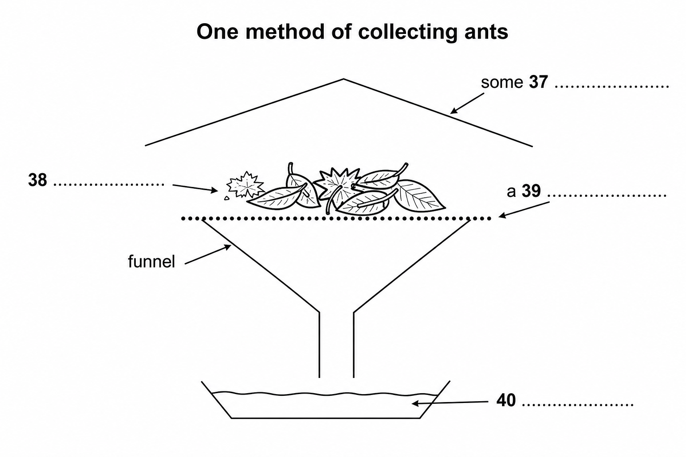

# 怎样采集蚂蚁标本｜Cambridge IELTS 08 Test 4 Passage 3 双语精读

## Collecting Ant Specimens

这篇方法说明文的主线不是简单罗列工具，而是先说明“研究目的决定采集方法”：分类学需要同一物种的大量个体，生态学需要尽可能广的物种范围，两者并不总能兼容。随后文章依次介绍手工采集、诱饵、地表枯落物取样和陷阱，并比较各自适用的场景。正文与题目来源页为 **96–99**，官方答案页为 **158**。

标题中的 `specimen`（C1，科研术语）指为了观察、分类或研究而采集的“标本”；复数 `specimens` 表明本文讨论的是成套采样，而不是随手观察一只蚂蚁。

**You should spend about 20 minutes on Questions 27-40, which are based on Reading Passage 3 below.** 你应该用大约20分钟完成第27至40题，这些题目基于下面的阅读文章3。

指令中的 `be based on`（B1）表示“以……为依据”，`passage`（B2）指较长文本中的一篇或一段文章；其余为基础词/基础表达。

## 01 逐句精读

### 研究目的决定方法

### 1

**Collecting ants can be as simple as picking up stray ones and placing them in a glass jar, or as complicated as completing an exhaustive survey of all species present in an area and estimating their relative abundances.**

采集蚂蚁可以简单到捡起零散的个体放进玻璃罐，也可以复杂到对某一区域内的全部物种进行彻底调查，并估算它们的相对丰度。

句子用 `as simple as ... or as complicated as ...` 拉开方法的两个极端；两个 `as` 结构后都接动名词短语，形成平衡。词汇逐次讲解：`stray`（C2）指离群或散落的；`glass jar`（B1）是玻璃罐，其中 `jar` 指带宽口的罐状容器；`complicated`（B1）指复杂的；`complete a survey`（B2）是“完成调查”；`exhaustive`（C1）是“详尽无遗的”；`survey`（B1）是系统调查；`species`（B2，生物学术语）是“物种”；`estimate`（B2）是依据有限信息估算；`relative`（B2）表示相对于其他对象；`abundance`（C1，生态学术语）指某物种的数量或丰度。`pick up` 为基础表达。

**A层深挖 1/3：[`exhaustive survey`](https://dictionary.cambridge.org/dictionary/english/exhaustive)（C1）**

本句中它指尽可能覆盖区域内全部蚂蚁物种的“全面调查”。`exhaustive` 与 `exhaust` 同源，字面上有“把可能性穷尽”的感觉，常搭配 `research / study / search / list`。它比普通的 `detailed survey` 更强：后者只是细，前者强调几乎不留遗漏；因此只适合确实追求全覆盖的正式研究，日常小调查不宜夸大使用。文章用它与 `picking up stray ones` 对照，把采集工作的复杂度从随手捡取推到系统普查。相近表达中，`comprehensive survey` 强调范围广，未必逐项穷尽；`thorough survey` 强调做得认真；`large-scale survey` 只强调规模大。可迁移：`The team conducted an exhaustive survey of accessibility barriers across the campus.` 团队对校园里的无障碍障碍进行了全面调查。`An exhaustive search of the records found no earlier complaint.` 对档案的彻底检索没有发现更早的投诉。

### 2

**The exact method used will depend on the final purpose of the collections.**

具体采用哪种方法，将取决于这些采集活动的最终目的。

主干是 `The exact method ... will depend on ...`；`used` 是过去分词，后置修饰 `method`。词汇逐次讲解：`exact`（B1）在这里是“具体、确切的”；`method`（B1）是有步骤的方法；`depend on`（B1）表示“取决于”；`purpose`（B1）是目的；`collection`（B1）在本文指采集行为或所采样本。

### 3

**For taxonomy, or classification, long series, from a single nest, which contain all castes (workers, including majors and minors, and, if present, queens and males) are desirable, to allow the determination of variation within species.**

对于分类学研究，也就是分类工作，理想的样本是来自同一个蚁巢、包含所有等级的长系列个体（工蚁，包括大型工蚁和小型工蚁；如果存在，还包括蚁后和雄蚁），这样才能确定同一物种内部的差异。

主干是 `long series ... are desirable`；`which contain ...` 修饰 `series`，末尾不定式说明目的。词汇逐次讲解：`taxonomy`（C2，生物学术语）是分类学；`classification`（C1）是分类；`series`（B2，科研语境）在这里指一系列样本；`single`（B1）强调同一巢穴；`nest`（B2，昆虫学术语）是蚁巢；`contain`（B1）表示包含；`caste`（C2，昆虫学术语）指群体中的等级；`major / minor`（B2，昆虫学术语）分别指大型与小型工蚁；`if present`（B1）表示“如果存在”；`male`（B1，生物学语境）指雄性个体；`desirable`（C1）是“理想、值得采用的”；`allow`（B1）表示使某事成为可能；`determination`（C1）是确定；`variation`（B2）是差异、变异；`within species`（B2，生物学表达）是同一物种内部。

### 4

**For ecological studies, the most important factor is collecting identifiable samples of as many of the different species present as possible.**

对于生态学研究，最重要的因素是采集可辨认的样本，而且要尽可能涵盖当地存在的不同物种。

`the most important factor is ...` 点明生态采集的首要标准；`as many ... as possible` 强调范围。词汇逐次讲解：`ecological`（C1，生态学术语）是生态学的；`study`（B2，科研语境）指为获得新知识而进行的研究；`factor`（B1）是因素；`identifiable`（C1）是可识别的；`sample`（B2，科研术语）是样本；`species`（B2，生物学术语）再次指物种；`present`（B1）此处不是“现在的”，而是“存在于当地的”；`as many ... as possible`（B1）表示尽可能多。

### 5

**Unfortunately, these methods are not always compatible.**

遗憾的是，这些方法并不总能彼此兼容。

短句承担转折：前两句分别给出分类学和生态学的理想目标，这里指出二者会冲突。`method`（B1）再次指采集方法；`compatible`（C1）指两种要求能够同时成立或配合使用。`unfortunately` 为基础表达。

### 6

**The taxonomist sometimes overlooks whole species in favour of those groups currently under study, while the ecologist often collects only a limited number of specimens of each species, thus reducing their value for taxonomic investigations.**

分类学家有时会为了当前正在研究的类群而忽略整个物种，而生态学家往往只采集每个物种的少量标本，从而降低这些样本对于分类学调查的价值。

`while` 对照两类研究者的取样偏差；`thus reducing ...` 是结果状语。词汇逐次讲解：`taxonomist`（C2，分类学术语）是分类学家；`overlook`（B2）是忽视、漏掉；第一次 `species`（B2，生物学术语）指被漏掉的整个物种；`in favour of`（B2）表示选择、偏重后者；`currently`（B2）是当前；`under study`（B2）是正在研究中；`ecologist`（C1，生态学术语）是生态学家；`limited`（B1）是有限的；`specimen`（C1，科研术语）是标本；第二次 `species`（B2，生物学术语）指生态学家逐种采集时的每个物种；`thus`（B2）正式表示“因此”；`reduce`（B1）是降低；`value`（B1）此处是研究价值；`taxonomic`（C2，分类学术语）是分类学的；`investigation`（B2，科研语境）是系统调查。

**A层深挖 2/3：[`in favour of`](https://dictionary.cambridge.org/dictionary/english/in-favour-of)（B2）**

本句不是说分类学家“喜欢”某些蚂蚁，而是说他们把采集注意力和资源优先给当前研究的类群，以至于漏掉其他物种。这个短语的核心画面是天平偏向一边，常见于 `choose A in favour of B`、`reject A in favour of B`，也可表示“支持某提议”。它比 `like` 正式，也比 `prefer` 更容易带出“舍弃一项、选择另一项”的取舍；当两者没有竞争关系时不宜使用。文章借它解释分类学采样为何不适合生态普查。相近表达中，`prefer` 只表达偏好；`prioritise` 强调资源排序；`at the expense of` 更进一步强调一方受损。可迁移：`The school reduced printed notices in favour of a single digital system.` 学校减少纸质通知，转而采用统一数字系统。`The committee voted in favour of extending library hours.` 委员会投票支持延长图书馆开放时间。

### 手工采集

### 7

**To collect as wide a range of species as possible, several methods must be used.**

为了采集尽可能广泛的物种，必须采用多种方法。

句首不定式表目的。词汇逐次讲解：`a wide range of`（B1）表示种类广泛；`species`（B2，生物学术语）再次指物种；`several` 为基础词（A2），表示若干；`method`（B1）再次出现。

### 8

**These include hand collecting, using baits to attract the ants, ground litter sampling, and the use of pitfall traps.**

这些方法包括手工采集、用诱饵吸引蚂蚁、地表枯落物取样，以及使用陷阱。

四个并列成分建立后文结构。词汇逐次讲解：`include` 为基础词（A2），表示包括；`bait`（B2）是诱饵；`attract`（B1）是吸引；`ground litter sampling`（C1，生态调查术语）是地表枯落物取样；`pitfall trap`（C1，昆虫采集术语）是埋入地面的掉落式陷阱。`hand collecting` 为基础表达。

### 9

**Hand collecting consists of searching for ants everywhere they are likely to occur.**

手工采集就是在蚂蚁可能出现的每个地方寻找它们。

`consist of` 后接动名词。词汇逐次讲解：`consist of`（B1）表示“由……构成、包括”；`search for`（B1）是寻找；`be likely to`（B1）表示很可能；`occur`（B2）此处是“出现、存在”。

### 10

**This includes on the ground, under rocks, logs or other objects on the ground, in rotten wood on the ground or on trees, in vegetation, on tree trunks and under bark.**

寻找地点包括地面上、岩石和原木或其他地面物体下、地面或树上的腐木中、植被里、树干上以及树皮下。

这是地点清单，省略了重复的 `searching`。词汇逐次讲解：`include` 再次出现，仍为基础词（A2），表示包括；`log`（C1，林业/自然环境语境）是倒下或截下的粗树干；`rotten`（B2）是腐烂的；`vegetation`（C1，植物学/生态学术语）指一个地区的植物总称；`trunk`（B2，植物学语境）是树干；`bark`（B2，植物学语境）是树皮。其余方位词为基础词/基础表达。

### 11

**When possible, collections should be made from nests or foraging columns and at least 20 to 25 individuals collected.**

如果条件允许，应从蚁巢或觅食队列中取样，并至少采集20至25个个体。

第二个 `collected` 前省略了 `should be`，使并列更紧凑。词汇逐次讲解：`collection`（B1）再次指采样；`nest`（B2，昆虫学术语）是蚁巢；`foraging column`（C2，昆虫学术语）是成列活动的觅食蚁群；`at least` 为基础表达（A2），表示至少；`individual`（B2，生物学语境）是单个生物个体。

### 12

**This will ensure that all individuals are of the same species, and so increase their value for detailed studies.**

这样可以确保所有个体属于同一物种，从而提高它们对于细致研究的价值。

`ensure that` 引出得到保证的结果，`and so` 再引出研究价值。词汇逐次讲解：`ensure`（B2）是确保；`individual`（B2，生物学语境）再次指个体；`species`（B2，生物学术语）再次出现；`increase` 为基础词（A2），表示提高；`value`（B1）再次指用途或价值；`detailed`（B2）是细致的；`study`（B2，科研语境）再次作名词表示研究。

### 13

**Since some species are largely nocturnal, collecting should not be confined to daytime.**

由于有些物种主要在夜间活动，采集工作不应局限在白天。

`Since` 引出原因，`be confined to` 是被动限制结构。词汇逐次讲解：`species`（B2，生物学术语）再次出现；`largely`（B2）表示主要地、大体上；`nocturnal`（C2，动物学术语）是夜行性的；`be confined to`（C1）表示局限于；`daytime`（B1）是白天。

### 14

**Specimens are collected using an aspirator (often called a pooter), forceps, a fine, moistened paint brush, or fingers, if the ants are known not to sting.**

标本可用吸虫器（常称 pooter）、镊子、蘸湿的细画笔或手指采集；最后一种办法只适用于已知不会蜇人的蚂蚁。

`using ...` 列出工具，末尾 `if` 限制徒手采集的条件。词汇逐次讲解：`specimen`（C1，科研术语）再次指标本；`aspirator / pooter`（C2，昆虫采集器材术语）是吸取小昆虫的装置；`forceps`（C2，器械术语）是镊子；`fine`（B2）此处是纤细的；`moistened`（C1）是稍微弄湿的；`be known to`（B2）表示已知会做某事；`sting`（B2，动物行为语境）是蜇、叮刺。

### 15

**Individual insects are placed in plastic or glass tubes (1.5-3.0 ml capacity for small ants, 5-8 ml for larger ants) containing 75% to 95% ethanol.**

单只昆虫被放进塑料管或玻璃管中；小蚂蚁用容量1.5至3.0毫升的管，大蚂蚁用5至8毫升的管，管内含75%至95%的乙醇。

`containing ...` 后置修饰 `tubes`；括号给出容量规格。词汇逐次讲解：`individual`（B1）此处作形容词，表示单个的；`insect` 为基础词（A2）；`tube`（B2，实验器材语境）是管状容器；`capacity`（B2，测量语境）是容积；`contain`（B1）再次表示装有；`ethanol`（C2，化学术语）是乙醇。

### 16

**Plastic tubes with secure tops are better than glass because they are lighter, and do not break as easily if mishandled.**

带牢固盖子的塑料管比玻璃管更好，因为它们更轻，而且即使操作不当也不那么容易破碎。

`because` 解释材料选择；`if mishandled` 是省略主语和被动助动词的条件状语。词汇逐次讲解：`secure`（B2）此处是牢固、不易脱落的；`mishandle`（C1）是操作或处置不当。`better than`、`break easily` 为基础表达。

### 诱饵采集

### 17

**Baits can be used to attract and concentrate foragers.**

诱饵可以用来吸引并集中觅食蚂蚁。

两个不定式共享 `to`，并列说明诱饵的作用。词汇逐次讲解：`bait`（B2）再次出现；`attract`（B1）再次表示吸引；`concentrate`（B2）此处是把分散个体集中起来；`forager`（C1，动物行为术语）是觅食个体。

### 18

**This often increases the number of individuals collected and attracts species that are otherwise elusive.**

这样往往既能增加采到的个体数量，也能吸引那些不用此法便很难发现的物种。

`that are otherwise elusive` 修饰 `species`；`otherwise` 表示“若非如此”。词汇逐次讲解：`increase` 再次出现，仍为基础词（A2）；`individual`（B2，生物学语境）再次作名词指个体；`attract`（B1）再次出现；`species`（B2，生物学术语）再次出现；`otherwise`（B2）是“在其他情况下”；`elusive`（C2）指难找、难以捕捉的。

**A层深挖 3/3：[`otherwise elusive`](https://dictionary.cambridge.org/dictionary/english/elusive)（C2）**

这里不是说物种神秘，而是说如果不用诱饵，它们通常难以被发现或捕获。`elusive` 的字面画面是目标总从人手中滑走，常搭配 `species / answer / solution / goal`；`otherwise` 精确补上条件，意为“若非采用这一办法”。它比普通的 `hard to find` 更凝练正式，也可描述抽象目标，但不等于数量稀少：常见物种也可能因为隐蔽而 elusive。文章用它给诱饵法建立独特优势，直接对应第33题。相近表达中，`rare` 强调数量少；`hidden` 强调被遮蔽；`difficult to detect` 是中性技术说法。可迁移：`Flexible interview times helped the researchers reach otherwise elusive participants.` 灵活的访谈时间帮助研究者接触到原本难以找到的参与者。`A stable routine can make the otherwise elusive goal of deep focus more attainable.` 稳定的日程能让原本难以实现的深度专注变得更可达到。

### 19

**Sugars and meats or oils will attract different species and a range should be utilised.**

糖类与肉类或油类会吸引不同物种，因此应使用多种诱饵。

`a range` 根据上下文指“一系列不同诱饵”，而非物种分布范围。词汇逐次讲解：`attract`（B1）再次出现；`species`（B2，生物学术语）再次出现；`a range`（B1）是多种选择；`utilise`（C1）是正式的“使用”。

### 20

**These baits can be placed either on the ground or on the trunks of trees or large shrubs.**

这些诱饵既可以放在地面上，也可以放在树干或大型灌木上。

`either ... or ...` 给出两类放置位置。词汇逐次讲解：`bait`（B2）再次出现；`trunk`（B2）再次表示树干；`shrub`（C1）是灌木。其余为基础表达。

### 21

**When placed on the ground, baits should be situated on small paper cards or other flat, light-coloured surfaces, or in test-tubes or vials.**

诱饵放在地面时，应置于小纸卡、其他平坦浅色的表面，或试管、小瓶中。

`When placed ...` 是省略式被动时间状语。词汇逐次讲解：`bait`（B2）再次出现；`be situated`（B2）是位于、放置于；`surface`（B2）是表面；`test-tube`（B2，实验器材）是试管；`vial`（C2，实验器材）是小药瓶或样品瓶。`flat`、`light-coloured` 为基础词/基础表达。

### 22

**This makes it easier to spot ants and to capture them before they can escape into the surrounding leaf litter.**

这样更容易发现并捕捉蚂蚁，免得它们逃进周围的枯落物中。

`make it easier to ...` 中 `it` 是形式宾语；`before` 带出必须及时捕获的原因。词汇逐次讲解：`spot`（B2）是发现、看见；`capture`（B2）是捕捉；`escape into`（B1）是逃入；`surrounding`（B2）是周围的；`leaf litter`（C1，生态学术语）是地表枯枝落叶层。

### 地表枯落物取样

### 23

**Many ants are small and forage primarily in the layer of leaves and other debris on the ground.**

许多蚂蚁体型很小，主要在地面的树叶层和其他碎屑中觅食。

`forage` 是谓语，`primarily` 限定主要活动区域。词汇逐次讲解：`forage`（C1，动物行为术语）是觅食；`primarily`（B2）是主要地；`layer`（B1）是一层；`debris`（C1）是散落碎屑。

### 24

**Collecting these species by hand can be difficult.**

用手采集这些物种可能很困难。

动名词短语作主语。词汇逐次讲解：`species`（B2，生物学术语）再次出现；`by hand`（B1）表示手工完成。`difficult` 为基础词。

### 25

**One of the most successful ways to collect them is to gather the leaf litter in which they are foraging and extract the ants from it.**

采集它们最有效的方法之一，是收集它们正在其中觅食的枯落物，再从中分离出蚂蚁。

主干是 `One of ... ways ... is to ...`；`in which` 引导定语从句。词汇逐次讲解：`successful`（B1）此处是“有效的”；`gather`（B1）是收集；`leaf litter`（C1，生态学术语）再次出现；`forage`（C1，动物行为术语）再次表示觅食；`extract ... from ...`（C1）是从混合物中分离、提取。

### 26

**This is most commonly done by placing leaf litter on a screen over a large funnel, often under some heat.**

最常见的做法是把枯落物放在大漏斗上方的筛网上，并通常从上方加热。

`by placing ...` 说明操作方式，三个空间成分建立图示层级。词汇逐次讲解：`commonly`（B1）是通常；`leaf litter`（C1，生态学术语）再次出现；`screen`（B2，采集装置语境）此处是筛网；`funnel`（C1，采集装置术语）是漏斗；`heat`（B1）是热、热量，`under some heat` 在这里表示处于热源下方。

### 27

**As the leaf litter dries from above, ants (and other animals) move downward and eventually fall out the bottom and are collected in alcohol placed below the funnel.**

随着枯落物从上方逐渐变干，蚂蚁和其他小动物会向下移动，最终从底部掉出，落入漏斗下方盛放的酒精中被收集。

`As` 表示伴随过程；`move ... fall ... are collected` 连续写出动作链。词汇逐次讲解：`leaf litter`（C1，生态学术语）再次出现；`downward`（B2）是向下；`eventually`（B1）是最终；`fall out`（B1）是掉出；`alcohol`（B1，标本保存语境）是酒精；`placed below`（B1）是置于下方；`funnel`（C1，采集装置术语）再次出现。

### 28

**This method works especially well in rain forests and marshy areas.**

这种方法在雨林和沼泽地区尤其有效。

`works well` 指方法有效，而非机器运转。词汇逐次讲解：`method`（B1）再次出现；`rain forest`（B1，生态学语境）是雨林；`marshy`（C1，生态学语境）是沼泽般湿软的；`area` 为基础词（A1），表示地区；`especially well` 为基础表达。

### 29

**A method of improving the catch when using a funnel is to sift the leaf litter through a coarse screen before placing it above the funnel.**

使用漏斗时，提高捕获量的一种办法，是先让枯落物通过粗筛，再把筛后的材料放到漏斗上方。

主干是 `A method ... is to sift ...`；两个省略式时间状语共享操作主体。词汇逐次讲解：`method`（B1）再次出现；`improve`（B1）是提高；`catch`（B2）在这里是捕获量；第一次 `funnel`（C1，采集装置术语）再次出现；`sift ... through ...`（C2，筛分操作术语）是用筛子筛；`leaf litter`（C1，生态学术语）再次出现；`coarse`（C1）是粗孔的；`screen`（B2，采集装置语境）再次指筛网；第二次 `funnel`（C1，采集装置术语）按重复出现再次讲解。

### 30

**This will concentrate the litter and remove larger leaves and twigs.**

这样会使枯落物更加集中，并去除较大的叶片和细枝。

两个并列动词说明筛分效果。词汇逐次讲解：`concentrate`（B2）再次表示使材料集中；`litter`（C1，生态学语境）是枯落物；`remove`（B1）是移除；`twig`（C1）是细枝。

### 31

**It will also allow more litter to be sampled when using a limited number of funnels.**

这也能让研究者在漏斗数量有限时对更多枯落物进行取样。

`allow ... to be sampled` 是使役意义加被动不定式。词汇逐次讲解：`allow`（B1）再次表示使之可能；`litter`（C1，生态学术语）再次指枯落物；`sample`（B2，科研语境）此处作动词“取样”；`limited`（B1）再次表示有限；`funnel`（C1，采集装置术语）再次出现。

### 陷阱采集

### 32

**The pitfall trap is another commonly used tool for collecting ants.**

掉落式陷阱是另一种常用的蚂蚁采集工具。

这是新方法的主题句。词汇逐次讲解：`pitfall trap`（C1，昆虫采集术语）再次出现；`commonly`（B1）再次表示通常；`tool` 为基础词（A2），此处指工具。

### 33

**A pitfall trap can be any small container placed in the ground with the top level with the surrounding surface and filled with a preservative.**

掉落式陷阱可以是任何埋入地下的小容器：顶部与周围地面齐平，内部装有防腐液。

`placed ...` 与 `filled ...` 都后置修饰 `container`；`with` 结构补充安装状态。词汇逐次讲解：`pitfall trap`（C1，昆虫采集术语）再次出现；`container`（B1）是容器；`level with`（B2）表示与……齐平；`surrounding`（B2）再次表示周围的；`surface`（B2）再次出现；`be filled with`（B1）是装满；`preservative`（C1，化学/标本处理术语）是防腐剂或防腐液。

### 34

**Ants are collected when they fall into the trap while foraging.**

蚂蚁在觅食时掉进陷阱，从而被收集起来。

`when` 交代触发采集的动作，`while foraging` 是省略式时间状语。词汇逐次讲解：`fall into`（B1）是掉入；`trap`（B1）是陷阱；`forage`（C1，动物行为术语）再次表示觅食。

### 35

**The diameter of the traps can vary from about 18 mm to 10 cm and the number used can vary from a few to several hundred.**

陷阱的直径可以从约18毫米到10厘米不等，使用数量则可以从几个到数百个不等。

两个 `can vary from ... to ...` 平行呈现尺寸和数量范围。词汇逐次讲解：`diameter`（C1，测量术语）是直径；`trap`（B1）再次出现；第一次 `vary from ... to ...`（B2）表示范围从……到……；`several` 再次出现，仍为基础词（A2），表示若干；第二次 `vary from ... to ...`（B2）为重复出现，仍表示数量范围。

### 36

**The size of the traps used is influenced largely by personal preference (although larger sizes are generally better), while the number will be determined by the study being undertaken.**

所用陷阱的尺寸主要受个人偏好影响（尽管尺寸通常越大越好），而数量则由正在开展的研究决定。

`while` 对照“尺寸”和“数量”的决定因素；`used` 与 `being undertaken` 都是后置修饰。词汇逐次讲解：`trap`（B1）再次出现；`be influenced by`（B2）是受……影响；`largely`（B2）再次表示主要地；`personal preference`（B2）是个人偏好；`generally`（B1）是通常；`determine`（B1）是决定；`study`（B2，科研语境）再次指研究；`undertake`（B2）是着手、开展正式工作。

### 37

**The preservative used is usually ethylene glycol or propylene glycol, as alcohol will evaporate quickly and the traps will dry out.**

所用防腐液通常是乙二醇或丙二醇，因为酒精会迅速蒸发，陷阱也会随之干掉。

`as` 引出不用酒精的原因。词汇逐次讲解：`preservative`（C1，化学/标本处理术语）再次出现；`ethylene glycol`（C2，化学术语）是乙二醇；`propylene glycol`（C2，化学术语）是丙二醇；`alcohol`（B1，化学/标本保存语境）再次出现；`evaporate`（B2）是蒸发；`trap`（B1）再次出现；`dry out`（B2）是完全变干。

### 38

**One advantage of pitfall traps is that they can be used to collect over a period of time with minimal maintenance and intervention,**

掉落式陷阱的一个优点是，可以用它们持续采集一段时间，而只需最低限度的维护和干预，

本句在印刷原文中以逗号收尾，逻辑上先陈述优点；下一句转入缺点。词汇逐次讲解：`advantage`（B1）是优点；`pitfall trap`（C1，昆虫采集术语）再次出现；`over a period of time`（B1）表示持续一段时间；`minimal`（C1）是最低限度的；`maintenance`（B2）是维护；`intervention`（C1）是人为介入、干预。

### 39

**One disadvantage is that some species are not collected as they either avoid the traps or do not commonly encounter them while foraging.**

一个缺点是，有些物种无法被采到，因为它们要么会避开陷阱，要么在觅食时通常不会碰到陷阱。

`either ... or ...` 并列两种漏采原因；这里的 `as` 表原因。词汇逐次讲解：`disadvantage`（B1）是缺点；`species`（B2，生物学术语）再次出现；`avoid`（B1）是避开；`trap`（B1）再次出现；`commonly`（B1）再次表示通常；`encounter`（B2）是偶然遇到；`forage`（C1，动物行为术语）再次表示觅食。

## 02 Questions 27–40 完整精讲

### Questions 27–30

**Do the following statements agree with the information given in Reading Passage 3?** 下面的陈述是否与阅读文章3提供的信息一致？  
**In boxes 27-30 on your answer sheet, write** 在答题纸第27至30题的方框中填写：  
**TRUE if the statement agrees with the information** 若陈述与信息一致，填 TRUE；  
**FALSE if the statement contradicts the information** 若陈述与信息矛盾，填 FALSE；  
**NOT GIVEN if there is no information on this** 若原文没有相关信息，填 NOT GIVEN。

三个判断选项在本组只定义一次。题型词汇：`following`（B1）下列的；`statement`（B2）陈述；`agree with`（B1）一致；`contradict`（C1）与……矛盾。`information`、`answer sheet` 为基础词/基础表达。

#### 27. Taxonomic research involves comparing members of one group of ants.

译文：分类学研究需要比较同一群蚂蚁的成员。  
词汇：`taxonomic`（C2，分类学术语）分类学的；`research`（B1）研究；`involve`（B1）涉及；`compare`（B1）比较。`member` 为基础词（A2）。  
**官方答案：TRUE**  
**连续证据：** “For taxonomy, or classification, long series, from a single nest, which contain all castes (workers, including majors and minors, and, if present, queens and males) are desirable, to allow the determination of variation within species.”  
同一巢穴的完整系列用于确定物种内差异，确实涉及同一群体成员间的比较。干扰项 `FALSE` 不成立，因为原文支持而非否定这种比较；`NOT GIVEN` 不成立，因为单巢、全部等级和物种内差异均被明确写出。

#### 28. New species of ant are frequently identified by taxonomists.

译文：分类学家经常识别出新的蚂蚁物种。  
词汇：`species`（B2，生物学术语）物种；`frequently`（B2）频繁地；`identify`（B2）识别；`taxonomist`（C2，分类学术语）分类学家。  
**官方答案：NOT GIVEN**  
**连续证据：** “The taxonomist sometimes overlooks whole species in favour of those groups currently under study, while the ecologist often collects only a limited number of specimens of each species, thus reducing their value for taxonomic investigations.”  
原文提到分类学家与研究中的物种，却没有说明发现新物种的频率。干扰项 `TRUE` 擅自增加了“经常发现”；`FALSE` 同样无依据，因为原文也没说新物种很少或从不被发现。

#### 29. Range is the key criterion for ecological collections.

译文：范围是生态学采集的关键标准。  
词汇：`range`（B1）范围；`key`（B1）关键的；`criterion`（C1）标准；`ecological`（C1，生态学术语）生态学的；`collection`（B1）采集。  
**官方答案：TRUE**  
**连续证据：** “For ecological studies, the most important factor is collecting identifiable samples of as many of the different species present as possible.”  
`as many ... species ... as possible` 就是物种覆盖范围，且被称为 `the most important factor`。干扰项 `FALSE` 与原文直接相反；`NOT GIVEN` 不成立，因为关键标准已明确说明。

#### 30. A single collection of ants can generally be used for both taxonomic and ecological purposes.

译文：一次蚂蚁采集通常可以同时用于分类学和生态学目的。  
词汇：`single`（B1）单一的；`collection`（B1）采集；`generally`（B1）通常；`taxonomic`（C2，分类学术语）分类学的；`ecological`（C1，生态学术语）生态学的；`purpose`（B1）目的。  
**官方答案：FALSE**  
**连续证据：** “Unfortunately, these methods are not always compatible. The taxonomist sometimes overlooks whole species in favour of those groups currently under study, while the ecologist often collects only a limited number of specimens of each species, thus reducing their value for taxonomic investigations.”  
两种目的的取样重点不同，原文明确说并非总能兼容。干扰项 `TRUE` 把“不总兼容”反写成“通常通用”；`NOT GIVEN` 不成立，因为兼容性已被直接评价。

### Questions 31–36

**Classify the following statements as referring to** 将下列陈述按其所指的采集方法分类：  
**A hand collecting** A 手工采集  
**B using bait** B 使用诱饵  
**C sampling ground litter** C 对地表枯落物取样  
**D using a pitfall trap** D 使用掉落式陷阱  
**Write the correct letter, A, B, C or D, in boxes 31-36 on your answer sheet.** 在答题纸第31至36题的方框中填写正确字母 A、B、C 或 D。

题型词汇：`classify`（B2）分类；`refer to`（B1）指的是；`statement`（B2）陈述；`bait`（B2）诱饵；`sample`（B2）取样；`ground litter`（C1，生态调查术语）地表枯落物；`pitfall trap`（C1，昆虫采集术语）掉落式陷阱。`correct letter`、`answer sheet` 为基础词/基础表达。

#### 31. It is preferable to take specimens from groups of ants.

译文：最好从成群的蚂蚁中采集标本。  
词汇：`preferable`（C1）更可取的；`specimen`（C1，科研术语）标本。  
**官方答案：A**  
**连续证据：** “Hand collecting consists of searching for ants everywhere they are likely to occur. This includes on the ground, under rocks, logs or other objects on the ground, in rotten wood on the ground or on trees, in vegetation, on tree trunks and under bark. When possible, collections should be made from nests or foraging columns and at least 20 to 25 individuals collected.”  
`nests or foraging columns` 对应成群采集。`B` 只说诱饵吸引觅食个体，没有规定优先从群体取样；`C` 收集枯落物后分离蚂蚁，没有规定巢或队列；`D` 捕获觅食时偶然掉入的个体。

#### 32. It is particularly effective for wet habitats.

译文：这种方法对于潮湿栖息地尤其有效。  
词汇：`particularly`（B1）尤其；`effective`（B1）有效的；`habitat`（B2，生态学术语）栖息地。  
**官方答案：C**  
**连续证据：** “This method works especially well in rain forests and marshy areas.”  
雨林和沼泽地区对应湿地环境。`A` 虽列出许多手工寻找地点，却没说潮湿地区尤其有效；`B` 讨论诱饵种类和位置，不讨论湿地；`D` 讨论尺寸、防腐液和维护，不讨论湿地优势。

#### 33. It is a good method for species which are hard to find.

译文：这是一种适合寻找难以发现物种的方法。  
词汇：`method`（B1）方法；`species`（B2，生物学术语）物种。`hard to find` 为基础表达。  
**官方答案：B**  
**连续证据：** “Baits can be used to attract and concentrate foragers. This often increases the number of individuals collected and attracts species that are otherwise elusive.”  
`otherwise elusive` 准确改写 `hard to find`。`A` 需要主动搜索，并未被说成特别适合隐蔽物种；`C` 针对在枯落物中觅食的蚂蚁，不等于所有难找物种；`D` 反而会漏掉避开陷阱或不接触陷阱的物种。

#### 34. Little time and effort is required.

译文：所需时间和精力很少。  
词汇：`effort`（B1）精力、努力；`be required`（B1）为……所需。  
**官方答案：D**  
**连续证据：** “One advantage of pitfall traps is that they can be used to collect over a period of time with minimal maintenance and intervention, One disadvantage is that some species are not collected as they either avoid the traps or do not commonly encounter them while foraging.”  
`minimal maintenance and intervention` 对应投入少。`A` 要主动搜索并逐只处理；`B` 要选择、放置诱饵并在蚂蚁逃走前捕捉；`C` 要收集、干燥、筛分枯落物并使用漏斗。

#### 35. Separate containers are used for individual specimens.

译文：单个标本分别使用独立容器。  
词汇：`separate`（B1）分开的；`container`（B1）容器；`individual`（B1）单个的；`specimen`（C1，科研术语）标本。  
**官方答案：A**  
**连续证据：** “Individual insects are placed in plastic or glass tubes (1.5-3.0 ml capacity for small ants, 5-8 ml for larger ants) containing 75% to 95% ethanol.”  
`Individual insects ... tubes` 对应单个标本分管保存。`B` 的卡片、试管或小瓶用于放诱饵，不明确是一只蚂蚁一个容器；`C` 让蚂蚁共同落入漏斗下方酒精；`D` 的一个陷阱可在一段时间里捕获多个个体。

#### 36. Non-alcoholic preservative should be used.

译文：应使用不含酒精的防腐液。  
词汇：`non-alcoholic`（B2）不含酒精的；`preservative`（C1，化学/标本处理术语）防腐剂、防腐液。  
**官方答案：D**  
**连续证据：** “The preservative used is usually ethylene glycol or propylene glycol, as alcohol will evaporate quickly and the traps will dry out.”  
陷阱使用乙二醇或丙二醇，而非易蒸发的酒精。`A` 明确把标本放入75%至95%的乙醇；`B` 没有规定任何防腐液；`C` 明确用漏斗下方的酒精收集蚂蚁。

### Questions 37–40

**Label the diagram below.** 标注下图。  
**Choose NO MORE THAN TWO WORDS from the passage for each answer.** 每个答案从文章中选择不超过两个单词。  
**Write your answers in boxes 37-40 on your answer sheet.** 将答案写在答题纸第37至40题的方框中。  
**One method of collecting ants** 蚂蚁采集方法之一。

题型词汇：`label`（C1）给图示加标签；`diagram`（B1）图示；`passage`（B2）文章段落；`no more than`（B1）不超过；`method`（B1）方法。其余为基础词/基础表达。

**funnel** 漏斗。这是图中已经给出的标签，不是答案空；`funnel`（C1，采集装置术语）指上宽下窄、把材料或液体导向下方容器的漏斗。

#### 37. some 37 ______

译文：一些 ______。  
**官方答案：heat**  
**连续证据：** “This is most commonly done by placing leaf litter on a screen over a large funnel, often under some heat.”  
图中顶部热源让枯落物从上方向下变干；`some heat` 与题面 `some` 直接衔接。`heat`（B1）是热、热量；本题没有印刷选项或正式干扰项。

#### 38. 38 ______

译文：第38空所指的上层材料。  
**官方答案：leaf litter**  
**连续证据：** “This is most commonly done by placing leaf litter on a screen over a large funnel, often under some heat.”  
箭头指向筛网上的叶片材料。`leaf litter`（C1，生态学术语）是地表枯枝落叶层；本题没有印刷选项或正式干扰项。

#### 39. a 39 ______

译文：一个 ______。  
**官方答案：screen**  
**连续证据：** “This is most commonly done by placing leaf litter on a screen over a large funnel, often under some heat.”  
箭头指向漏斗口的筛网，`a screen` 与题面冠词搭配。`screen`（B2，采集装置语境）此处是筛网；本题没有印刷选项或正式干扰项。

#### 40. 40 ______

译文：第40空所指的下方液体。  
**官方答案：alcohol**  
**连续证据：** “As the leaf litter dries from above, ants (and other animals) move downward and eventually fall out the bottom and are collected in alcohol placed below the funnel.”  
箭头指向漏斗下方容器里的液体。`alcohol`（B1，化学/标本保存语境）是酒精；本题没有印刷选项或正式干扰项。

## 03 答案汇总

| 题号 | 答案 | 题号 | 答案 |
|---:|---|---:|---|
| 27 | TRUE | 34 | D |
| 28 | NOT GIVEN | 35 | A |
| 29 | TRUE | 36 | D |
| 30 | FALSE | 37 | heat |
| 31 | A | 38 | leaf litter |
| 32 | C | 39 | screen |
| 33 | B | 40 | alcohol |
