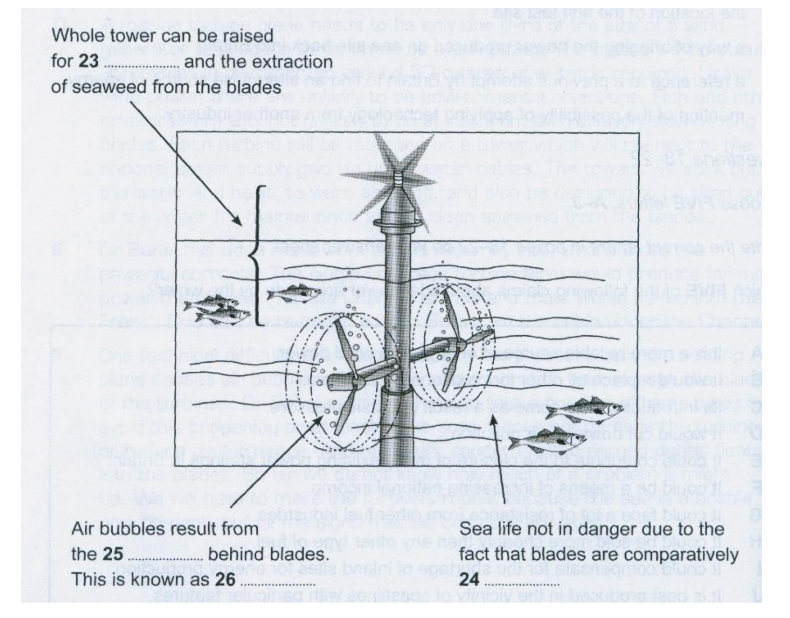

# Cambridge IELTS 9 Test 3 Reading Passage 2
## Tidal Power
*Undersea turbines which produce electricity from the tides are set to become an important source of renewable energy for Britain. It is still too early to predict the extent of the impact they may have, but all the signs are that they will play a significant role in the future*
**中文标题：潮汐能**
本文介绍英国潮汐涡轮发电的潜力、选址、结构和技术风险。

## 正文逐句精读

### 第1段（原文无段落标签）

### 1. Undersea turbines which produce electricity from the tides are set to become an important source of renewable energy for Britain.

**中文翻译：** 利用潮汐发电的海底涡轮机即将成为英国一种重要的可再生能源。

**句法与表达作用：** which 定语从句修饰 turbines；be set to 表即将发生。作用：概述新型能源前景。

**词汇与短语：**

- undersea turbine (C1，能源工程专业词)：海底涡轮机；本句中的语境义
- produce electricity (B1，能源专业词)：发电；本句中的语境义
- tide (B2，海洋专业词)：潮汐；本句中的语境义
- be set to (B2)：即将；本句中的语境义
- source (B1)：来源；本句中的语境义
- renewable energy (B2，能源专业词)：可再生能源；本句中的语境义

### 2. It is still too early to predict the extent of the impact they may have, but all the signs are that they will play a significant role in the future

**中文翻译：** 现在预测它们可能产生多大影响还为时过早，但所有迹象都表明，它们未来将发挥重要作用。

**句法与表达作用：** too early to predict 为固定评价结构；but 连接谨慎判断与积极迹象，that 从句说明 signs 内容。

**词汇与短语：**

- too early to (B1)：做……还太早；本句中的语境义
- predict (B1)：预测；本句中的语境义
- extent (B2)：程度；本句中的语境义
- impact (B1)：影响；本句中的语境义
- all the signs are that (B2)：所有迹象表明；本句中的语境义
- significant role (B2)：重要作用；本句中的语境义

### Paragraph A

### 3. Operating on the same principle as wind turbines, the power in sea turbines comes from tidal currents which turn blades similar to ships propellers, but, unlike wind, the tides are predictable and the power input is constant.

**中文翻译：** 海洋涡轮机的工作原理与风力涡轮机相同：潮流中的能量带动类似船舶螺旋桨的叶片转动；但与风不同，潮汐可以预测，动力输入也是恒定的。

**句法与表达作用：** 表面结构中 Operating on... 是悬垂分词，语义上应由 turbines 执行 operate；主干是 power comes from currents，which 从句说明潮流带动叶片；but 转折比较潮汐与风。保留原书异常，不擅改正文。

**词汇与短语：**

- operate (B1)：运行；本句中的语境义
- principle (B2)：原理；本句中的语境义
- wind turbine (B2，能源工程专业词)：风力涡轮机；本句中的语境义
- sea turbine (C1，能源工程专业词)：海洋涡轮机；本句中的语境义
- tidal current (C1，海洋能源专业词)：潮流；本句中的语境义
- blade (B2，工程专业词)：叶片；本句中的语境义
- similar to (B1)：与……相似；本句中的语境义
- ship propeller (C1，船舶专业词)：船舶螺旋桨；本句中的语境义
- unlike (B1)：与……不同；本句中的语境义
- predictable (B2)：可预测的；本句中的语境义
- power input (C1，能源工程专业词)：动力输入；本句中的语境义
- constant (B2)：恒定的；本句中的语境义

### 4. The technology raises the prospect of Britain becoming self-sufficient in renewable energy and drastically reducing its carbon dioxide emissions.

**中文翻译：** 这项技术使英国有望在可再生能源方面实现自给，并大幅减少二氧化碳排放。

**句法与表达作用：** 主干 technology raises the prospect；of 后接两个并列动名词，说明可能带来的结果。

**词汇与短语：**

- technology (B1)：技术；本句中的语境义
- raise the prospect of (C1)：带来……的可能；本句中的语境义
- self-sufficient (C1)：自给自足的；本句中的语境义
- renewable energy (B2，能源专业词)：可再生能源；本句中的语境义
- drastically (C1)：大幅度地；本句中的语境义
- reduce (B1)：减少；本句中的语境义
- carbon dioxide emissions (B2，环境专业词)：二氧化碳排放；本句中的语境义

### 5. If tide, wind and wave-power are all developed, Britain would be able to close gas, coal and nuclear plants and export renewable power to other parts of Europe.

**中文翻译：** 如果潮汐能、风能和波浪能都得到开发，英国就能关闭燃气、燃煤和核电站，并向欧洲其他地区出口可再生电力。

**句法与表达作用：** If 引导条件句；主句并列 close 与 export，列出能源开发的后果。

**词汇与短语：**

- wave-power (B2，能源专业词)：波浪能；本句中的语境义
- develop (B1)：开发；本句中的语境义
- gas plant (B1，能源专业词)：燃气电站；本句中的语境义
- coal plant (B1，能源专业词)：燃煤电站；本句中的语境义
- nuclear plant (B2，能源专业词)：核电站；本句中的语境义
- export (B1)：出口；本句中的语境义
- renewable power (B2，能源专业词)：可再生电力；本句中的语境义

### 6. Unlike wind power which Britain originally developed and then abandoned for 20 years allowing the Dutch to make it a major industry, undersea turbines could become a big export earner to island nations such as Japan and New Zealand.

**中文翻译：** 英国最初开发风能后又搁置了20年，使荷兰人得以把它发展成一个重要产业；与此不同，海底涡轮机可能成为英国向日本、新西兰等岛国出口创汇的重要产品。

**句法与表达作用：** Unlike 引出对比；which 定语从句说明 wind power，allowing 分词说明搁置造成的结果；could become 为主句。

**词汇与短语：**

- unlike (B1)：与……不同；本句中的语境义
- wind power (B1，能源专业词)：风能；本句中的语境义
- originally (B1)：最初；本句中的语境义
- develop (B1)：开发；本句中的语境义
- abandon (B2)：放弃；本句中的语境义
- allow (B1)：使能够；本句中的语境义
- major industry (B1)：重要产业；本句中的语境义
- undersea turbine (C1，能源工程专业词)：海底涡轮机；本句中的语境义
- export earner (C1，经济专业词)：出口创汇产品；本句中的语境义
- island nation (B2，地理专业词)：岛国；本句中的语境义

### Paragraph B

### 7. Tidal sites have already been identified that will produce one sixth or more of the UK’s power—and at prices competitive with modern gas turbines and undercutting those of the already ailing nuclear industry.

**中文翻译：** 已经确定的潮汐地点将能提供英国六分之一或更多的电力，而且价格可与现代燃气轮机竞争，并低于已经衰落的核工业。

**句法与表达作用：** that 定语从句修饰 sites；破折号后 and 连接价格的两种比较。

**词汇与短语：**

- tidal site (C1，能源专业词)：潮汐地点；本句中的语境义
- identify (B1)：确定；本句中的语境义
- produce (B1)：产生；本句中的语境义
- competitive with (B2)：可与……竞争；本句中的语境义
- modern gas turbine (B2，能源工程专业词)：现代燃气轮机；本句中的语境义
- undercut (C1)：以更低价格竞争；本句中的语境义
- ailing (C1)：衰落的；本句中的语境义
- nuclear industry (B2，能源专业词)：核工业；本句中的语境义

### 8. One site alone, the Pentland Firth, between Orkney and mainland Scotland, could produce 10% of the country’s electricity with banks of turbines under the sea, and another at Alderney in the Channel Islands three times the 1,2000 megawatts of Britain’s largest and newest nuclear plant, Sizewell B, in Suffolk.

**中文翻译：** 仅奥克尼群岛与苏格兰大陆之间的彭特兰海峡一处，就能凭借海底成排的涡轮机提供全国10%的电力；海峡群岛奥尔德尼岛的另一处地点，产量则是英国最大、最新的萨福克郡塞兹韦尔B核电站1,2000兆瓦的三倍。

**句法与表达作用：** 主句有两个并列地点及其潜在产量；between 等介词短语定位，with 短语说明实现方式。

**词汇与短语：**

- one site alone (B1)：仅一处地点；本句中的语境义
- mainland (B1)：大陆；本句中的语境义
- produce (B1)：产生；本句中的语境义
- electricity (B1)：电力；本句中的语境义
- bank of turbines (C1，能源工程专业词)：成排涡轮机；本句中的语境义
- under the sea (B1)：在海底；本句中的语境义
- three times (B1)：三倍；本句中的语境义
- megawatt (C1，能源专业词)：兆瓦；本句中的语境义
- nuclear plant (B2，能源专业词)：核电站；本句中的语境义

### 9. Other sites identified include the Bristol Channel and the west coast of Scotland, particularly the channel between Campbelttown and Northern Irealand.

**中文翻译：** 其他已确定的地点包括布里斯托尔湾和苏格兰西海岸，尤其是坎贝尔敦与北爱尔兰之间的海峡。

**句法与表达作用：** include 引出地点清单；particularly 缩小到关键海峡。

**词汇与短语：**

- site (B1)：地点；本句中的语境义
- identify (B1)：确定；本句中的语境义
- include (B1)：包括；本句中的语境义
- west coast (B1，地理专业词)：西海岸；本句中的语境义
- particularly (B1)：尤其；本句中的语境义
- channel (B2，地理专业词)：海峡；本句中的语境义

### Paragraph C

### 10. Work on designs for the new turbine blades and sites are well advanced at the university of Southampton’s sustainable energy research group.

**中文翻译：** 南安普敦大学的可持续能源研究小组在新涡轮叶片和选址设计方面已经进展顺利。

**句法与表达作用：** 主干 Work ... are well advanced；on 短语说明工作对象，at 短语说明机构。

**词汇与短语：**

- design (B1)：设计；本句中的语境义
- turbine blade (B2，工程专业词)：涡轮叶片；本句中的语境义
- site (B1)：选址；本句中的语境义
- well advanced (C1)：进展顺利；本句中的语境义
- sustainable energy (B2，能源专业词)：可持续能源；本句中的语境义
- research group (B1)：研究小组；本句中的语境义

### 11. The first station is expected to be installed off Lynmouth in Devon shortly to test the technology in a venture jointly funded by the department of Trade and Industry and the European Union.

**中文翻译：** 首个试验站预计很快会安装在德文郡林茅斯近海，以测试这项技术；该项目由贸易与工业部和欧盟共同资助。

**句法与表达作用：** 被动主干 station is expected to be installed；to test 表目的，过去分词 jointly funded 后置修饰 venture。

**词汇与短语：**

- station (B1，能源专业词)：试验站；本句中的语境义
- be expected to (B1)：预计会；本句中的语境义
- install (B1)：安装；本句中的语境义
- off (B2)：在近海；本句中的语境义
- shortly (B2)：很快；本句中的语境义
- test (B1)：测试；本句中的语境义
- technology (B1)：技术；本句中的语境义
- venture (C1，商业专业词)：项目；本句中的语境义
- jointly funded (B2)：共同资助的；本句中的语境义
- department of Trade and Industry (B2，机构名)：贸易与工业部；本句中的语境义
- European Union (B1，机构名)：欧盟；本句中的语境义

### 12. AbuBakn Bahaj, in charge of the Southampton research, said: ‘The prospects for energy from tidal currents are far better than from wind because the flows of water are predictable and constant.

**中文翻译：** 负责南安普敦研究的 AbuBakn Bahaj 说：“潮流发电的前景远好于风力发电，因为水流可预测而且恒定。

**句法与表达作用：** 引语主干 prospects are better；because 从句给出水流可预测、恒定的原因。

**词汇与短语：**

- in charge of (B1)：负责；本句中的语境义
- research (B1)：研究；本句中的语境义
- prospect (B2)：前景；本句中的语境义
- tidal current (C1，海洋能源专业词)：潮流；本句中的语境义
- far better than (B1)：远好于；本句中的语境义
- flow of water (B1)：水流；本句中的语境义
- predictable (B2)：可预测的；本句中的语境义
- constant (B2)：恒定的；本句中的语境义

### 13. The technology for dealing with the hostile saline environment under the sea has been developed in the North Sea oil industry and much is already known about turbine blade design, because of wind power and ship propellers.

**中文翻译：** 应对海底恶劣盐水环境的技术已经由北海石油工业开发出来；由于风力发电和船舶螺旋桨的经验，人们对涡轮叶片设计也已了解很多。

**句法与表达作用：** and 连接“技术已开发”与“人们已掌握很多知识”两个分句；because of 是介词短语，说明叶片设计知识来自风能与船舶螺旋桨经验。

**词汇与短语：**

- technology（第1次） (B1)：技术；本句中的语境义
- deal with (B1)：应对；本句中的语境义
- hostile (C1)：恶劣的；本句中的语境义
- saline (C1，海洋工程专业词)：含盐的；本句中的语境义
- environment (B1)：环境；本句中的语境义
- develop (B1)：开发；本句中的语境义
- oil industry (B1，能源专业词)：石油工业；本句中的语境义
- turbine blade design (C1，工程专业词)：涡轮叶片设计；本句中的语境义
- wind power (B1，能源专业词)：风能；本句中的语境义
- ship propeller (C1，船舶专业词)：船舶螺旋桨；本句中的语境义

### 14. There are a few technical difficulties, but I believe in the next five to ten years we will be installing commercial marine turbine farm.

**中文翻译：** 还有少数技术难题，但我相信未来五到十年内我们将安装商业海洋涡轮机组。

**句法与表达作用：** There are 引出困难；but 转折后宾语从句表达预测。

**词汇与短语：**

- technical difficulty (B2)：技术难题；本句中的语境义
- commercial (B2)：商业的；本句中的语境义
- marine turbine farm (C1，海洋能源专业词)：海洋涡轮机组；本句中的语境义
- install (B1)：安装；本句中的语境义

### 15. Southampton has been rewarded £215,000 over three years to develop the turbines and is working with Marine Current Turbines, a subsidiary of IT power, on the Lynmouth project.

**中文翻译：** 南安普敦已获得为期三年的21.5万英镑奖励资金用于开发涡轮机，并正与 IT power 的子公司 Marine Current Turbines 合作开展林茅斯项目。

**句法与表达作用：** has been rewarded 与 is working 并列；to develop 表资金用途，a subsidiary 同位说明合作方。

**词汇与短语：**

- reward (B1)：给予资金奖励；本句中的语境义
- develop (B1)：开发；本句中的语境义
- turbine (B2，工程专业词)：涡轮机；本句中的语境义
- work with (B1)：与……合作；本句中的语境义
- subsidiary (C1，商业专业词)：子公司；本句中的语境义
- project (B1)：项目；本句中的语境义

### 16. EU research has now identified 106 potential sites for tidal power, 80% round the coasts of Britain.

**中文翻译：** 欧盟研究现在已确定106个潜在潮汐发电地点，其中80%位于英国沿岸。

**句法与表达作用：** 现在完成时 has identified 强调研究结果；80% 为省略关系结构，补充地点分布。

**词汇与短语：**

- EU research (B1)：欧盟研究；本句中的语境义
- identify (B1)：确定；本句中的语境义
- potential site (B2)：潜在地点；本句中的语境义
- tidal power (B2，能源专业词)：潮汐能；本句中的语境义
- coast (B1，地理专业词)：海岸；本句中的语境义

### 17. The best sites are between islands or around heavily indented coasts where there are strong tidal currents.

**中文翻译：** 最佳地点处于岛屿之间，或位于海岸线凹入很深、潮流强劲的地方。

**句法与表达作用：** 主干 sites are；between / around 并列说明地形，where 定语从句解释为何合适。

**词汇与短语：**

- site (B1)：地点；本句中的语境义
- island (B1)：岛屿；本句中的语境义
- heavily (B1)：很大程度地；本句中的语境义
- indented coast (C1，地理专业词)：凹入的海岸；本句中的语境义
- strong tidal current (C1，海洋能源专业词)：强劲潮流；本句中的语境义

### Paragraph D

### 18. A marine turbine blade needs to be only one third of the size of a wind generator to produce three times as much power.

**中文翻译：** 海洋涡轮叶片只需达到风力发电机大小的三分之一，就能产生其三倍的电力。

**句法与表达作用：** needs to be...to produce... 表尺寸要求与产能结果；倍数结构 three times as much。

**词汇与短语：**

- marine turbine blade (C1，海洋工程专业词)：海洋涡轮叶片；本句中的语境义
- one third of (B1)：三分之一；本句中的语境义
- size (B1)：大小；本句中的语境义
- wind generator (B2，能源工程专业词)：风力发电机；本句中的语境义
- produce (B1)：产生；本句中的语境义
- three times as much (B1)：三倍之多；本句中的语境义
- power (B1，能源专业词)：电力；本句中的语境义

### 19. The blades will be about 20 meters in diameter, so around 30 meters of water is required.

**中文翻译：** 叶片直径约为20米，因此需要约30米深的水。

**句法与表达作用：** so 连接叶片尺寸与水深要求。

**词汇与短语：**

- blade (B2，工程专业词)：叶片；本句中的语境义
- diameter (C1，工程专业词)：直径；本句中的语境义
- be required (B1)：需要；本句中的语境义

### 20. Unlike wind power, there are unlikely to be environmental objections.

**中文翻译：** 与风力发电不同，潮汐发电不大可能招致环保方面的反对。

**句法与表达作用：** Unlike 引出对比；there are unlikely to be 表低可能性。

**词汇与短语：**

- unlike (B1)：与……不同；本句中的语境义
- wind power (B1，能源专业词)：风能；本句中的语境义
- unlikely (B1)：不大可能的；本句中的语境义
- environmental objection (B2)：环保反对意见；本句中的语境义

### 21. Fish and other creatures are thought unlikely to be at risk from the relatively slow-turning blades.

**中文翻译：** 人们认为，鱼类和其他生物不大可能受到转动相对缓慢的叶片威胁。

**句法与表达作用：** 被动认知结构 are thought unlikely to be；from 引出风险来源。

**词汇与短语：**

- creature (B1)：生物；本句中的语境义
- be thought unlikely to (B2)：被认为不大可能；本句中的语境义
- at risk (B1)：处于危险中；本句中的语境义
- relatively (B2)：相对地；本句中的语境义
- slow-turning (B2，工程专业词)：转动缓慢的；本句中的语境义
- blade (B2，工程专业词)：叶片；本句中的语境义

### 22. Each turbine will be mounted on a tower which will connect to the national power supply grid via underwater cables.

**中文翻译：** 每台涡轮机都将安装在塔架上，塔架通过水下电缆连接国家供电网。

**句法与表达作用：** 被动主干 turbine will be mounted；which 定语从句修饰 tower，via 说明连接方式。

**词汇与短语：**

- turbine (B2，工程专业词)：涡轮机；本句中的语境义
- mount (B2，工程专业词)：安装；本句中的语境义
- tower (B1，工程专业词)：塔架；本句中的语境义
- connect to (B1)：连接到；本句中的语境义
- national (B1)：国家的；本句中的语境义
- power supply grid (C1，电力专业词)：供电网；本句中的语境义
- via (B2)：通过；本句中的语境义
- underwater cable (B2，电力专业词)：水下电缆；本句中的语境义

### 23. The towers will stick out of the water and be lit, to warn shipping, and also be designed to be lifted out of the water for maintenance and to clean seaweed from the blades.

**中文翻译：** 塔架会露出水面并装灯，以警示船只；其设计也使塔架能够被提出水面进行维护，并清除叶片上的海藻。

**句法与表达作用：** 三个谓语并列：will stick out 是主动形式，be lit 与 be designed 是被动形式；to warn 和 to be lifted 表目的，for 引出维护用途。

**词汇与短语：**

- tower (B1，工程专业词)：塔架；本句中的语境义
- stick out (B2)：伸出；本句中的语境义
- be lit (B1)：被照亮；装灯；本句中的语境义
- warn shipping (C1，航运专业词)：警示船只；本句中的语境义
- be designed to (B1)：被设计用于；本句中的语境义
- be lifted (B1)：被提起；本句中的语境义
- maintenance (B2)：维护；本句中的语境义
- seaweed (B2)：海藻；本句中的语境义
- blade (B2，工程专业词)：叶片；本句中的语境义

### Paragraph E

### 24. Dr Bahaj has done most work on the Alderney site, where there are powerful currents.

**中文翻译：** Bahaj 博士对奥尔德尼地点开展的研究最多，那里水流强劲。

**句法与表达作用：** where 定语从句说明该地点特征；most 修饰省略的 work。

**词汇与短语：**

- site (B1)：地点；本句中的语境义
- powerful current (B2，海洋专业词)：强劲水流；本句中的语境义

### 25. The single undersea turbine farm would produce far more power than needed for the Channel Isalands and most would be fed into the French Grid and be re-imported into Britain via the cable under the Channel.

**中文翻译：** 这一个海底涡轮机组产生的电力将远超海峡群岛所需；大部分电力会输送进法国电网，再通过英吉利海峡下方的电缆重新输入英国。

**句法与表达作用：** would produce 为主句；and 连接电力先输出法国再重新输入英国的过程，两个被动语态突出电流方向。

**词汇与短语：**

- undersea turbine farm (C1，海洋能源专业词)：海底涡轮机组；本句中的语境义
- produce (B1)：产生；本句中的语境义
- far more ... than (B1)：远多于；本句中的语境义
- power (B1，能源专业词)：电力；本句中的语境义
- feed into (B2)：输送进；本句中的语境义
- grid (B2，电力专业词)：电网；本句中的语境义
- re-import (C1，贸易专业词)：重新进口；本句中的语境义
- via (B2)：通过；本句中的语境义
- cable (B1，电力专业词)：电缆；本句中的语境义

### Paragraph F

### 26. One technical difficulty is cavitation, where low pressure behind a turning blade causes air bubbles.

**中文翻译：** 一项技术难题是空化现象，即旋转叶片后方的低压会产生气泡。

**句法与表达作用：** where 引导非限制性说明，解释 cavitation 的成因链。

**词汇与短语：**

- technical difficulty (B2)：技术难题；本句中的语境义
- cavitation (C2，流体工程专业词)：空化现象；本句中的语境义
- low pressure (B1，物理专业词)：低压；本句中的语境义
- turning blade (B2，工程专业词)：旋转叶片；本句中的语境义
- cause (B1)：导致；本句中的语境义
- air bubble (B1)：气泡；本句中的语境义

### 27. These can cause vibration and damage the blades of the turbines.

**中文翻译：** 这些气泡会引起振动并损坏涡轮机叶片。

**句法与表达作用：** These 回指气泡；cause 后接 vibration 和 damage 两个并列宾语。

**词汇与短语：**

- cause (B1)：导致；本句中的语境义
- vibration (C1，工程专业词)：振动；本句中的语境义
- damage (B1)：损坏；本句中的语境义
- blade (B2，工程专业词)：叶片；本句中的语境义
- turbine (B2，工程专业词)：涡轮机；本句中的语境义

### 28. Dr Bahaj said: ‘We have to test a number of blade types to avoid this happening or at least make sure it does not damage the turbines or reduce performance.

**中文翻译：** Bahaj 博士说：“我们必须测试多种叶片类型，以避免这种情况，或至少确保它不会损坏涡轮机或降低性能。

**句法与表达作用：** have to test 表必要性；to avoid 表目的，or at least 引出退一步目标，两个并列谓语 damage/reduce。

**词汇与短语：**

- test (B1)：测试；本句中的语境义
- a number of (B1)：多种；本句中的语境义
- blade type (B2，工程专业词)：叶片类型；本句中的语境义
- avoid (B1)：避免；本句中的语境义
- at least (B1)：至少；本句中的语境义
- make sure (B1)：确保；本句中的语境义
- damage (B1)：损坏；本句中的语境义
- turbine (B2，工程专业词)：涡轮机；本句中的语境义
- reduce (B1)：降低；本句中的语境义
- performance (B2，工程专业词)：性能；本句中的语境义

### 29. Another slight concern is submerged debris floating into the blades.

**中文翻译：** 另一个小问题是漂浮在水下的碎屑漂入或冲向叶片。

**句法与表达作用：** 主干 concern is debris；submerged 与 floating 修饰 debris，floating into 表移动结果。

**词汇与短语：**

- slight concern (B2)：小问题；本句中的语境义
- submerged (C1)：浸没水下的；本句中的语境义
- debris (C1，海洋工程专业词)：碎屑；本句中的语境义
- float into (B1)：漂入；冲向；本句中的语境义
- blade (B2，工程专业词)：叶片；本句中的语境义

### 30. So far we do not know how much of a problem it might be.

**中文翻译：** 目前我们还不知道这可能会成为多大的问题。

**句法与表达作用：** So far 限定当前认知；how much 引导宾语从句。

**词汇与短语：**

- so far (B1)：到目前为止；本句中的语境义
- how much of a problem (B1)：会成为多大的问题；本句中的语境义

### 31. We will have to make the turbines robust because the sea is a hostile environment, but all the signs that we can do it are good.

**中文翻译：** 我们必须把涡轮机造得坚固耐用，因为海洋环境恶劣；但所有迹象都很好，表明我们能够做到这一点。

**句法与表达作用：** have to 表必要性；because 给原因；but 后 that 从句修饰 signs，说明可行性判断。

**词汇与短语：**

- turbine (B2，工程专业词)：涡轮机；本句中的语境义
- robust (C1)：坚固耐用的；本句中的语境义
- hostile environment (C1)：恶劣环境；本句中的语境义
- all the signs ... are good (B2)：所有迹象都很好；本句中的语境义

## 核心表达深挖

### A层深挖：句 4 — [self-sufficient](https://dictionary.cambridge.org/dictionary/english/self-sufficient)

**含义：** 自给自足的，不依赖外部供应。

**语法：** 形容词；become/be self-sufficient in + 领域。

**语境作用：** 说明潮汐技术可能使英国在可再生能源供应上独立。

**近义辨析：** independent 范围较广；self-sufficient 特指能满足自身需要。

**双语例句：**

- The island aims to be self-sufficient in energy.｜该岛力求实现能源自给。
- A self-sufficient grid needs reliable storage.｜自给自足的电网需要可靠储能。

### A层深挖：句 7 — [undercut](https://dictionary.cambridge.org/dictionary/english/undercut)

**含义：** 以更低价格竞争；削弱。

**语法：** 及物动词，undercut + competitor/price/position。

**语境作用：** 这里比较潮汐发电价格与核电成本，突出商业竞争力。

**近义辨析：** be cheaper than 只是价格比较；undercut 暗含竞争中压低对方价格。

**双语例句：**

- Tidal power could undercut nuclear energy.｜潮汐能的价格可能低于核能。
- The new supplier undercut its rivals.｜新供应商以低价压过竞争对手。

### A层深挖：句 31 — [robust](https://dictionary.cambridge.org/dictionary/english/robust)

**含义：** 坚固耐用的；能承受恶劣条件的。

**语法：** 形容设备时表示强健可靠，make + 宾语 + robust。

**语境作用：** 海洋环境恶劣，因此设备强度成为工程必要条件。

**近义辨析：** strong 强调力量；durable 强调耐久；robust 兼有坚固和可靠运行。

**双语例句：**

- The turbines must be robust enough for rough seas.｜涡轮机必须足够坚固以应对汹涌海况。
- Engineers designed a robust control system.｜工程师设计了一套稳健的控制系统。

## 题目与选项精讲

### 总体答题指令

You should spend about 20 minutes on Question 14—26, which are based on Reading Passage 2 below.

**总体指令翻译：** 你应花约20分钟完成第14—26题；这些题目以以下阅读文章2为依据。

先按题组指令完成题目；选择题按题组要求选取段落或多个字母，图示填空须直接取自原文并严格遵守词数限制。

### Question14-17

**原文题型指令：**

- Reading Passage 2 has six paragraphs, A—F.
- Which paragraph contains the following information?
- Write the correct letter, A—F, in boxes 14—17 on your answer sheet.
- NB You may use any letter more than once.

**指令翻译：**

- 文章2有 A—F 六段。
- 哪一段包含下列信息？
- 把正确字母 A—F 写在答题纸14—17题处。
- 注意：同一字母可重复使用。

**全部选项 / 标题 / 分类标签：**

- A. Paragraph A｜A段
- B. Paragraph B｜B段
- C. Paragraph C｜C段
- D. Paragraph D｜D段
- E. Paragraph E｜E段
- F. Paragraph F｜F段

**本组策略：** 提取地点、回输电力、英国旧尝试、借用其他行业技术四类定位词。

#### 14. The location of the first test site

**题干翻译：** 第一个试验地点的位置

**官方答案：** C

**可接受答案：** C

**原文证据：** The first station is expected to be installed off Lynmouth in Devon shortly to test the technology in a venture jointly funded by the department of Trade and Industry and the European Union.

**定位：** Passage 2, paragraph C, physical page 70

**定位逻辑：** 依据校准证据定位到 Passage 2, paragraph C, physical page 70，将题干关键词与原文同义表达逐项对应。

**干扰项排除：** 排除与原文范围、因果、程度或对象不一致的选项；未提及的信息不能凭常识补足。 Paragraph C alone names the first station and Lynmouth test location.

#### 15. a way of bringing the power produced on one site back into Britain

**题干翻译：** 把某一地点产生的电力输回英国的方法

**官方答案：** E

**可接受答案：** E

**原文证据：** The single undersea turbine farm would produce far more power than needed for the Channel Isalands and most would be fed into the French Grid and be re-imported into Britain via the cable under the Channel.

**定位：** Passage 2, paragraph E, physical page 71

**定位逻辑：** 依据校准证据定位到 Passage 2, paragraph E, physical page 71，将题干关键词与原文同义表达逐项对应。

**干扰项排除：** 排除与原文范围、因果、程度或对象不一致的选项；未提及的信息不能凭常识补足。 Paragraph E explains the Channel cable and re-importation; other sites only discuss generation.

#### 16. a reference to a previous attempt by Britain to find an alternative source of energy

**题干翻译：** 提到英国过去寻找替代能源的一次尝试

**官方答案：** A

**可接受答案：** A

**原文证据：** Unlike wind power which Britain originally developed and then abandoned for 20 years allowing the Dutch to make it a major industry, undersea turbines could become a big export earner to island nations such as Japan and New Zealand.

**定位：** Passage 2, paragraph A, physical page 69

**定位逻辑：** 依据校准证据定位到 Passage 2, paragraph A, physical page 69，将题干关键词与原文同义表达逐项对应。

**干扰项排除：** 排除与原文范围、因果、程度或对象不一致的选项；未提及的信息不能凭常识补足。 Paragraph A mentions Britain’s earlier wind-power development and abandonment.

#### 17. mention of the possibility of applying technology from another industry

**题干翻译：** 提到可以应用另一个行业的技术

**官方答案：** C

**可接受答案：** C

**原文证据：** The technology for dealing with the hostile saline environment under the sea has been developed in the North Sea oil industry and much is already known about turbine blade design, because of wind power and ship propellers.

**定位：** Passage 2, paragraph C, physical page 70

**定位逻辑：** 依据校准证据定位到 Passage 2, paragraph C, physical page 70，将题干关键词与原文同义表达逐项对应。

**干扰项排除：** 排除与原文范围、因果、程度或对象不一致的选项；未提及的信息不能凭常识补足。 Paragraph C names technology from the North Sea oil industry and wind/ship propellers.

### Question18-22

**原文题型指令：**

- Choose FIVE letters, A—J.
- Write the correct letters in boxes 18—22 on your answer sheet.
- Which FIVE of the following claims about tidal power are made by the writer?

**指令翻译：**

- 选择五个字母 A—J。
- 把正确字母写在答题纸18—22题处。
- 作者提出了下列哪五项关于潮汐能的说法？

**全部选项 / 标题 / 分类标签：**

- A. It is a more reliable source of energy than wind power.｜比风能更可靠
- B. It would replace all other forms of energy in Britain｜取代英国所有其他能源
- C. Its introduction has come as a result of public pressure.｜因公众压力而引进
- D. It would cut down on air pollution.｜减少空气污染
- E. It could contribute to the closure of many existing power stations in Britain.｜促使英国许多现有电站关闭
- F. It could be a means of increasing national income.｜增加国民收入
- G. It could face a lot of resistance from other fuel industries.｜遭到其他燃料行业大量抵制
- H. It could be sold more cheaply than any other type of fuel.｜售价低于任何其他燃料
- I. It could compensate for the shortage of inland sites for energy production.｜弥补内陆能源生产地点不足
- J. It is best produced in the vicinity of coastlines with particular features.｜最适合在具有特定地形的海岸附近生产

**本组策略：** 五项顺序不限；只选正文明确提出的好处或选址条件，警惕绝对化措辞。

#### 18. Which FIVE of the following claims about tidal power are made by the writer?

**题干翻译：** 作者提出了哪五项关于潮汐能的说法？

**官方答案：** A（五项总体为 A、D、E、F、J，填入五格时顺序不限）

**可接受答案：** A；D；E；F；J

**计分说明：** IN ANY ORDER

**原文证据：** Operating on the same principle as wind turbines, the power in sea turbines comes from tidal currents which turn blades similar to ships propellers, but, unlike wind, the tides are predictable and the power input is constant.

**定位：** Passage 2, paragraph A, physical page 69

**定位逻辑：** 依据校准证据定位到 Passage 2, paragraph A, physical page 69，将题干关键词与原文同义表达逐项对应。

**干扰项排除：** 排除与原文范围、因果、程度或对象不一致的选项；未提及的信息不能凭常识补足。 A is supported by predictable, constant tides; H overstates the price comparison.

#### 19. Which FIVE of the following claims about tidal power are made by the writer?

**题干翻译：** 作者提出了哪五项关于潮汐能的说法？

**官方答案：** D（五项总体为 A、D、E、F、J，填入五格时顺序不限）

**可接受答案：** A；D；E；F；J

**计分说明：** IN ANY ORDER

**原文证据：** The technology raises the prospect of Britain becoming self-sufficient in renewable energy and drastically reducing its carbon dioxide emissions.

**定位：** Passage 2, paragraph A, physical page 69

**定位逻辑：** 依据校准证据定位到 Passage 2, paragraph A, physical page 69，将题干关键词与原文同义表达逐项对应。

**干扰项排除：** 排除与原文范围、因果、程度或对象不一致的选项；未提及的信息不能凭常识补足。 D follows directly from reduced carbon-dioxide emissions; C public pressure is absent.

#### 20. Which FIVE of the following claims about tidal power are made by the writer?

**题干翻译：** 作者提出了哪五项关于潮汐能的说法？

**官方答案：** E（五项总体为 A、D、E、F、J，填入五格时顺序不限）

**可接受答案：** A；D；E；F；J

**计分说明：** IN ANY ORDER

**原文证据：** If tide, wind and wave-power are all developed, Britain would be able to close gas, coal and nuclear plants and export renewable power to other parts of Europe.

**定位：** Passage 2, paragraph A, physical page 69

**定位逻辑：** 依据校准证据定位到 Passage 2, paragraph A, physical page 69，将题干关键词与原文同义表达逐项对应。

**干扰项排除：** 排除与原文范围、因果、程度或对象不一致的选项；未提及的信息不能凭常识补足。 E is supported conditionally by closing gas, coal and nuclear plants; B wrongly says tidal power alone replaces all energy.

#### 21. Which FIVE of the following claims about tidal power are made by the writer?

**题干翻译：** 作者提出了哪五项关于潮汐能的说法？

**官方答案：** F（五项总体为 A、D、E、F、J，填入五格时顺序不限）

**可接受答案：** A；D；E；F；J

**计分说明：** IN ANY ORDER

**原文证据：** Unlike wind power which Britain originally developed and then abandoned for 20 years allowing the Dutch to make it a major industry, undersea turbines could become a big export earner to island nations such as Japan and New Zealand.

**定位：** Passage 2, paragraph A, physical page 69

**定位逻辑：** 依据校准证据定位到 Passage 2, paragraph A, physical page 69，将题干关键词与原文同义表达逐项对应。

**干扰项排除：** 排除与原文范围、因果、程度或对象不一致的选项；未提及的信息不能凭常识补足。 F is supported by “big export earner”; G resistance from fuel industries is not stated.

#### 22. Which FIVE of the following claims about tidal power are made by the writer?

**题干翻译：** 作者提出了哪五项关于潮汐能的说法？

**官方答案：** J（五项总体为 A、D、E、F、J，填入五格时顺序不限）

**可接受答案：** A；D；E；F；J

**计分说明：** IN ANY ORDER

**原文证据：** The best sites are between islands or around heavily indented coasts where there are strong tidal currents.

**定位：** Passage 2, paragraph C, physical pages 70–71

**定位逻辑：** 依据校准证据定位到 Passage 2, paragraph C, physical pages 70–71，将题干关键词与原文同义表达逐项对应。

**干扰项排除：** 排除与原文范围、因果、程度或对象不一致的选项；未提及的信息不能凭常识补足。 J matches islands and heavily indented coasts; I invents a shortage of inland sites.

### Question 23—26

**原文题型指令：**

- Label the diagram below.
- Choose NO MORE THAN TWO WORDS from the passage for each answer.
- Write your answers in boxes 23—26 on your answer sheet.

**指令翻译：**

- 给下图标注。
- 每题从文章中选择不超过两个单词。
- 把答案写在答题纸23—26题处。

**字数限制：** NO MORE THAN TWO WORDS

**作答所需紧裁图：**

**本组策略：** 按图中塔架、叶片和气泡的因果顺序回到 D、F 段；答案须取自原文且不超过两个单词。

#### 23. Whole tower can be raised for 23 ______________ and the extraction of seaweed from the blades

**题干翻译：** 整座塔可升起以进行 ______，并清除叶片上的海藻。

**官方答案：** maintenance

**可接受答案：** maintenance

**本题字数限制：** NO MORE THAN TWO WORDS

**原文证据：** The towers will stick out of the water and be lit, to warn shipping, and also be designed to be lifted out of the water for maintenance and to clean seaweed from the blades.

**定位：** Passage 2, paragraph D, physical page 71

**定位逻辑：** 依据校准证据定位到 Passage 2, paragraph D, physical page 71，将题干关键词与原文同义表达逐项对应。

**干扰项排除：** 排除与原文范围、因果、程度或对象不一致的选项；未提及的信息不能凭常识补足。 The tower is lifted for maintenance and seaweed removal; “shipping” is warned by lights, not the reason for raising it.

#### 24. Sea life not in danger due to the fact that blades are comparatively 24 ______________

**题干翻译：** 由于叶片转动相对 ______，海洋生物不会处于危险中。

**官方答案：** slow (turning)

**可接受答案：** slow；slow turning；slow-turning

**本题字数限制：** NO MORE THAN TWO WORDS

**原文证据：** Fish and other creatures are thought unlikely to be at risk from the relatively slow-turning blades.

**定位：** Passage 2, paragraph D, physical page 71

**定位逻辑：** 依据校准证据定位到 Passage 2, paragraph D, physical page 71，将题干关键词与原文同义表达逐项对应。

**干扰项排除：** 排除与原文范围、因果、程度或对象不一致的选项；未提及的信息不能凭常识补足。 The blades are relatively slow-turning, not small or shallow.

#### 25. Air bubbles result from the 25 ______________ behind blades.

**题干翻译：** 叶片后方的 ______ 会产生气泡。

**官方答案：** low pressure

**可接受答案：** low pressure

**本题字数限制：** NO MORE THAN TWO WORDS

**原文证据：** One technical difficulty is cavitation, where low pressure behind a turning blade causes air bubbles.

**定位：** Passage 2, paragraph F, physical page 71

**定位逻辑：** 依据校准证据定位到 Passage 2, paragraph F, physical page 71，将题干关键词与原文同义表达逐项对应。

**干扰项排除：** 排除与原文范围、因果、程度或对象不一致的选项；未提及的信息不能凭常识补足。 The text identifies low pressure as the cause of air bubbles.

#### 26. This is known as 26 ______________

**题干翻译：** 这种现象称为 ______。

**官方答案：** cavitation

**可接受答案：** cavitation

**本题字数限制：** NO MORE THAN TWO WORDS

**原文证据：** One technical difficulty is cavitation, where low pressure behind a turning blade causes air bubbles.

**定位：** Passage 2, paragraph F, physical page 71

**定位逻辑：** 依据校准证据定位到 Passage 2, paragraph F, physical page 71，将题干关键词与原文同义表达逐项对应。

**干扰项排除：** 排除与原文范围、因果、程度或对象不一致的选项；未提及的信息不能凭常识补足。 Cavitation names the low-pressure bubble phenomenon, not vibration.
