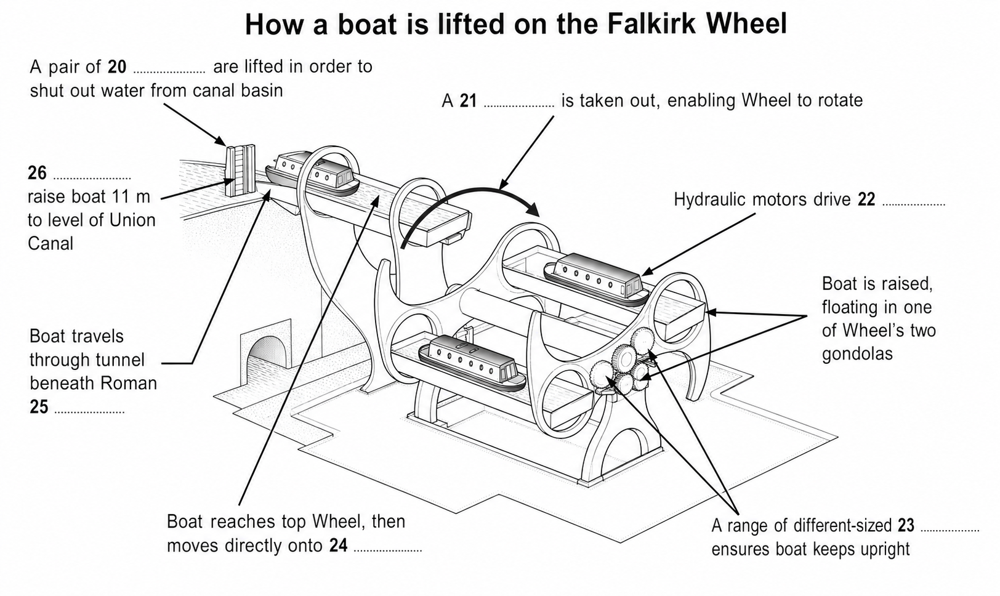

# 福尔柯克轮：让船“坐电梯”的旋转奇迹

**THE FALKIRK WHEEL**  
**A unique engineering achievement**（一项独一无二的工程成就）

这篇文章写的是一座船舶升降机，却没有停在“宏伟、先进”这些空泛形容词上。它先交代苏格兰两条运河为何需要重新连通，再写方案、制造和装配，最后用阿基米德原理与齿轮系统解释巨轮为何能以极少能量平稳旋转。阅读时要抓住三条线：旧航道的恢复、工程结构的受力、船只升高的完整流程。

原书总指令：*You should spend about 20 minutes on Questions 14–26, which are based on Reading Passage 2 below.*  
中文：你应当用大约 20 分钟完成第 14—26 题；这些题目以以下阅读文章 2 为依据。

## 01 逐句精读

### 第 1 段

**1**

The Falkirk Wheel in Scotland is the world’s first and only rotating boat lift.

苏格兰的福尔柯克轮是世界上第一座、也是唯一一座旋转式船舶升降机。

主干是 `The Falkirk Wheel ... is ... boat lift`；`in Scotland` 补充地点，`the world’s first and only` 把独特性推到最前，`rotating` 说明它不是普通垂直升降机。开篇一句同时完成“是什么”和“为何值得读”两项任务。

- `rotating` (B2)：旋转的；此处修饰船舶升降机。
- `boat lift` (B2，水运工程专业词)：船舶升降机，用机械方式帮助船只跨越水位差。

**2**

Opened in 2002, it is central to the ambitious £84.5m Millennium Link project to restore navigability across Scotland by reconnecting the historic waterways of the Forth & Clyde and Union Canals.

它于 2002 年投入使用，是耗资 8,450 万英镑、雄心勃勃的“千禧连通工程”的核心；该工程通过重新连接历史悠久的福斯—克莱德运河与联合运河，恢复横贯苏格兰的通航能力。

主干是 `it is central to ... project`。句首过去分词 `Opened in 2002` 压缩了时间信息；`to restore ...` 说明工程目标；`by reconnecting ...` 再说明实现目标的手段，形成“地位—目标—方法”的递进。

- `be central to` (B2)：对……至关重要、处于……核心。
- `ambitious` (B2)：雄心勃勃的；这里强调工程规模与目标都很大。
- `Millennium Link project` (B2，水运工程专业表达)：千禧连通工程。
- `restore` (B2)：恢复，使回到先前良好状态。
- `navigability` (C1，水运工程专业词)：可通航性、通航能力。
- `reconnect` (B2)：重新连接。
- `historic` (B1)：有历史意义的、历史悠久的。
- `waterway` (B2，水运专业词)：水道、航道。

**A层深挖 1｜restore navigability**

这里不是简单的 `build a route`，而是让曾经存在、后来中断的通航功能“重新回来”。`restore` 自带“回到原先状态”的方向感，[Cambridge Dictionary 对 restore 的释义](https://dictionary.cambridge.org/dictionary/english/restore)也突出这种恢复。它与 `repair` 不同：`repair` 偏重修好损坏的物件，`restore` 可恢复功能、联系、信心或生态；`revive` 则更强调让衰弱的事物重新活跃。

这组表达在文中把工程的意义从“一座新地标”推回“修复全国航道网络”。可迁移为：`The city plans to restore navigability to the polluted river.`（这座城市计划恢复这条受污染河流的通航能力。）`The talks helped restore trust between the two teams.`（这次会谈帮助两支团队恢复了信任。）写交通、生态或公共服务时，都可以用 `restore + function/condition` 表达“恢复一种能力或状态”。

### 第 2 段

**3**

The major challenge of the project lay in the fact that the Forth & Clyde Canal is situated 35 metres below the level of the Union Canal.

该工程的主要挑战在于：福斯—克莱德运河的位置比联合运河低 35 米。

主干是 `The major challenge ... lay in the fact`，`that` 从句给出具体事实。`lay in` 把“难点”精确落在巨大的水位差上，为后文升船方案铺路。

- `major challenge` (B2)：主要挑战。
- `project` (B1)：项目；本句再次指整项运河连通工程。
- `lie in the fact that` (B2)：在于……这一事实。
- `canal` (B2，水运专业词)：运河；本句两次出现，分别指福斯—克莱德运河与联合运河。
- `be situated` (B2)：位于。
- `level` (B1)：高度、水位。

**4**

Historically, the two canals had been joined near the town of Falkirk by a sequence of 11 locks – enclosed sections of canal in which the water level could be raised or lowered – that stepped down across a distance of 1.5 km.

历史上，两条运河曾在福尔柯克镇附近由连续 11 座船闸相连——船闸是封闭的运河区段，其中水位可以升高或降低——这些船闸在 1.5 公里的距离内逐级下降。

主干是 `the two canals had been joined ... by a sequence of 11 locks`。破折号中的同位解释定义 `locks`；末尾 `that stepped down ...` 回指 11 座船闸。过去完成时说明这条连接早于后文的拆除。

- `historically` (B2)：从历史上看。
- `join` (B1)：连接；这里用过去完成时被动语态 `had been joined`。
- `canal` (B2，水运专业词)：运河；本句在主句与船闸定义中重复出现。
- `a sequence of` (B2)：一连串、一系列。
- `lock` (B2，水运工程专业词)：船闸。
- `enclosed` (B2)：封闭的。
- `section` (B1)：区段；此处指可独立调节水位的封闭运河区段。
- `raise or lower` (B1)：升高或降低。
- `step down` (B2)：逐级下降。
- `across a distance of` (B2)：横跨……的距离。

**5**

This had been dismantled in 1933, thereby breaking the link.

这套船闸于 1933 年被拆除，从而切断了两条运河之间的连接。

主干是被动语态 `This had been dismantled`；`thereby breaking ...` 是结果分词结构，强调“拆除”直接造成“断链”。`This` 指上一句的 11 座船闸组成的连接系统。

- `dismantle` (C1)：拆除、拆解。
- `thereby` (C1)：从而、因此，正式书面连接结果。
- `break the link` (B2)：切断联系或连接。

**6**

When the project was launched in 1994, the British Waterways authority were keen to create a dramatic twenty-first-century landmark which would not only be a fitting commemoration of the Millennium, but also a lasting symbol of the economic regeneration of the region.

1994 年项目启动时，英国水道管理机构希望打造一座引人注目的 21 世纪地标：它不仅要成为对千禧年的恰当纪念（物），也要成为该地区经济复兴的长久象征。

主干是 `the ... authority were keen to create ... landmark`。`When` 从句给时间，`which` 定语从句用 `not only ... but also ...` 并列地标的两层意义：纪念过去，也象征未来。原文保留集合机构名后的 `were`。

- `launch a project` (B2)：启动项目。
- `authority` (B2)：管理机构、主管部门。
- `be keen to` (B1)：热衷于、很想做。
- `dramatic` (B2)：引人注目的、视觉效果强烈的。
- `landmark` (B2)：地标；也可指里程碑。
- `fitting` (B2)：恰当的、合适的。
- `commemoration` (C1)：纪念、纪念物。
- `not only ... but also ...` (B2)：不仅……而且……；把纪念意义与经济复兴象征并列起来。
- `Millennium` (B2)：千禧年。
- `lasting symbol` (B2)：长久的象征。
- `economic regeneration` (C1，城市发展专业表达)：经济复兴、再生。
- `region` (B1)：地区。

### 第 3 段

**7**

Numerous ideas were submitted for the project, including concepts ranging from rolling eggs to tilting tanks, from giant see-saws to overhead monorails.

项目收到大量方案，包括从“滚动的蛋”到“倾斜的水箱”、从巨型跷跷板到高架单轨系统等各种构想。

主干是被动语态 `Numerous ideas were submitted`；`including` 引出例子，两个 `from ... to ...` 扩大想象范围，表现早期设计竞赛的开放性。

- `numerous` (B2)：众多的。
- `project` (B1)：项目；本句再次指方案所服务的工程。
- `submit` (B2)：提交。
- `concept` (B2)：构想、概念。
- `range from ... to ...` (B1)：范围从……到……。
- `roll / rolling` (B1)：滚动；`rolling eggs` 是早期方案的形象概念。
- `tilt` (B2)：倾斜。
- `tank` (B1)：水箱、储液罐；此处指可倾斜的工程容器。
- `giant` (B2)：巨大的；本句修饰跷跷板方案。
- `see-saw` (B2)：跷跷板。
- `overhead` (B2)：高架的、头顶上方的。
- `monorail` (C1，交通工程专业词)：单轨铁路。

**8**

The eventual winner was a plan for the huge rotating steel boat lift which was to become The Falkirk Wheel.

最终胜出的方案是一座巨型旋转钢制船舶升降机，它后来成为福尔柯克轮。

主干是 `The eventual winner was a plan`；`which was to become ...` 带有“后来注定成为”的回顾语气，把设计阶段与成品连接起来。

- `eventual` (B2)：最终的。
- `winner` (B1)：获胜者；此处指胜出的方案。
- `huge` (B1)：巨大的；强调最终方案的尺度。
- `rotating` (B2)：旋转的，再次出现时仍指核心机械运动。
- `steel` (B1)：钢制的。
- `boat lift` (B2，水运工程专业词)：船舶升降机。
- `be to become` (B2)：后来成为，常用于回顾后续发展。

**9**

The unique shape of the structure is claimed to have been inspired by various sources, both manmade and natural, most notably a Celtic double-headed axe, but also the vast turning propeller of a ship, the ribcage of a whale or the spine of a fish.

据称，这一结构的独特造型受到多种人造和自然形态的启发，其中最显著的是凯尔特双刃斧，也包括船只巨大的旋转螺旋桨、鲸的胸腔和鱼的脊柱。

主干是 `The unique shape ... is claimed to have been inspired by ...`。`is claimed` 保留信息距离，不把灵感来源写成无争议事实；`both ... and ...` 先分类，再用 `most notably ... but also ...` 排出主次。

- `unique` (B2)：独特的。
- `shape` (B1)：形状、造型；是本句讨论灵感来源的中心。
- `structure` (B2)：结构、建筑物。
- `be claimed to have been` (C1)：据称曾经……，带审慎距离。
- `be inspired by` (B2)：受到……启发。
- `various` (B1)：各种各样的。
- `source` (B1)：来源；本句用复数概括多种造型灵感。
- `manmade` (B2)：人造的。
- `notably` (C1)：尤其、特别值得注意地。
- `Celtic` (C1，历史文化专业词)：凯尔特的。
- `double-headed axe` (C1，历史器物专业词)：双刃斧。
- `vast` (B2)：巨大的。
- `propeller` (C1，船舶工程专业词)：螺旋桨。
- `ribcage` (C1，解剖专业词)：胸腔、肋骨架。
- `spine` (B2，解剖专业词)：脊柱。

### 第 4 段

**10**

The various parts of The Falkirk Wheel were all constructed and assembled, like one giant toy building set, at Butterley Engineering’s Steelworks in Derbyshire, some 400 km from Falkirk.

福尔柯克轮的各个部件都在德比郡的巴特利工程公司钢铁厂制造并组装，那里距福尔柯克约 400 公里，整个过程就像拼一套巨型建筑玩具。

主干是 `The various parts ... were all constructed and assembled`。`like one giant toy building set` 用熟悉的玩具比喻复杂工程，地点和距离则解释为何后文还要拆卸运输。

- `various` (B1)：各种的；重复出现仍需按本句理解为多个部件。
- `construct` (B2)：建造、制造。
- `assemble` (B2)：组装。
- `giant` (B2)：巨大的。
- `building set` (B2)：拼装玩具、建筑套件。
- `steelworks` (C1，工业专业词)：钢铁厂。

**11**

A team there carefully assembled the 1,200 tonnes of steel, painstakingly fitting the pieces together to an accuracy of just 10 mm to ensure a perfect final fit.

那里的团队仔细组装了 1,200 吨钢材，煞费苦心地把部件拼接起来，将误差控制在仅 10 毫米，以确保最终严丝合缝。

主干是 `A team ... assembled ... steel`。`painstakingly fitting ...` 描写伴随方式；`to an accuracy of ...` 给精度，`to ensure ...` 给目的。数字不是装饰，而是证明异地预装可行所需的精确程度。

- `assemble` (B2)：组装；本句强调团队实施的动作。
- `tonne` (B1)：公吨。
- `steel` (B1)：钢材；即使前文出现过，本句仍指 1,200 吨的具体材料。
- `painstakingly` (C1)：煞费苦心地、一丝不苟地。
- `fit together` (B2)：拼合、装配在一起。
- `accuracy` (B2)：精确度。
- `ensure` (B2)：确保。
- `final fit` (B2，工程专业表达)：最终装配吻合度。

**12**

In the summer of 2001, the structure was then dismantled and transported on 35 lorries to Falkirk, before all being bolted back together again on the ground, and finally lifted into position in five large sections by crane.

2001 年夏天，这一结构随后被拆解，用 35 辆卡车运往福尔柯克；所有部件先在地面重新用螺栓连接，最后再由起重机分五个大型区段吊装就位。

主干串联三个被动动作：`was dismantled and transported`、`being bolted back together`、`lifted into position`。`then / before / finally` 明确工序顺序，正是流程题常用的定位词。

- `structure` (B2)：结构；本句指已预装完成的整体。
- `dismantle` (C1)：拆解；重复出现但这里是运输前的工序。
- `transport` (B1)：运输。
- `lorry` (B1)：卡车，英式英语。
- `bolt ... together` (C1，工程专业表达)：用螺栓连接。
- `lift into position` (B2)：吊装就位。
- `finally` (B1)：最后；明确运输、重装之后的最终工序。
- `position` (B1)：位置；`into position` 表示进入预定安装位置。
- `section` (B1)：区段、部件。
- `crane` (B2，工程专业词)：起重机。

**13**

The Wheel would need to withstand immense and constantly changing stresses as it rotated, so to make the structure more robust, the steel sections were bolted rather than welded together.

福尔柯克轮在旋转时必须承受巨大而且不断变化的应力，因此，为了使结构更坚固，钢制区段采用螺栓连接，而不是焊接在一起。

主干先说需求 `The Wheel would need to withstand ... stresses`，`as` 交代旋转期间；`so` 引出设计后果，`to make ...` 给目的，`rather than` 突出工程选择。句子把“受力问题”与“螺栓方案”连成因果链。

- `withstand` (C1)：承受、经受住。
- `immense` (C1)：巨大的。
- `constantly` (B2)：持续不断地。
- `stress` (C1，工程力学专业词)：应力、机械负荷。
- `rotate` (B2)：旋转。
- `structure` (B2)：结构；重复出现时仍指整座轮体。
- `robust` (C1)：坚固的、稳健的。
- `steel section` (B2，工程专业表达)：钢制区段。
- `bolt` (C1，工程专业词)：用螺栓固定。
- `rather than` (B1)：而不是。
- `weld` (C1，工程专业词)：焊接。

**A层深挖 2｜withstand immense and constantly changing stresses**

`withstand` 不是被动地“忍受一下”，而是面对强大外力仍不损坏、不改变。[Cambridge Dictionary 对 withstand 的释义](https://dictionary.cambridge.org/dictionary/english/withstand)强调“足够坚固，能抵抗而不受改变”。在工程文体里，它常与 `pressure, force, heat, stress, earthquake` 搭配；`endure` 更常写长期痛苦或困难，`resist` 强调主动抵抗，`bear` 则更宽泛。

原文把 `immense` 与 `constantly changing` 并列，说明难点不仅是力很大，还在于载荷持续变化。可迁移为：`The bridge was designed to withstand severe winds.`（这座桥按可承受强风的标准设计。）`A good policy must withstand public scrutiny.`（一项好政策必须经得起公众审视。）前者是物理承载，后者把“经得住”迁移到抽象检验；两种用法都保留了“压力之下仍稳固”的核心画面。

**14**

Over 45,000 bolt holes were matched with their bolts, and each bolt was hand-tightened.

超过 45,000 个螺栓孔都与相应螺栓一一配对，而且每一枚螺栓都由人工拧紧。

两个并列被动语态突出制造控制，而非工人个人。`each` 把宏观数字重新落到逐个操作，强化精细与可靠。

- `bolt hole` (C1，工程专业词)：螺栓孔。
- `match ... with ...` (B1)：使……与……匹配。
- `bolt` (C1，工程专业词)：螺栓；在本句作为名词重复出现。
- `hand-tightened` (C1，工程专业词)：人工拧紧的。

### 第 5 段

**15**

The Wheel consists of two sets of opposing axe-shaped arms, attached about 25 metres apart to a fixed central spine.

福尔柯克轮由两组相对的斧形轮臂构成，它们相隔约 25 米，连接在一根固定的中央主轴上。

主干是 `The Wheel consists of ... arms`；过去分词 `attached ...` 补充轮臂的安装位置。句子从制造过程转向结构说明。

- `consist of` (B1)：由……组成。
- `opposing` (B2)：相对的、对置的。
- `axe-shaped` (C1，工程造型专业词)：斧形的。
- `attach` (B1)：连接、固定。
- `apart` (B1)：相隔。
- `fixed` (B1)：固定的。
- `central spine` (C1，工程专业表达)：中央主轴；借“脊柱”比喻承重核心。

**16**

Two diametrically opposed water-filled ‘gondolas’, each with a capacity of 360,000 litres, are fitted between the ends of the arms.

两个装满水、在直径方向上彼此相对的“吊舱”安装在轮臂末端之间，每个容量为 36 万升。

主干是 `Two ... gondolas are fitted ...`。`each with ...` 是独立补充结构；多个前置修饰语依次说明位置、介质与名称。

- `diametrically opposed` (C2，几何工程专业表达)：在直径方向上相对。
- `water-filled` (B2)：装满水的。
- `gondola` (C1，水运工程专业词)：轮体上的载船吊舱。
- `capacity` (B2)：容量。
- `be fitted` (B2)：被安装。

**17**

These gondolas always weigh the same, whether or not they are carrying boats.

这些吊舱的重量始终相同，无论其中是否载有船只。

主干是 `These gondolas always weigh the same`；`whether or not` 排除“有船/无船”这一变量，为下一句的浮力解释制造悬念。

- `gondola` (C1，水运工程专业词)：载船吊舱；重复出现仍是核心结构名词。
- `weigh the same` (B1)：重量相同。
- `whether or not` (B2)：无论是否。
- `carry` (B1)：承载、载运。

**18**

This is because, according to Archimedes’ principle of displacement, floating objects displace their own weight in water.

这是因为，根据阿基米德排水原理，漂浮物体会排开与其自身重量相等的水。

主干是 `This is because ... objects displace ...`；`according to ...` 插入科学依据。这里的 `displace` 第一次是原理名称，第二次是动作“排开”。

- `according to` (B1)：根据。
- `Archimedes’ principle of displacement` (C1，物理专业词)：阿基米德排水原理。
- `floating object` (B2，物理专业表达)：漂浮物体。
- `displace` (C1，物理专业词)：排开液体。
- `one's own weight` (B2)：与自身重量相等的量。

**19**

So when a boat enters a gondola, the amount of water leaving the gondola weighs exactly the same as the boat.

因此，当一艘船进入吊舱时，流出吊舱的那部分水恰好与船本身等重。

主干是 `the amount of water ... weighs ...`；`when` 从句给触发条件，`leaving the gondola` 修饰水。它把抽象原理改写成实际运作过程。

- `gondola` (C1，水运工程专业词)：载船吊舱，本句两次出现都指同一容器。
- `the amount of` (B1)：……的量，修饰不可数名词。
- `weigh exactly the same as` (B2)：重量与……完全相同。

**20**

This keeps the Wheel balanced and so, despite its enormous mass, it rotates through 180° in five and a half minutes while using very little power.

这使福尔柯克轮保持平衡；因此，尽管它质量巨大，仍能在五分半钟内旋转 180 度，而且耗能极少。

主干由 `This keeps ... balanced` 与 `it rotates ...` 构成；`despite` 插入让步，`while using ...` 补充伴随的低能耗。对比“巨大质量”与“极少动力”突出设计巧妙。

- `keep ... balanced` (B2)：使……保持平衡。
- `despite` (B1)：尽管。
- `enormous` (B2)：巨大的。
- `mass` (B2，物理专业词)：质量。
- `rotate through` (B2)：旋转过……角度。
- `power` (B1，工程专业词)：动力、功率。

**21**

It takes just 1.5 kilowatt-hours (5.4 MJ) of energy to rotate the Wheel – roughly the same as boiling eight small domestic kettles of water.

旋转福尔柯克轮只需 1.5 千瓦时（5.4 兆焦）的能量，约相当于烧开八小壶水所需的能量。

结构是 `It takes + 数量 + to do`；破折号后的生活化类比把抽象能耗变成可感知的尺度。

- `kilowatt-hour` (C1，能源专业词)：千瓦时。
- `MJ (megajoule)` (C1，能源专业词)：兆焦。
- `energy` (B1)：能量。
- `rotate` (B2)：使旋转；本句作及物动词。
- `roughly` (B2)：大约、大致。
- `domestic` (B2)：家用的。
- `kettle` (B1)：水壶。

### 第 6 段

**22**

Boats needing to be lifted up enter the canal basin at the level of the Forth & Clyde Canal and then enter the lower gondola of the Wheel.

需要升高的船只先驶入与福斯—克莱德运河同一水位的运河水池，然后进入福尔柯克轮下方的吊舱。

主干是两个顺序动作 `Boats ... enter ... and then enter ...`；`needing to be lifted up` 是现在分词短语，筛选出需要升高的船。`then` 是流程定位词。

- `be lifted up` (B1)：被提升。
- `canal basin` (C1，水运工程专业词)：运河水池、船池。
- `at the level of` (B2)：与……同一高度。
- `lower` (B1)：较低处的。
- `gondola` (C1，水运工程专业词)：载船吊舱。

**23**

Two hydraulic steel gates are raised, so as to seal the gondola off from the water in the canal basin.

两扇液压钢闸门被升起，以便将吊舱与运河水池中的水隔开。

主干是被动语态 `Two ... gates are raised`；`so as to` 明确目的，`seal ... off from ...` 说明闸门的隔水功能。

- `hydraulic` (C1，液压工程专业词)：液压的。
- `steel` (B1)：钢制的；本句再次说明闸门材质。
- `gate` (B2，水运工程专业词)：闸门。
- `raise` (B1)：升起；这里用被动语态 `are raised` 描述流程动作。
- `so as to` (B2)：为了，以便。
- `seal ... off from ...` (C1)：把……与……严密隔开。
- `gondola` (C1，水运工程专业词)：载船吊舱。
- `canal basin` (C1，水运工程专业词)：运河水池。

**24**

The water between the gates is then pumped out.

随后，两道闸门之间的水被抽出。

主干是 `The water ... is pumped out`；`then` 继续推动流程，被动语态把注意力放在水位控制而不是设备操作者上。

- `gate` (B2，水运工程专业词)：闸门；重复出现以限定水的位置。
- `pump out` (B2)：用泵抽出。

**25**

A hydraulic clamp, which prevents the arms of the Wheel moving while the gondola is docked, is removed, allowing the Wheel to turn.

液压夹具被移除，于是福尔柯克轮可以转动；在吊舱停靠期间，这个夹具原本会阻止轮臂移动。

主干是 `A hydraulic clamp ... is removed`。`which` 从句解释夹具原有功能，`while` 给时间条件，`allowing ...` 给移除后的结果。题目用 `taken out` 改写 `is removed`。

- `hydraulic` (C1，液压工程专业词)：液压的；重复出现描述驱动方式。
- `clamp` (C1，机械工程专业词)：夹具、夹钳。
- `prevent ... moving` (B2)：阻止……移动。
- `gondola` (C1，水运工程专业词)：载船吊舱。
- `dock` (B2，水运专业词)：停靠、对接。
- `remove` (B1)：移除。
- `allow ... to` (B1)：使……能够。

**26**

In the central machine room an array of ten hydraulic motors then begins to rotate the central axle.

随后，中央机房内的一组十台液压马达开始带动中央轴旋转。

主干是 `an array of ... motors ... begins to rotate ... axle`；地点状语提前。`an array of` 表示成组配置，`central` 两次出现分别限定机房与轴。

- `machine room` (B2，工程专业词)：机房。
- `central` (B1)：中央的；第一次出现修饰 `machine room`。
- `an array of` (C1)：一组、一系列有序配置的。
- `hydraulic motor` (C1，液压工程专业词)：液压马达。
- `rotate` (B2)：使旋转。
- `central` (B1)：中央的；第二次出现修饰 `axle`，重复项单独讲解。
- `axle` (C1，机械工程专业词)：轴、轮轴。

**27**

The axle connects to the outer arms of the Wheel, which begin to rotate at a speed of 1/8 of a revolution per minute.

这根轴连接着福尔柯克轮的外侧轮臂；这些轮臂开始以每分钟八分之一圈的速度旋转。

主干是 `The axle connects to ... arms`；`which` 回指复数 `arms`，所以从句谓语是 `begin`。本句跨栏，不能把页内行序误当句序。

- `axle` (C1，机械工程专业词)：轴；重复出现，承接上一句的驱动链。
- `connect to` (B1)：连接到。
- `outer` (B2)：外侧的。
- `rotate` (B2)：旋转。
- `at a speed of` (B1)：以……的速度。
- `revolution` (C1，机械工程专业词)：一整圈、一次旋转。
- `per minute` (B1)：每分钟。

**28**

As the wheel rotates, the gondolas are kept in the upright position by a simple gearing system.

随着巨轮旋转，吊舱由一套简单的齿轮传动系统保持直立。

`As` 从句写同步发生的运动；主句用被动语态 `are kept ... by ...`，强调系统产生的稳定效果。

- `rotate` (B2)：旋转；重复出现描述持续运动。
- `gondola` (C1，水运工程专业词)：载船吊舱。
- `upright` (B2)：直立的。
- `position` (B1)：位置、姿态；`upright position` 指直立状态。
- `gearing system` (C1，机械工程专业词)：齿轮传动系统。

**29**

Two eight-metre-wide cogs orbit a fixed inner cog of the same width, connected by two smaller cogs travelling in the opposite direction to the outer cogs – so ensuring that the gondolas always remain level.

两个宽八米的齿轮绕着一个同宽的固定内齿轮转动，并由两个朝外齿轮相反方向运动的较小齿轮连接，从而确保吊舱始终保持水平。

主干是 `Two ... cogs orbit ... cog`；`connected by ...` 补充连接方式，`travelling ...` 修饰小齿轮，破折号后的 `so ensuring ...` 总结机械结果。不同尺寸和相反方向共同抵消轮体旋转对吊舱姿态的影响。

- `cog` (C1，机械工程专业词)：齿轮。
- `orbit` (B2)：环绕运行。
- `fixed` (B1)：固定的。
- `inner` (B2)：内侧的。
- `width` (B1)：宽度；本句用 `of the same width` 比较内外齿轮。
- `connect` (B1)：连接。
- `opposite direction` (B1)：相反方向。
- `outer` (B2)：外侧的；再次出现以区分不同齿轮。
- `ensure` (B2)：确保；重复出现，强调结果可靠。
- `gondola` (C1，水运工程专业词)：载船吊舱。
- `remain level` (B2)：保持水平。

**30**

When the gondola reaches the top, the boat passes straight onto the aqueduct situated 24 metres above the canal basin.

当吊舱到达顶部时，船便直接驶上位于运河水池上方 24 米处的渡槽。

主干是 `the boat passes straight onto the aqueduct`；`When` 从句给流程节点，`situated ...` 后置修饰渡槽并给出高度。

- `gondola` (C1，水运工程专业词)：载船吊舱。
- `pass straight onto` (B2)：直接驶上。
- `aqueduct` (C1，水利工程专业词)：渡槽、高架水道。
- `be situated` (B2)：位于；重复出现，定位渡槽。
- `canal basin` (C1，水运工程专业词)：运河水池。

### 第 7 段

**31**

The remaining 11 metres of lift needed to reach the Union Canal is achieved by means of a pair of locks.

到达联合运河还需要上升 11 米，这段剩余升程通过一对船闸完成。

主干是 `The remaining 11 metres of lift ... is achieved ...`；`needed to reach ...` 修饰升程，`by means of` 说明手段。原文把 11 米视为一个整体量，因此用 `is`。

- `remaining` (B1)：剩余的。
- `lift` (B2，水运工程专业词)：升程、提升高度。
- `achieve` (B1)：实现、完成。
- `by means of` (B2)：借助、通过。
- `a pair of` (B1)：一对。
- `lock` (B2，水运工程专业词)：船闸；与历史上的旧船闸同词，但此处指新系统末端的一对船闸。

**32**

The Wheel could not be constructed to elevate boats over the full 35-metre difference between the two canals, owing to the presence of the historically important Antonine Wall, which was built by the Romans in the second century AD.

由于具有重要历史意义的安东尼长城位于附近，福尔柯克轮无法建成可让船只跨越两条运河全部 35 米高差的结构；这道长城由罗马人在公元 2 世纪修建。

主干是 `The Wheel could not be constructed to elevate boats ...`；`owing to ...` 给工程限制的原因，`which` 从句补充古迹年代。句子解释为何巨轮只完成 24 米，剩余 11 米必须交给船闸。

- `construct` (B2)：建造；重复出现但本句讨论受古迹限制的设计范围。
- `elevate` (C1)：提升、抬高。
- `difference` (B1)：差距；此处是高度差。
- `canal` (B2，水运专业词)：运河；本句再次指两条运河之间的高差。
- `owing to` (B2)：由于，因为，正式书面表达。
- `presence` (B2)：存在、在场；此处指古迹位于现场。
- `historically important` (B2)：具有重要历史意义的。
- `Antonine Wall` (C1，古罗马历史专业词)：安东尼长城。
- `Roman` (B2，历史专业词)：古罗马人；此处复数 `Romans`。
- `second century AD` (B2，历史纪年专业表达)：公元 2 世纪。

**A层深挖 3｜owing to the presence of**

`owing to` 是正式的原因介词，含义就是“由于”，[Cambridge Dictionary 对 owing to 的释义](https://dictionary.cambridge.org/dictionary/english/owing-to)也标明它相当于 `because of`。这里用它，不只是在补背景，而是在指出古迹的“存在”直接构成设计边界。`because of` 最通用；`due to` 在现代英语中也常见；`as a result of` 更强调可观察到的结果链。

`the presence of` 则把“附近有一堵墙”写成工程条件，适合正式说明约束。可迁移为：`The route was changed owing to the presence of protected wetlands.`（由于存在受保护湿地，路线被调整。）`The event was delayed owing to severe weather.`（活动因恶劣天气延期。）这种结构在小作文流程说明或大作文因果论证中很有用，但原因必须真实对应结果，不能只用正式连接词制造假因果。

**33**

Boats travel under this wall via a tunnel, then through the locks, and finally on to the Union Canal.

船只经隧道从长城下方穿过，再通过船闸，最终驶入联合运河。

主干是 `Boats travel ...`；`under / via / through / on to` 连续给出空间路径，`then` 与 `finally` 给出时间顺序，干净地收束整套升船流程。

- `via` (B2)：经由、通过。
- `tunnel` (B1)：隧道。
- `lock` (B2，水运工程专业词)：船闸；重复出现，指完成最后 11 米升程的设施。
- `finally` (B1)：最终，流程收束词。
- `on to` (B1)：向前进入、到达。

## 02 题目与选项精讲

### 总体答题指令

*You should spend about 20 minutes on Questions 14–26, which are based on Reading Passage 2 below.*

你应当用大约 20 分钟完成第 14—26 题；所有答案都必须以文章信息为依据。第 14—19 题判断陈述与原文的关系，第 20—26 题从原文各取一个词补全流程图。

### Questions 14–19｜TRUE / FALSE / NOT GIVEN

**原书题型指令**

*Do the following statements agree with the information given in Reading Passage 2?*  
*In boxes 14–19 on your answer sheet, write*  
*TRUE if the statement agrees with the information*  
*FALSE if the statement contradicts the information*  
*NOT GIVEN if there is no information on this*

中文：下列陈述是否与文章信息一致？若一致写 **TRUE（正确）**；若与原文矛盾写 **FALSE（错误）**；若原文没有提供足够信息判断写 **NOT GIVEN（未提及）**。

**14. The Falkirk Wheel has linked the Forth & Clyde Canal with the Union Canal for the first time in their history.**  
中文：福尔柯克轮在历史上第一次把福斯—克莱德运河与联合运河连接起来。  
**官方答案：FALSE**  
证据：`Historically, the two canals had been joined ... by a sequence of 11 locks.`  
定位逻辑：题干的绝对词 `for the first time` 对应历史段；原文明确说两条运河过去已经由 11 座船闸相连。  
干扰项排除：福尔柯克轮确实“重新连接”两条运河，但 `reconnecting` 恰好证明不是第一次连接；不能把“新设备”偷换成“首次连通”。

**15. There was some opposition to the design of the Falkirk Wheel at first.**  
中文：起初，有人反对福尔柯克轮的设计。  
**官方答案：NOT GIVEN**  
证据：原文只说 `Numerous ideas were submitted`，并介绍 `The eventual winner`，没有说明任何人支持或反对最终设计。  
定位逻辑：`design ... at first` 把范围锁定在方案征集段。  
干扰项排除：存在多个竞争方案不等于存在反对意见；不能用常识补出“有争议”。

**16. The Falkirk Wheel was initially put together at the location where its components were manufactured.**  
中文：福尔柯克轮最初是在其部件制造地组装起来的。  
**官方答案：TRUE**  
证据：`The various parts ... were all constructed and assembled ... at Butterley Engineering’s Steelworks in Derbyshire.`  
定位逻辑：`initially put together` 同义改写 `assembled`，`where its components were manufactured` 对应同一钢铁厂的 `constructed`。  
干扰项排除：后来运往福尔柯克重新组装不影响“最初”组装地点；时间顺序是预装—拆解—运输—重装。

**17. The Falkirk Wheel is the only boat lift in the world which has steel sections bolted together by hand.**  
中文：福尔柯克轮是世界上唯一一座其钢制区段由人工用螺栓连接的船舶升降机。  
**官方答案：NOT GIVEN**  
证据：原文分别说它是 `the world’s first and only rotating boat lift`，并说 `each bolt was hand-tightened`，但没有说手工螺栓连接这一做法在世界上独一无二。  
定位逻辑：拆开题干的两部分核对：`only boat lift` 与 `bolted ... by hand` 来自不同段落。  
干扰项排除：这是典型“拼接信息”干扰；`only` 在原文修饰 `rotating boat lift`，不能越界修饰手工连接方法。

**18. The weight of the gondolas varies according to the size of boat being carried.**  
中文：吊舱的重量会随所载船只大小而变化。  
**官方答案：FALSE**  
证据：`These gondolas always weigh the same, whether or not they are carrying boats.`  
定位逻辑：`weight / gondolas` 直接定位阿基米德原理段；`varies` 与 `always weigh the same` 正面矛盾。  
干扰项排除：船越大可能让人凭常识想到越重，但进入吊舱的船会排出等重的水，总重量保持不变。

**19. The construction of the Falkirk Wheel site took into account the presence of a nearby ancient monument.**  
中文：福尔柯克轮场地的建设考虑到了附近一处古代遗迹的存在。  
**官方答案：TRUE**  
证据：`The Wheel could not be constructed to elevate boats over the full 35-metre difference ... owing to the presence of the historically important Antonine Wall.`  
定位逻辑：题干 `took into account` 被原文“因古迹存在而不能建足 35 米”具体化；`ancient monument` 对应罗马时期的安东尼长城。  
干扰项排除：原文虽未逐字出现 `took into account`，但设计被迫保留隧道和船闸，清楚证明古迹实际影响了建设。

### Questions 20–26｜Diagram Label Completion

**原书题型指令**

*Label the diagram below.*  
*Choose ONE WORD from the passage for each answer.*  
*Write your answers in boxes 20–26 on your answer sheet.*

中文：为下图添加标签。每个答案必须从文章中选择 **一个词（ONE WORD）**，并写在答题纸第 20—26 格。拼写、单复数都要与语法和原文一致。

**How a boat is lifted on the Falkirk Wheel**  
中文：船只如何借助福尔柯克轮升高

图中固定标签：*Boat is raised, floating in one of Wheel’s two gondolas*  
中文：船漂浮在巨轮的两个吊舱之一中并被升高。

**Q20｜A pair of 20 … are lifted in order to shut out water from canal basin**  
中文：一对【空格】被升起，以隔绝运河水池中的水。  
**官方答案：gates；可接受答案：gates；字数限制：ONE WORD。**  
证据：`Two hydraulic steel gates are raised, so as to seal the gondola off from the water in the canal basin.`  
定位逻辑：`are lifted` 改写 `are raised`，`shut out water` 改写 `seal ... off from the water`。  
干扰项排除：`hydraulic` 与 `steel` 都是修饰语；`a pair of` 后需要复数名词，因此必须填 `gates`，不能填 `gate`。

**Q21｜A 21 … is taken out, enabling Wheel to rotate**  
中文：一个【空格】被取出，使巨轮能够旋转。  
**官方答案：clamp；可接受答案：clamp；字数限制：ONE WORD。**  
证据：`A hydraulic clamp ... is removed, allowing the Wheel to turn.`  
定位逻辑：`taken out` 对应 `removed`，`enabling ... to rotate` 对应 `allowing ... to turn`。  
干扰项排除：`hydraulic` 是形容词，真正被移除的部件是 `clamp`；冠词 `A` 也要求单数名词。

**Q22｜Hydraulic motors drive 22 …**  
中文：液压马达驱动【空格】。  
**官方答案：axle；可接受答案：axle；字数限制：ONE WORD。**  
证据：`an array of ten hydraulic motors then begins to rotate the central axle.`  
定位逻辑：`drive` 是 `rotate` 的概括；马达直接作用的对象是中央轴。  
干扰项排除：轮臂随后由轴带动，并非马达在原文中直接驱动的宾语；`motors` 已在题干，不能重复。

**Q23｜A range of different-sized 23 … ensures boat keeps upright**  
中文：一组尺寸不同的【空格】确保船保持直立。  
**官方答案：cogs；可接受答案：cogs；字数限制：ONE WORD。**  
证据：`Two eight-metre-wide cogs ... connected by two smaller cogs ... so ensuring that the gondolas always remain level.`  
定位逻辑：`different-sized` 对应八米宽齿轮和较小齿轮，`keeps upright` 对应 `remain level`。  
干扰项排除：`gearing system` 有两个词且违反字数限制；题干 `a range of` 后接复数可数名词，答案为 `cogs`。

**Q24｜Boat reaches top Wheel, then moves directly onto 24 …**  
中文：船到达巨轮顶部，随后直接驶上【空格】。  
**官方答案：aqueduct；可接受答案：aqueduct；字数限制：ONE WORD。**  
证据：`When the gondola reaches the top, the boat passes straight onto the aqueduct.`  
定位逻辑：`moves directly onto` 几乎逐词改写 `passes straight onto`。  
干扰项排除：`canal basin` 位于下方且有两个词；到达顶部后直接衔接的是 `aqueduct`。

**Q25｜Boat travels through tunnel beneath Roman 25 …**  
中文：船穿过罗马【空格】下方的隧道。  
**官方答案：wall；可接受答案：wall；字数限制：ONE WORD。**  
证据：`the historically important Antonine Wall, which was built by the Romans`；`Boats travel under this wall via a tunnel`。  
定位逻辑：`beneath` 对应 `under`，`through tunnel` 对应 `via a tunnel`；`Roman` 概括“由罗马人修建”。  
干扰项排除：`Antonine` 是专名的一部分，但题干已经用 `Roman` 提供修饰，所缺中心名词是 `wall`。

**Q26｜26 … raise boat 11 m to level of Union Canal**  
中文：【空格】将船再提升 11 米，使其到达联合运河水位。  
**官方答案：locks；可接受答案：locks；字数限制：ONE WORD。**  
证据：`The remaining 11 metres of lift ... is achieved by means of a pair of locks.`  
定位逻辑：数字 `11 metres` 是最强定位信号；题干复数谓语 `raise` 也要求复数答案。  
干扰项排除：福尔柯克轮只把船送至高出水池 24 米的渡槽；完成剩余 11 米的是 `locks`，不是 `gondolas`。

## 03 B1+词汇深讲总表

| 词汇或短语 | CEFR 与领域 | 本文义 / 使用提醒 |
|---|---|---|
| rotating boat lift | B2，水运工程 | 旋转式船舶升降机；`rotating` 是区分其世界唯一性的限定词。 |
| restore navigability | B2 + C1，水运工程 | 恢复通航能力；强调让中断的既有功能重新出现。 |
| lie in the fact that | B2 | 难点或原因“在于……这一事实”，后接完整从句。 |
| a sequence of locks | B2，水运工程 | 一连串船闸；`lock` 在本文不是“锁头”。 |
| economic regeneration | C1，城市发展 | 经济复兴、经济再生，常用于衰退地区的重建。 |
| painstakingly | C1 | 煞费苦心地，突出极高耐心与细致程度。 |
| bolt rather than weld | C1，工程 | 用螺栓连接而非焊接；`rather than` 标出设计取舍。 |
| withstand stress | C1，工程力学 | 承受应力；`stress` 在工程语境不是心理压力。 |
| diametrically opposed | C2，几何工程 | 在直径方向上彼此相对。 |
| principle of displacement | C1，物理 | 排水原理；漂浮物排开与自身等重的水。 |
| canal basin | C1，水运工程 | 运河水池、船池，是船进入轮体前的水域。 |
| hydraulic clamp | C1，液压工程 | 液压夹具；停靠时锁住轮臂，旋转前移除。 |
| axle | C1，机械工程 | 轴、轮轴；液压马达先驱动轴，再带动轮臂。 |
| gearing system | C1，机械工程 | 齿轮传动系统，用来让吊舱始终保持水平。 |
| owing to the presence of | B2 | 由于……的存在；正式说明客观约束。 |

## 04 IELTS阅读提醒

1. TRUE / FALSE / NOT GIVEN 判断的是“原文是否支持题干”，不是题干在现实中是否合理。第 15 题的“有人反对”很可能符合常识，但文章没有说，所以只能选 NOT GIVEN。
2. 警惕限定词错位。第 17 题把原文修饰 `rotating boat lift` 的 `only` 偷换到“人工螺栓连接”上，这是典型跨句拼接。
3. 流程图优先追踪顺序词和动作同义改写：`raised → lifted`、`removed → taken out`、`passes straight onto → moves directly onto`。
4. ONE WORD 不只限制词数，也会帮助判断词性和单复数：`a pair of`、`different-sized`、复数谓语 `raise` 都提示复数名词。
5. 数字是快速定位器：24 米对应渡槽高度，剩余 11 米对应船闸；不要把整套 35 米升程都归给福尔柯克轮。

## 05 答案汇总

| 题号 | 答案 | 题号 | 答案 |
|---:|---|---:|---|
| 14 | FALSE | 21 | clamp |
| 15 | NOT GIVEN | 22 | axle |
| 16 | TRUE | 23 | cogs |
| 17 | NOT GIVEN | 24 | aqueduct |
| 18 | FALSE | 25 | wall |
| 19 | TRUE | 26 | locks |
| 20 | gates |  |  |
